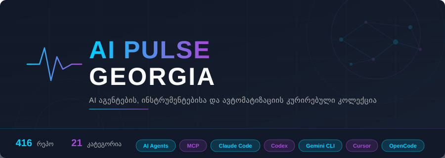

<p align="center">
  
</p>

<h1 align="center">Awesome AI Pulse Georgia</h1>

<p align="center">
  <b>AI აგენტების, დეველოპერ ინსტრუმენტებისა და ავტომატიზაციის კურირებული კოლექცია</b><br/>
  შერჩეული <a href="https://aipulsegeorgia.ge">AI Pulse Georgia</a>-ს მიერ
</p>

<p align="center">
  <a href="https://awesome.re"></a>
  
  
  
  <a href="https://aipulsegeorgia.ge"></a>
</p>

<p align="center"><i>A curated collection of AI agent frameworks, developer tools, and automation resources — by AI Pulse Georgia</i></p>

---

## ⚡ გამოიყენე Claude Code-ში / Cursor-ში — MCP Server-ით ან CLI-ით

ეს მთელი კოლექცია ხელმისაწვდომია **MCP server-ად** — Claude Code-ის, Cursor-ის, Codex-ის ან ნებისმიერი MCP-თავსებადი client-ის შიგნიდან 405 რეპოს ეძებ ბუნებრივი ენით. ნაცვლად იმისა, რომ GitHub-ი გახსნა და README-ი დააქოქო, AI ასისტენტს ჰკითხე *"აი Pulse-ის კოლექციაში რა არის საუკეთესო RAG-ისთვის?"* — სწორ რეპოს ქართული აღწერით დაგიბრუნებს.

**MCP Install** — `~/.claude/claude_desktop_config.json` ან Cursor MCP settings-ში:

```json
{
  "mcpServers": {
    "aipulsegeorgia": {
      "command": "npx",
      "args": ["-y", "@aipulsegeorgia/mcp-server"]
    }
  }
}
```

**ან პირდაპირ ტერმინალში — `aipulse` CLI-ით** (MCP-კლიენტის გარეშე):

```bash
npx -p @aipulsegeorgia/mcp-server aipulse search "rag memory"
npx -p @aipulsegeorgia/mcp-server aipulse list --category coding
npx -p @aipulsegeorgia/mcp-server aipulse stats
```

ბრძანებები: `categories` · `list` · `search` · `get` · `stats` — ფლაგებით `-c/--category`, `-n/--limit`, `-l/--lang en|ka|both`, `--json`.

> *Available as an MCP server **and an `aipulse` CLI** — query 405 curated AI repos from Claude Code, Cursor, any MCP client, or straight from your terminal.* Full docs: [`mcp/README.md`](./mcp/README.md) · Source: [`mcp/`](./mcp/)

---

## 🗂️ კატეგორიები

ყოველი რეპო თავისი **ფუნქციის** მიხედვითაა დალაგებული და არა ფორმის: ვიდეოს შესაქმნელი skill-ი 🎬 მედია-გენერაციის კატეგორიაშია, უსაფრთხოების skill-ი — 🛡️ AI უსაფრთხოებაში, n8n-ის MCP სერვერი — 🔁 Workflow-ში, ხმოვანი აგენტების ფრეიმვორკი კი — 🎙️ ხმასა და მეტყველებაში. ზოგადი დანიშნულების skill-ები და მეთოდოლოგიები ⚡ უნარების კატეგორიაშია, ხოლო პროტოკოლები და სერვისების connector-ები — 🔌 MCP-ში.

| კატეგორია | რა არის აქ |
|---|---|
| 🤖 [კოდინგ აგენტები და AI IDE-ები](#-კოდინგ-აგენტები-და-ai-ide-ები) | თავად აგენტი ან რედაქტორი, რომელიც კოდს წერს: CLI, IDE, ავტონომიური SWE აგენტი |
| 🎛️ [აგენტების ორკესტრაცია](#%EF%B8%8F-აგენტების-ორკესტრაცია) | ბევრი აგენტის ერთდროულად გაშვება და მართვა: ADE-ები, multiplexer-ები, აგენტების გუნდები |
| ⚡ [უნარები, პლაგინები და მეთოდოლოგიები](#-უნარები-პლაგინები-და-მეთოდოლოგიები) | ზოგადი დანიშნულების skill-ები, plugin-ების მაღაზიები, spec-driven და TDD მეთოდოლოგიები |
| 🔍 [კოდბაზის გრაფები და კონტექსტი](#-კოდბაზის-გრაფები-და-კონტექსტი) | აგენტს კოდბაზას ან დოკუმენტაციას აცნობს: გრაფები, სემანტიკური ძიება, docs-კონტექსტი |
| 💸 [ტოკენები, ხარჯი და LLM Gateway-ები](#-ტოკენები-ხარჯი-და-llm-gateway-ები) | ტოკენების შეკუმშვა, ხარჯის თვალყური, მოდელებს შორის routing და proxy |
| 🧬 [AI აგენტების ფრეიმვორკები](#-ai-აგენტების-ფრეიმვორკები) | ბიბლიოთეკა ან SDK, რომლითაც საკუთარ აგენტს აწყობ |
| 🔌 [MCP და ინტეგრაციები](#-mcp-და-ინტეგრაციები) | MCP/A2A პროტოკოლი და SDK, სერვისების connector-ები (GitHub, Notion, Supabase...) |
| 🕷️ [ვები, ბრაუზერი და კომპიუტერის მართვა](#%EF%B8%8F-ვები-ბრაუზერი-და-კომპიუტერის-მართვა) | ვების ძიება და სკრეიპინგი, ბრაუზერის ავტომატიზაცია, desktop/mobile computer use |
| 🧠 [მეხსიერება, RAG და დოკუმენტები](#-მეხსიერება-rag-და-დოკუმენტები) | აგენტის მეხსიერება, RAG ძრავები, vector DB, დოკუმენტების Markdown-ად გარდაქმნა |
| 🧰 [Sandbox-ები, Evals და Observability](#-sandbox-ები-evals-და-observability) | სად და როგორ ეშვება აგენტი უსაფრთხოდ, როგორ ფასდება და როგორ აკვირდები |
| 🛡️ [AI უსაფრთხოება](#%EF%B8%8F-ai-უსაფრთხოება) | AI-ით უსაფრთხოების შემოწმება (pentest, აუდიტი, reverse engineering) და AI-ის დაცვა |
| ⚙️ [ინფერენსი და მოდელები](#%EF%B8%8F-ინფერენსი-და-მოდელები) | მოდელების გაშვების ძრავები (ლოკალური და სერვერული), fine-tuning, ღია მოდელები |
| 🔁 [Workflow და No-Code ბილდერები](#-workflow-და-no-code-ბილდერები) | ვიზუალური workflow ბილდერები და მათი ეკოსისტემა (n8n MCP და skill-ები ჩათვლით) |
| 🦞 [AI ასისტენტები და ჩატ-ინტერფეისები](#-ai-ასისტენტები-და-ჩატ-ინტერფეისები) | პირადი 24/7 აგენტები (OpenClaw-ის ოჯახი) და ჩატის აპები ღრუბლოვანი ან ლოკალური მოდელებისთვის |
| 💼 [ბიზნეს და სამუშაო აგენტები](#-ბიზნეს-და-სამუშაო-აგენტები) | კონკრეტული სამუშაოს აგენტები: ოფისი, CRM, მარკეტინგი, HR, მონაცემები და BI |
| 🔬 [კვლევა და განათლება](#-კვლევა-და-განათლება) | deep research აგენტები, AI მეცნიერი, NotebookLM-ის ალტერნატივები, AI რეპეტიტორები |
| 💰 [ფინანსური AI](#-ფინანსური-ai) | ტრეიდინგი, ფინანსური ანალიზი, ფინანსური მონაცემები და მოდელები |
| 🎨 [დიზაინი და UI](#-დიზაინი-და-ui) | UI კომპონენტები, დიზაინის skill-ები, დიაგრამები, 3D და CAD |
| 🎬 [მედია-გენერაცია](#-მედია-გენერაცია) | სურათი და ვიდეო: გენერაცია, მონტაჟი, პროგრამული ვიდეო, ავატარები |
| 🎙️ [ხმა და მეტყველება](#%EF%B8%8F-ხმა-და-მეტყველება) | TTS და ხმის კლონირება, მეტყველების ამოცნობა (ASR), ხმოვანი აგენტების ფრეიმვორკები |
| 📚 [რესურსები და სასწავლო მასალები](#-რესურსები-და-სასწავლო-მასალები) | კურსები, წიგნები, cookbook-ები, awesome-სიები, prompt-ების კოლექციები |

---

## 🤖 კოდინგ აგენტები და AI IDE-ები

> **Coding Agents & AI IDEs** — AI, რომელიც თავად წერს, ასწორებს და ატესტებს კოდს: ტერმინალის აგენტები, AI-რედაქტორები და ავტონომიური SWE აგენტები. თუ პროგრამისტი ხარ და გინდა, რომ AI კოდის წერაში, ტესტირებასა და გამართვაში დაგეხმაროს, აქედან დაიწყე; ბევრი აგენტის ერთდროულად მართვისთვის კი იხილე „აგენტების ორკესტრაცია“.

| რეპოზიტორია | ⭐ | აღწერა |
|---|---|---|
| [DeepSeek Harness](https://github.com/deepseek-ai/deepseek-harness) | 262K | DeepSeek Harness (`dsh`) DeepSeek AI-ის ოფიციალური ღია კოდის agent harness-ია — გარსი, რომელიც მოდელს ხელსაწყოებთან, ფაილებთან, სესიებთან და ბრაუზერის UI-სთან აკავშირებს. „ყველაფერი plugin-ია" არქიტექტურაზეა აგებული (Cordis ბიბლიოთეკის ბაზაზე): მოდელი, ხელსაწყოები, ინტერფეისი და მეხსიერებაც კი ცალკე plugin-ებია, რომლებსაც საზოგადოება `dsh-plugin` topic-ით ავრცელებს. ერთი ბრძანებით ეშვება — `npx @deepseek-ai/dsh web` — და ლოკალურ Web UI-ს ხსნის. 2026 წლის 13 აგვისტოს გამოქვეყნდა და სამ-ნახევარ კვირაში 200,000+ ვარსკვლავი დააგროვა — GitHub-ის ისტორიაში ერთ-ერთი ყველაზე სწრაფი ზრდა Claw Code-ის (ასევე ამ კოლექციაში) შემდეგ. ჯერ developer preview-შია და API თავსებადობის დარღვევით იცვლება; MIT ლიცენზია. |
| [Claw Code](https://github.com/ultraworkers/claw-code) | 195K | Claw Code არის Claude Code-ისა და სხვა კომერციული coding agent-ების ღია კოდის ალტერნატივა, Rust-ში დაწერილი `oh-my-codex`-ის ბაზაზე. მუშაობს Claude-თან, OpenAI-თან, Grok-თან და ნებისმიერ OpenAI-თავსებად მოდელ API-სთან — შენ ირჩევ რომელ AI-ს ენდობი და რამდენს იხდი. Rust-ის არქიტექტურა მაქსიმალურ სიჩქარეს უზრუნველყოფს და რესურსების მინიმალურ მოხმარებას. 2026 წლის 31 მარტს გამოიცა და GitHub-ის ისტორიაში ერთ-ერთ ყველაზე სწრაფად მზარდ AI ხელსაწყოდ იქცა. |
| [opencode](https://github.com/anomalyco/opencode) | 222K | opencode სრულად ღია კოდის coding agent-ია ტერმინალში — Claude Code-ისა და Cursor-ის უფასო, self-hosted ალტერნატივა. `anomalyco` org-ის მიერ შენახული, TypeScript-ში დაწერილი, ლამაზი TUI ინტერფეისით. ნებისმიერი AI მოდელით მუშაობს — Anthropic, OpenAI, Google Gemini, Ollama და სხვა. 2025 წლის მეორე ნახევრიდან ერთ-ერთი ყველაზე პოპულარული ღია coding agent-ია. |
| [Claude Code](https://github.com/anthropics/claude-code) | 153K | Claude Code — Anthropic-ის ოფიციალური agentic coding tool, რომელიც პირდაპირ ტერმინალში ცხოვრობს, შენს კოდბაზას ესმის და ბუნებრივი ენის ბრძანებებით რუტინულ ამოცანებს თავად ასრულებს. ამ მთელი კოლექციის სახელობითი ცენტრი — პლაგინების, skill-ებისა და MCP სერვერების უმეტესობა სწორედ Claude Code-ის ეკოსისტემისთვისაა. |
| [Gemini CLI](https://github.com/google-gemini/gemini-cli) | 108K | Gemini CLI არის Google-ის ოფიციალური, ღია კოდის AI კოდირების აგენტი ტერმინალისთვის — Gemini 2.5 Pro მოდელი პირდაპირ შენს command line-ში. 1 მილიონი ტოკენის კონტექსტის ფანჯარა ნიშნავს, რომ მთელი დიდი კოდბაზა ერთიანად ჩაიტვირთება. Apache 2.0 ლიცენზიით სრულად უფასოა, MCP პროტოკოლს და Google Workspace ინტეგრაციებს უჭერს მხარს. Google-ს Claude Code-ისა და opencode-ის საპასუხო, ოფიციალური შეთავაზება. |
| [Zed](https://github.com/zed-industries/zed) | 92K | Zed — Atom-ისა და Tree-sitter-ის შემქმნელების მაღალწარმადი, Rust-ში დაწერილი კოდის რედაქტორი. 2026-ში ღრმად ინტეგრირდა agentic ფუნქციები — ჩაშენებული AI აგენტი, skills და MCP მხარდაჭერა. VS Code-ისა და Cursor-ის სიჩქარეზე ორიენტირებული ალტერნატივა. |
| [Codex CLI](https://github.com/openai/codex) | 131K | Codex CLI არის OpenAI-ის ოფიციალური, მსუბუქი coding agent ტერმინალისთვის — Rust-ში დაწერილია სიჩქარისა და სტაბილურობისთვის. კოდს sandbox-ში იზოლირებულად ასრულებს, approval-mode ფლაგებით შეგიძლია ზუსტად განსაზღვრო რა ნებართვები აქვს. ChatGPT-ის ანგარიშით (Plus, Pro, Business, Edu ან Enterprise) პირდაპირ ავტორიზდები — ცალკე API key-ის გარეშე იმდენივე მოდელი გაქვს, რამდენსაც შენი გამოწერა მოიცავს. OpenAI-ის პირდაპირი პასუხი Claude Code-ზე — ანალოგიური ფილოსოფია, სხვა backend-ით. დამატებით `codex app` გრაფიკულ ვერსიასაც უშვებს. |
| [OpenHands](https://github.com/OpenHands/OpenHands) | 92K | OpenHands (ყოფილი OpenDevin) ავტონომიური AI სოფტვერ-ინჟინერია — ქმნის და რედაქტირებს ფაილებს, ასრულებს shell ბრძანებებს, ვებ ბრაუზერს იყენებს და API-ებს უძახებს, ადამიანის ჩარევის გარეშე. Docker კონტეინერში იზოლირებულად მუშაობს, ვებ UI-ითაც და CLI-ითაც. 200-ზე მეტი contributor-ი, 60+ LLM backend (Anthropic, OpenAI, Gemini, Ollama) — SWE-bench-ის ღია კოდის ბენჩმარკ-ლიდერი. Cognition AI-ის Devin-ის ღია ალტერნატივა Python-ში. |
| [Cline](https://github.com/cline/cline) | 71K | Cline VS Code-ში ჩაშენებული ავტონომიური coding agent-ია, რომელიც ყოველ ნაბიჯზე შენს ნებართვას ითხოვს — ვერც ერთ ფაილს ვერ შეცვლის და ვერც ერთ ბრძანებას ვერ გაუშვებს შენი დამტკიცების გარეშე. ფაილების შექმნა, რედაქტირება, ბრძანებების გაშვება, ბრაუზერის გამოყენება — ყველაფერი ერთ IDE-ში. TypeScript-ში დაწერილია, VS Code extension-ის სახით 5 მილიონზე მეტი ინსტალაცია აქვს, Claude, GPT, Gemini და 500+ LLM-ს უჭერს მხარს. |
| [Pi (pi-mono)](https://github.com/earendil-works/pi) | 118K | Pi coding agent-ის სრული toolkit-ია ერთ monorepo-ში — interactive CLI agent, unified LLM API (Anthropic, OpenAI, Google, Groq ერთ ინტერფეისში), agent runtime და TUI/web UI ბიბლიოთეკები, Slack bot-ისა და vLLM deployment-ის ჩათვლით. interchangeable კომპონენტების არქიტექტურა საშუალებას გაძლევს საკუთარი coding agent ააწყო მზა ნაწილებისგან. TypeScript (93.5%), MIT, v0.77.0 (2026 წლის 28 მაისი). **opencode**-ისა და **Cline**-ის უფრო „ლეგოსებრივი", toolkit-ზე ორიენტირებული ალტერნატივა — badlogic-ის (Mario Zechner) სწრაფად მზარდი პროექტი. |
| [Aider](https://github.com/Aider-AI/aider) | 50K | Aider ტერმინალის AI pair programming ხელსაწყოა — ერთ-ერთი პიონერი ამ სფეროში, 2023 წლიდან. უბრალოდ სთხოვ რა გინდა შეცვალო, Aider საჭირო ფაილებს თავადვე ხსნის, კოდს ასწორებს და git-ში commit-ს ქმნის. Python-ში დაწერილია, MIT ლიცენზიით სრულად ღია, 4 მილიონზე მეტი ინსტალაცია. Claude, GPT, Gemini, DeepSeek, Ollama და 100+ LLM-ს უჭერს მხარს — ყველა მთავარი frontier მოდელი და ლოკალური ოფციები. უნივერსალური, ძველი და სანდო. |
| [Goose](https://github.com/aaif-goose/goose) | 56K | Goose ღია კოდის, გაფართოებადი AI agent-ია. თავდაპირველად Block-ის (Square/Cash App-ის ფინტექ კომპანია) შექმნილი, 2026-ში პროექტი **Agentic AI Foundation**-ში (Linux Foundation) გადავიდა — სახელი და ოფიციალური owner ახლა `aaif-goose`, კოდი neutral governance-ქვეშ. კოდის წერის მიღმა სრული სამუშაო ციკლი — ინსტალაცია, გაშვება, ტესტირება, მონაცემთა ანალიზი და ავტომატიზაცია. Rust-ში დაწერილია, 15+ AI პროვაიდერს (Anthropic, OpenAI, Google, Ollama) და 70+ MCP გაფართოებას უჭერს მხარს. |
| [Open Code Review](https://github.com/alibaba/open-code-review) | 48K | Open Code Review Alibaba-ს AI code review CLI-ია, რომელიც ჯერ კომპანიის შიდა ოფიციალური ასისტენტი იყო — ორ წელიწადში ათიათასობით დეველოპერს ემსახურა და მილიონობით დეფექტი იპოვა — და მერე ღია კოდად გამოვიდა. git diff-ს კითხულობს და ჰიბრიდული არქიტექტურით (დეტერმინისტული pipeline-ები + ხელსაწყოებიანი LLM აგენტი) ხაზის სიზუსტით სტრუქტურირებულ კომენტარებს წერს; ჩაშენებული წესები იჭერს NPE-ს, thread-safety-ის პრობლემებს, XSS-სა და SQL injection-ს, `ocr scan` კი მთელ ფაილებს ამოწმებს. ავტორების benchmark-ით (50 რეპო, 200 რეალური PR) ზოგად აგენტზე ზუსტია და ~9-ჯერ ნაკლებ ტოკენს ხარჯავს, თუმცა ნაკლებ ხარვეზს პოულობს — შეგნებულად ირჩევს სიზუსტეს ხმაურის ნაცვლად. Go, Apache-2.0, OpenAI- და Anthropic-თავსებადი. |
| [Tabby](https://github.com/TabbyML/tabby) | 34K | Tabby AI-ის კოდირების ასისტენტია, რომელიც შენს საკუთარ სერვერზე ეშვება — GitHub Copilot-ის self-hosted, ღია ალტერნატივა. კოდის auto-completion და ჩატი VS Code-ში, JetBrains-ში და სხვა IDE-ებში. Rust-ში დაწერილია, OpenAPI ინტერფეისი, LDAP/SSO, პერსონალიზებული fine-tuning — კორპორატიული გამოყენებისთვის, სადაც კოდი კომპანიის სერვერს ვერ ტოვებს. MIT ლიცენზია. |
| [Continue.dev](https://github.com/continuedev/continue) | 36K | Continue ღია კოდის AI კოდირების გაფართოებაა VS Code-ისა და JetBrains-ისთვის. ნებისმიერი AI მოდელი — Claude, GPT, Gemini, Mistral, Ollama ლოკალური მოდელები — ერთ ინტერფეისში. chat, autocomplete, edit და agent რეჟიმები, CI-ში ჩართვადი AI checks. TypeScript-ში დაწერილია და სრულად კონფიგურირებადია. გამოწერა არ სჭირდება — Copilot-ის უფასო ალტერნატივა. |
| [GPT Pilot](https://github.com/Pythagora-io/gpt-pilot) | 34K | GPT Pilot AI დეველოპერია, რომელიც მთელ აპლიკაციას ნულიდან წერს: აანალიზებს მოთხოვნებს, წერს კოდს, უშვებს, ხარვეზებს ასწორებს და ადამიანს მხოლოდ საკვანძო წერტილებში ეკითხება. Pythagora-ს პროექტია. |
| [CodeWhale](https://github.com/codewhale-hq/Codewhale) | 41K | CodeWhale (ყოფილი DeepSeek-TUI) ღია კოდის coding agent-ია ტერმინალისთვის, რომელიც ნებისმიერ მოდელთან მუშაობს — 40+ ჩაშენებული provider, ნაგულისხმევად DeepSeek V4.1 Flash, და შენს კომპიუტერზე გაშვებული ლოკალური მოდელებიც (უკვე გაშვებულ Ollama-ს თავისით პოულობს). დავალებას აძლევ და ის რეპოს კითხულობს, ფაილებს არედაქტირებს და ბრძანებებს უშვებს, სანამ საქმე არ დასრულდება; shell-ის ბრძანებებზე ჯერ ნებართვას გთხოვს, `/undo` ბოლო მოთხოვნას აუქმებს, `/receipts` კი აჩვენებს, რომელი ფაილები შეცვალა, რა ბრძანებები გაუშვა და რომელ ვებ- და MCP-გამოძახებებს მიმართა. Rust-ში დაწერილი, MIT ლიცენზია, codewhale.net. თავდაპირველად DeepSeek-ზე მორგებული ხელსაწყო იყო; ახლა Aider-ისა და Codex CLI-ის მსგავსად ტერმინალში მუშაობს, ოღონდ ნებისმიერ provider-თან. |
| [OpenClaude](https://github.com/Twigpine/openclaude) | 34K | OpenClaude ღია კოდის terminal coding agent-ია, რომელიც 200+ AI მოდელს ერთი CLI ინტერფეისიდან ხდის ხელმისაწვდომს — OpenAI, Gemini, DeepSeek, Ollama, Codex, GitHub Models. TypeScript-ში დაწერილია, OpenAI-თავსებადი API სტანდარტზე. 2026 წლის აპრილში გამოჩნდა და სწრაფად გაიზარდა. Claw Code-ისგან სხვაობა: ეს ფოკუსირებულია მრავალი provider-ის მხარდაჭერაზე, ის კი სიჩქარეზე. (არ აერიოს OpenHands-ში — სრულიად განსხვავებული პროექტია.) |
| [Qwen Code](https://github.com/QwenLM/qwen-code) | 29K | Qwen Code Alibaba-ს Qwen გუნდის ოფიციალური, ღია კოდის terminal coding agent-ია. TypeScript-ში დაწერილი, OpenAI-თავსებადი API-ის სტანდარტით მუშაობს — ანუ Anthropic-ის, OpenAI-ის და Google-ის მოდელებიც ჩართულია. Qwen 3 მოდელებით განსაკუთრებით კარგია კოდბაზის ნავიგაციასა და ავტომატიზაციაში. Claude Code-ისა და Gemini CLI-ის კონკურენტი Alibaba-ს ეკოსისტემიდან. |
| [Grok Build](https://github.com/xai-org/grok-build) | 28K | Grok Build (`grok`) xAI-ის (ახლა SpaceXAI) ოფიციალური ტერმინალური coding agent-ია, Rust-ში დაწერილი. სრულეკრანიანი, მაუსით მართვადი TUI კოდბაზას ესმის, ფაილებს ასწორებს, shell ბრძანებებს უშვებს, ვებში ეძებს და ხანგრძლივ ამოცანებს მართავს. სამ რეჟიმში მუშაობს: ინტერაქტიულად, headless-ად სკრიპტებისა და CI-სთვის, და რედაქტორებში ჩაშენებულად Agent Client Protocol-ით (ACP). 2026 წლის ივლისში გამოვიდა Apache-2.0 ლიცენზიით — Claude Code-ისა და Codex-ის გვერდით მესამე დიდი ლაბორატორიის კოდინგ აგენტი. |
| [Kilocode](https://github.com/kilo-org/kilocode) | 28K | Kilocode VS Code-ის AI coding agent-ია — kilo.ai-ის agentic engineering პლატფორმის ღია კოდის გული. 500+ AI მოდელს უჭერს მხარს და ბუნებრივი ენის ბრძანებებით კოდს წერს, ტესტავს და deploy-საც თავად აკეთებს. TypeScript, 1.5 მილიონზე მეტი ინსტალაცია — Roo Code-ისა და Cline-ის პირდაპირი კონკურენტი. |
| [Prime Agent](https://github.com/PrimeIntellect-ai/prime-agent) | 22K | Prime Agent Prime Intellect-ის ღია coding და research agent-ია ხანგრძლივი, ავტონომიური სამუშაოსთვის. ორ იდეაზეა აგებული: Recursive Language Model (RLM), რომელიც კონტექსტს ცვლადებად და ქვეაგენტებს ფუნქციებად განიხილავს, და Continual Harness — მუდმივი მდგომარეობა, სადაც დამატებითი prompt-ები, მეხსიერება და ქვეაგენტების სპეციფიკაციები ერთი ჩატის ფანჯრის მიღმაც ინახება. Python-ის მუდმივ საკონტროლო გარემოსთან ერთად ეს იმას ნიშნავს, რომ აგენტი სესიიდან სესიამდე თავის სამუშაო კონტექსტს არ კარგავს. 2026 წლის მაისში გამოვიდა MIT ლიცენზიით. |
| [Devika](https://github.com/stitionai/devika) | 20K | Devika — ღია AI software engineer: მაღალ-დონის დავალებას ანაწილებს, იკვლევს, წერს კოდს რამდენიმე ენაზე. Devin-ის ღია ალტერნატივა. |
| [avante.nvim](https://github.com/avante-corp/avante.nvim) | 18K | avante.nvim — Cursor-ის მაგვარი AI-ასისტენტი Neovim-ში: inline edit, agentic ცვლილებები და code-suggestions პირდაპირ რედაქტორში. |
| [oh-my-pi](https://github.com/can1357/oh-my-pi) | 37K | oh-my-pi — ტერმინალის AI coding agent Mario Zechner-ის Pi-ს ბაზაზე: hash-anchored edits, ოპტიმიზებული tool harness, LSP, browser და subagents. რეალური debugger მხარდაჭერა და multi-provider routing. MIT. |
| [MiMo Code](https://github.com/XiaomiMiMo/MiMo-Code) | 14K | MiMo Code Xiaomi-ს ტერმინალური AI coding ასისტენტია — კოდს კითხულობს და წერს, ბრძანებებს უშვებს, Git-ს მართავს და მუდმივი მეხსიერების სისტემით პროექტის ღრმა გაგებას სესიებს შორის ინახავს. ნებისმიერ მთავარ LLM პროვაიდერს უერთდება: Xiaomi MiMo პლატფორმას OAuth-ით, Codex-ს (ChatGPT Plus/Pro) OpenAI OAuth-ით, ან Claude Code-იდან არსებულ ავტორიზაციას ერთ ნაბიჯში გადმოიტანს. ერთხაზიანი ინსტალაცია macOS/Linux/Windows-ზე ან `npm install -g @mimo-ai/cli`. MIT ლიცენზია, 2026 წლის ივნისიდან. |
| [Freebuff](https://github.com/CodebuffAI/freebuff) | 14K | Freebuff Codebuff-ის ხუთი უფასო AI პროდუქტია კოდის წერისთვის, აშენებისა და კვლევისთვის — გამოწერის, კრედიტებისა და API გასაღების გარეშე: სპეციალიზებული აგენტები და წამყვანი მოდელების არჩევანი ტერმინალში, დესკტოპზე, ბრაუზერსა და GitHub რეპოზიტორიებში. ფასის საიდუმლო მარტივია — ჩართულ მოდელებზე წვდომას ტექსტური რეკლამა აფინანსებს. ნებისმიერ პროექტში ერთი ბრძანებით ეშვება. Apache-2.0; რეპო 2024 წლიდან არსებობს, 2026 წლის ზაფხულში „უფასო coding agent"-ად გადაკეთდა და trending-ში ავიდა. |
| [e2e](https://github.com/tester-army/e2e) | 12K | e2e ახალი თაობის end-to-end ტესტირების ფრეიმვორკია ვებისა და მობილური აპებისთვის: მიზანს ჩვეულებრივ ენაზე აღწერ, აგენტი აპს თვითონ ატარებს მის მისაღწევად, შედეგს კი იმავე ტესტში ჩვეულებრივი locator-ებითა და assertion-ებით ამოწმებ. აგენტის ნაბიჯები, რომლებიც assertion-მა დაადასტურა, ჩაიწერება და შემდეგ გაშვებაზე მოდელის გარეშე მეორდება, სანამ აპი არ შეიცვლება — ასე რომ, ტესტები სწრაფი და იაფი რჩება. Playwright-ით Chromium/Firefox/WebKit-ზე, iOS/Android სიმულატორებზე, მზა მაგალითებით Next.js-ისთვის, Expo-სთვის, SwiftUI-სთვის, Flutter-ისთვის და სხვებისთვის; TypeScript, Apache-2.0, საკუთარი გამოწერით, API key-ით ან ლოკალური მოდელით. 1.0-მდე ჯერ აქტიურ განვითარებაშია. |
| [Claude Code Action](https://github.com/anthropics/claude-code-action) | 9.6K | Claude Code Action Anthropic-ის ოფიციალური GitHub Action-ია, რომელიც Claude Code-ს PR-ებსა და issue-ებში შემოიყვანს: `@claude`-ის ხსენებაზე კითხვებს პასუხობს, PR-ის ცვლილებებს არევიუებს, მარტივ შესწორებებს, რეფაქტორინგსა და ახალ ფუნქციებსაც კი თვითონ წერს, პროგრესს კი ჩეკბოქსებით აჩვენებს. რეჟიმს workflow-ის კონტექსტის მიხედვით თვითონ ირჩევს, შენს GitHub runner-ზე ეშვება და Anthropic API-ით, Amazon Bedrock-ით, Google Vertex AI-ით ან Microsoft Foundry-ით მუშაობს; სწრაფი დაყენება — Claude Code-ში `/install-github-app`. TypeScript, MIT. გუნდებისთვის, ვისაც code review-სა და მცირე ამოცანების ავტომატიზაცია პირდაპირ GitHub-ში სურთ. |
| [fx](https://github.com/vercel-labs/fx) | 3.6K | fx Vercel Labs-ის ექსპერიმენტული coding agent harness და CLI-ია, Zig-ში დაწერილი — მთელი ბინარი 7.8 MiB-ია. მინიმალიზმზეა გათვლილი: სისტემური prompt-ის დიზაინიდან ხელსაწყოებამდე ყველაფერი შემცირებულია, რომ კვლევისა და სხვა სისტემებში ჩაშენებისთვის გამოდგეს. მომხმარებლისთვის Unix shell-ს უფრო ჰგავს, ვიდრე „IDE ტერმინალში" ტიპის მძიმე TUI-ს. მოდელ-აგნოსტიკურია, ლოკალურ და cloud ინფერენსთანაც მუშაობს, fx.sh-დან ერთი ხაზით ეყენება და Vercel AI Gateway-ით ავტორიზდება. Apache-2.0; სტატუსი: ექსპერიმენტული. |

---

## 🎛️ აგენტების ორკესტრაცია

> **Agent Orchestration** — როცა ერთი აგენტი აღარ კმარა: ბევრი coding agent-ის პარალელურად გაშვება და მართვა — agentic IDE-ები, ტერმინალის multiplexer-ები, აგენტების გუნდები და მათი სამართავი პანელები. თუ Claude Code, Codex და OpenCode ერთდროულად გიმუშავია, აქ ნახავ, როგორ მოაქციო ისინი ერთ ეკრანზე.

| რეპოზიტორია | ⭐ | აღწერა |
|---|---|---|
| [Paperclip](https://github.com/paperclipai/paperclip) | 107K | Paperclip არის TypeScript-ის ღია კოდის AI ორკესტრაციის პლატფორმა ბიზნეს პროცესების ავტომატიზაციისთვის — „zero-human companies" (ადამიანის მინიმალური მონაწილეობით მუშაობა) ფილოსოფიით. AI აგენტების გუნდს აწყობ, ბიუჯეტის ლიმიტებს, audit log-ს და progress tracking-ს ჩაშენებული მართვის panel-ით. 2026 წლის მარტში გამოვიდა და სწრაფად გავრცელდა. ბიზნეს ხელმძღვანელებისთვის, ვინც AI automation-ს ეფექტურ ფინანსურ კონტროლთან ერთად ქმნის. |
| [Orca](https://github.com/stablyai/orca) | 107K | Orca ADE-ია (agent development environment) პარალელური აგენტების „ფლოტის" სამართავად — ნებისმიერ coding agent-ს უშვებ შენივე subscription-ით, ერთდროულად რამდენიმეს. desktop-ზეც და mobile-ზეც ხელმისაწვდომია. TypeScript-ში დაწერილია. თუ ერთდროულად ბევრ აგენტს ამუშავებ სხვადასხვა ამოცანაზე, orca მათ ერთ ინტერფეისში აერთიანებს — cmux-ისა და herdr-ის მსგავსი orchestration ფენა, უფრო სრული UI-ით. |
| [RuFlo (ex-Claude Flow)](https://github.com/ruvnet/ruflo) | 79K | RuFlo v3.5 (ყოფილი **Claude Flow**) Enterprise AI Orchestration Platform-ია — „distributed swarm intelligence" მიდგომით რამდენიმე AI agent პარალელურად ასრულებს ერთ workflow-ს. RAG ინტეგრაცია, native Claude Code + Codex მხარდაჭერა, enterprise-დონის არქიტექტურა. TypeScript-ში, `ruvnet` (ruv.io) platform-ის ნაწილი. Claude Code-ის ეკოსისტემაში ერთ-ერთი ყველაზე ფუნქციონალური multi-agent orchestration ხელსაწყოა. |
| [omo (ex-oh-my-openagent)](https://github.com/code-yeongyu/oh-my-openagent) | 70K | omo (**ახლანდელი სახელი**; ადრე oh-my-openagent, უფრო ადრე oh-my-opencode) ერთი AI coding session-ს სრულ multi-agent სისტემად აქცევს — სპეციალიზებული AI-ები პარალელურად ასრულებენ სხვადასხვა ამოცანებს ერთ workflow-ში. TypeScript-ში დაწერილი orchestration framework, რომელიც Claude Code-თან, Codex-თან, opencode-თან და Cursor-თან მუშაობს. Oh My ClaudeCode-ისგან სრულიად განსხვავებული პროექტია — ეს ზოგადი agent harness-ია, ის კი Claude Code-სპეციფიკური. 2025 წლის ბოლოს გამოჩნდა (repo URL ჯერ ძველ სახელს ინახავს). |
| [Multica](https://github.com/multica-ai/multica) | 54K | Multica არის TypeScript-ის ღია კოდის managed agents პლატფორმა, რომელიც AI კოდირების აგენტებს (coding agents) რეალური გუნდის წევრებად აქცევს. ამოცანების მინიჭება, პროგრესის მონიტორინგი, გამოცდილების დაგროვება (compounding skills) — ყოველი ციკლით AI უფრო კარგად ასრულებს ამ გუნდის სპეციფიკურ ამოცანებს. 2026 წლის იანვარში გამოვიდა და სწრაფად გავრცელდა. ტექნიკური გუნდებისთვის, ვინც Claude Code-ის, Codex-ის ან სხვა coding agent-ების სამართავ ინსტრუმენტს ეძებს. |
| [herdr](https://github.com/herdrdev/herdr) | 46K | herdr აგენტების multiplexer-ია, რომელიც შენს ტერმინალში ცხოვრობს — რამდენიმე coding agent-ს ერთდროულად მართავ ერთი ინტერფეისიდან. სიჩქარისთვის Rust-შია დაწერილი. cmux-ის მსგავსი იდეა, მაგრამ cross-platform terminal multiplexer-ის სახით — თუ Claude Code + Codex + opencode ერთდროულად გიმუშავია, herdr მათ შორის გადართვას ამარტივებს. |
| [Oh My ClaudeCode](https://github.com/yeachan-heo/oh-my-claudecode) | 40K | Oh My ClaudeCode Claude Code-ს multi-agent orchestration სისტემად აქცევს — autopilot რეჟიმში ავტონომიურად მუშაობს 5-ფაზიანი pipeline-ით (Expansion, Planning, Execution, QA, Validation), team რეჟიმში კი N agent-ი პარალელურად ასრულებს ამოცანებს. TypeScript-ში, 19 სპეციალიზებული agent, 36 skill. oh-my-openagent-ისგან განსხვავება: ეს Claude Code-სპეციფიკური orchestration-ია, ის კი ზოგადი agent harness. |
| [T3 Code](https://github.com/pingdotgg/t3code) | 30K | T3 Code Theo Browne-ის (t3.gg) ღია „agent harness control surface"-ია: ერთი აპლიკაცია, რომლითაც შენს კომპიუტერზე მომუშავე coding agent-ებს მართავ — Claude Code-ს, Codex-ს, Cursor-ს, Grok Build-ს, OpenCode-სა და Google Antigravity-ს — შენივე გამოწერებით, დამატებითი გადასახადის გარეშე. „საუკეთესო კლასის" iOS აპი აქვს, რომლითაც აგენტებს ტელეფონიდან აკვირდები და უბრძანებ. ავტორების თქმით არაფერს ყიდიან — Codex desktop-ის, Conductor-ისა და Claude Desktop-ის შთაგონებით საკუთარი თავისთვის ააშენეს. TypeScript, MIT, 2026 წლის თებერვლიდან; issue tracker-ზე 1,500+ ღია საკითხი აქტიურ გამოყენებაზე მიუთითებს. |
| [cmux](https://github.com/manaflow-ai/cmux) | 29K | cmux Ghostty-ს საფუძველზე აშენებული macOS terminal emulator-ია, სპეციალურად AI coding agent-ებისთვის ოპტიმიზებული. ვერტიკალური tabs, push notifications და პარალელური სესიების მარტივი მართვა — თუ ერთდროულად რამდენიმე AI agent-ს ამუშავებ (Claude Code + Codex + opencode), ეს terminal-ი სამართავს გამარტივებს. Swift-ში დაწერილია, macOS-only. |
| [Archon](https://github.com/coleam00/Archon) | 24K | Archon არის ღია კოდის TypeScript ინსტრუმენტი, რომელიც AI კოდირების სამუშაო ნაკადებს deterministic-სა და განმეორებადს ხდის YAML-ში აღწერილი harness-ებით. იდეა მარტივია: კოდს AI კვლავ თავად წერს, მაგრამ ფიქსირებულ ფაზებს გადის — planning, implementation, validation, review — და ყოველი ნაბიჯი აუდიტს ექვემდებარება და უკან დაბრუნებადია. განსაკუთრებით ეფექტურია CI/CD pipeline-ებში, სადაც AI-ის მიერ დაწერილი კოდი production-ში მიდის — „Dockerfile AI-ისთვის“ კონცეფციის პრაქტიკული განხორციელება. |
| [AX (Agent Executor)](https://github.com/google/ax) | 14K | AX (Agent Executor) Google-ის ღია, დეკლარაციული runtime-ია აგენტების ორკესტრაციისთვის, რომელიც კლასტერში მილიარდობით ავტონომიური აგენტური ამოცანის გასაშვებადაა აწყობილი — ვისაც Kubernetes გამოუყენებია, `ax` ნაცნობად მოეჩვენება. სამი პრიმიტივით მუშაობს: `Task` (აგენტის კოდი იზოლირებულ sandbox-ში, CPU/მეხსიერების ლიმიტებით), `Workspace` (წინასწარ მიერთებული git რეპოები, MCP სერვერები და skill-ები) და `Model`; უმოქმედო აგენტს აჩერებ და ზუსტად იმ ადგილიდან აგრძელებ (`ax suspend` / `ax resume`), `ax ssh`-ით კი მომუშავე აგენტში შედიხარ. Go, Apache-2.0, Agent Substrate-ზე; ჯერ აქტიურ განვითარებაშია და stable ვერსიამდე დიდი ცვლილებებია მოსალოდნელი. პლატფორმის გუნდებისთვის, ვისაც აგენტების მასშტაბური გაშვება სჭირდება. |
| [PAL (ex-zen-mcp-server)](https://github.com/BeehiveInnovations/pal-mcp-server) | 12K | PAL (ყოფილი zen-mcp-server) — MCP სერვერი, რომელიც Claude Code-ს, Gemini CLI-სა და Codex-ს ერთ workflow-ში აერთიანებს მრავალ მოდელთან (OpenAI, Grok, Ollama, OpenRouter). კონტექსტი ნარჩუნდება ხელსაწყოებს შორის — code review, debugging, planning ერთობლივად. Python. |
| [Omnigent](https://github.com/omnigent-ai/omnigent) | 11K | Omnigent ღია კოდის „მეტა-harness"-ია — საერთო ორკესტრაციის ფენა Claude Code-ის, Codex-ის, Cursor-ის, OpenCode-ის, Hermes-ის, Pi-სა და შენივე დაწერილი აგენტების ზემოდან: მათ ცვლი ან აერთიანებ ისე, რომ სამუშაო პროცესი არ იცვლება. macOS დესკტოპ აპიც აქვს. იდეა ის არის, რომ აგენტების „ომში" მხარე არ აირჩიო — ერთი ინტერფეისიდან ყველას მართავ. Apache-2.0, 2026 წლის ივნისიდან, ძალიან აქტიური issue tracker-ით. |
| [Kiro Crew](https://github.com/kirodotdev/KiroCrew) | 4.6K | Kiro Crew Kiro-ს (AWS-ის AI IDE) ღია კოდის სამუშაო სივრცეა, რომელიც ლოკალურად ან შენს სერვერზე ეშვება და სესიების მიღმა „ცოცხლობს": მუდმივია, თვითსწავლადი და თვითგანვითარებადი. მრავალნაბიჯიანი ამოცანები უყურადღებოდ სრულდება, განმეორებადი სამუშაოები განრიგით ეშვება, heartbeat-ები სისტემებს აკვირდება, სანამ ჩარევა არ დასჭირდება. დესკტოპ აპით, ვებ დაფით და CLI-ით მართავ, ან Slack-იდან და Discord-იდან აგრძელებ იმავე სამუშაოს. Python, Apache-2.0, 2026 წლის ივლისიდან. |

---

## ⚡ უნარები, პლაგინები და მეთოდოლოგიები

> **Skills, Plugins & Methodologies** — ზოგადი დანიშნულების skill-ები, plugin-ების მაღაზიები და სამუშაო მეთოდოლოგიები (spec-driven, TDD), რომლებიც Claude Code-ს, Codex-სა და სხვა აგენტებს ახალ ჩვევებს ასწავლის. კონკრეტული სფეროს skill-ები — დიზაინის, უსაფრთხოების, მედიისა თუ კვლევის — თავიანთ კატეგორიებშია.

| რეპოზიტორია | ⭐ | აღწერა |
|---|---|---|
| [Superpowers](https://github.com/obra/superpowers) | 305K | Superpowers agentic skills framework-ია AI coding agent-ებისთვის — software development methodology, რომელიც AI-ს „ჯერ დაფიქრდი, მერე დაწერე" პრინციპს ასწავლის. სანამ კოდი ეწერება, ჯერ სპეციფიკაცია, დიზაინ დოკუმენტი და test plan იქმნება. Claude Code-ს, Codex-ს, Cursor-ს და Gemini CLI-ს უჭერს მხარს. Shell scripts, MIT ლიცენზია. Spec Kit-ის (GitHub-ისა) და GSD-ის იდეური წინამორბედი. |
| [Everything Claude Code](https://github.com/affaan-m/ECC) | 289K | Everything Claude Code Claude Code-ის, Codex-ის, opencode-ისა და Cursor-ის ყოვლისმომცველი performance optimization სისტემაა — skills, memory, security scanning და research-first workflow ერთ პაკეტში. JavaScript, ecc.tools — Claude Code-ის გაუმჯობესებების ერთ-ერთი ყველაზე პოპულარული კოლექცია. AI-ს „ინსტინქტების" (instincts) სისტემა განასხვავებს სხვა skill-pack-ებისგან — agent-ი ავტომატურად ადაპტირდება სიტუაციებზე წინასწარ განსაზღვრული behavior-ებით. |
| [Anthropic Skills](https://github.com/anthropics/skills) | 184K | Anthropic Skills — **Anthropic-ის ოფიციალური** Agent Skills რეპოზიტორია და მთელი skills ეკოსისტემის ფუნდამენტი. შიგნით 17 example skill — მათ შორის **frontend-design** (generic „AI slop" დიზაინისგან თავის დასაღწევი წესები), mcp-builder, webapp-testing, canvas-design, brand-guidelines და skill-creator — პლუს ის 4 production document skill (docx, pdf, pptx, xlsx), რომლებიც Claude-ში ფაილების რეალურ შექმნას უზრუნველყოფს და აქ source-available სახითაა გამოქვეყნებული. აქვეა Agent Skills სპეციფიკაცია (agentskills.io) და skill template. ერთი ბრძანებით ეყენება: `/plugin marketplace add anthropics/skills`. Python-ში; 2025 წლის სექტემბერში გამოჩნდა და GitHub-ის ისტორიის ერთ-ერთ ყველაზე სწრაფად მზარდ რეპოდ იქცა. Skills ეკოსისტემისთვის იგივეა, რაც modelcontextprotocol/servers MCP-სთვის — **Agent Skills Spec**-ის (ასევე ამ კოლექციაში) reference implementation. |
| [Agency Agents](https://github.com/msitarzewski/agency-agents) | 164K | Agency Agents („The Agency“) მზა AI-აგენტების დიდი კოლექციაა — 230-ზე მეტი სპეციალისტი ყველა „განყოფილებიდან“: frontend-დეველოპერი, Reddit-ის საზოგადოების მენეჯერი, QA-ს „რეალობის შემმოწმებელი“, მარკეტოლოგი და სხვები. თითოეულს საკუთარი ხასიათი, სამუშაო პროცესი, მზა deliverable-ები და წარმატების მეტრიკები აქვს, ამიტომ ჩვეულებრივ prompt-შაბლონზე ბევრად კონკრეტულია. Reddit-ის ერთი თემიდან დაიბადა; Claude Code-ში, Cursor-ში, Codex-ში, Gemini CLI-სა და OpenCode-ში ერთი კლიკით დგება, macOS/Linux/Windows დესკტოპ აპითაც. Shell, MIT. ვინც AI-ს „გუნდს“ აწყობს, აქედან მზა როლებს აიღებს. |
| [Spec Kit](https://github.com/github/spec-kit) | 143K | Spec Kit GitHub-ის ოფიციალური Spec-Driven Development toolkit-ია — AI-ს „ჯერ გეგმა, მერე კოდი" პრინციპს ასწავლის. `/specify`, `/plan`, `/tasks`, `/implement` slash-commands-ით AI ჯერ სრულ სპეციფიკაციას ქმნის, შემდეგ კი კოდირებაზე გადადის. Claude Code-ს, Codex CLI-ს, Gemini CLI-ს, Cursor-ს, Copilot-ს, Windsurf-ს და Qwen Code-ს უჭერს მხარს. GitHub-ის ოფიციალური პასუხია Superpowers-ისა და GSD-ის მსგავს მეთოდოლოგიებზე. |
| [Karpathy Skills](https://github.com/multica-ai/andrej-karpathy-skills) | 224K | Karpathy Skills ერთი CLAUDE.md ფაილია, რომელიც Andrej Karpathy-ს (OpenAI-ისა და Tesla AI-ს ყოფილი ხელმძღვანელი) LLM coding pitfalls-ის შენიშვნებიდანაა გამომდინარე. AI-ს ჰალუცინაციებს, ზედმეტ refactoring-ს და ცუდ debugging-ს ებრძვის წინასწარ განსაზღვრული rules-ით. Forrest Chang-მა 2026 წლის იანვარში შექმნა და GitHub Trending-ზე #1 ადგილამდე ავიდა. Andrej Karpathy-ს სახელი ატარებს, მაგრამ მის მიერ ოფიციალურად შექმნილი არ არის. |
| [ponytail](https://github.com/DietrichGebert/ponytail) | 177K | ponytail skill-ია, რომელიც შენს AI აგენტს „ოთახში ყველაზე ზარმაცი senior dev-ივით" აფიქრებინებს — ის ინჟინერი, რომელიც კომპანიაში version control-ზე დიდხანსაა და შენს ორმოცდაათ ხაზს ჩუმად ერთით ცვლის. მაგალითი README-დან: date picker-ს რომ სთხოვ, ჩვეულებრივი აგენტი flatpickr-ს აყენებს, wrapper კომპონენტს წერს, stylesheet-ს ამატებს და timezone-ებზე იწყებს მსჯელობას; ponytail-ით ერთი ჩვეულებრივი HTML ხაზი გამოდის. 2026 წლის ივნისში გამოვიდა და ზაფხულის ყველაზე ვირუსული skill გახდა. Karpathy-ის „Simplicity first" პრინციპის ინსტალირებადი ფორმა; MIT. |
| [Matt Pocock Skills](https://github.com/mattpocock/skills) | 304K | Matt Pocock-ის (Total TypeScript-ის ავტორი, ერთ-ერთი ყველაზე ცნობილი TypeScript ინსტრუქტორი მსოფლიოში) პირადი `.claude/skills/` დირექტორიის გაზიარებული ვერსიაა — სლოგანი: *"Skills for Real Engineers. Straight from my .claude directory"*. Shell-ში, MIT ლიცენზია; 2026 წლის თებერვალში გამოქვეყნდა და სწრაფად გავრცელდა. Pocock-ის ყოველდღიური workflow-ის რეალური ანარეკლი — TypeScript-ის, React-ის და modern web development-ის სპეციფიკური skills, რომლებსაც ის თვითონ იყენებს professional კონტექსტში. ვინც TypeScript-ში ან React-ში სერიოზულად მუშაობს Claude Code-ით, ეს კოლექცია უპირველესად განსახილველია. |
| [OpenSpec](https://github.com/Fission-AI/OpenSpec) | 73K | OpenSpec spec-driven development-ის (SDD) ფრეიმვორკია AI coding ასისტენტებისთვის: სანამ კოდის ერთი ხაზი დაიწერება, AI ჩვეულებრივ Markdown-ში წერს მოთხოვნებს კონკრეტული სცენარებით, შენ კი გეგმას ამოწმებ და ამტკიცებ. `/opsx:explore`-ით იდეას ერთად „გაიაზრებთ“, `/opsx:propose`-ით ცვლილებას შემოგთავაზებს; ახალი Stores (ბეტა) ერთ სპეციფიკაციას რამდენიმე რეპოსა და მთელ გუნდს შორის აზიარებს. 30+ AI ხელსაწყოსთან მუშაობს (Cursor, GitHub Copilot, Amazon Q, Codex და სხვ.); TypeScript, MIT, Node.js 20.19+. Spec Kit-ისა და GSD Core-ის (ასევე ამ კატეგორიაში) მსუბუქი, „ჯერ გეგმა, მერე კოდი“ ალტერნატივაა. |
| [BMAD-METHOD](https://github.com/bmad-code-org/BMAD-METHOD) | 55K | BMAD-METHOD — universal agentic agile-development method: სპეციალიზებული AI აგენტები (analyst, PM, architect, dev, QA) სტრუქტურირებულ workflow-ში მართავენ პროექტს იდეიდან კოდამდე. Claude Code/Cursor/Gemini-თან თავსებადი. |
| [Humanizer](https://github.com/blader/humanizer) | 61K | Humanizer AI-ს „ხმით" დაწერილ ტექსტს ისე გადაწერს, რომ ადამიანის დაწერილს ჰგავდეს — შინაარსის შეცვლის გარეშე. Wikipedia-ს „Signs of AI writing" გვერდის 35 პატერნს იყენებს, რომელსაც WikiProject AI Cleanup ინახავს; არაფერს იგონებს — სახელი, რიცხვი, თარიღი, ციტატა წყაროდან უნდა მოდიოდეს; პირად ნაწერში ავტორის სტილს ინარჩუნებს. ჩასმულ ტექსტზე ჯერ პირველ გადაწერას და მოკლე კრიტიკას აჩვენებს, მერე საბოლოო ვერსიას; ფაილზე მიმართვისას მხოლოდ იმას ცვლის, რაც ხელოვნურად ჟღერს. სუფთა Markdown skill-ია, ამიტომ ნებისმიერ skills-თავსებად აგენტში მუშაობს. 2026 წლის იანვრიდან, MIT — ამ ჟანრის ორიგინალი; No AI Slop (ასევე ამ კოლექციაში) მისი უფრო „სარედაქციო" ვარიანტია. |
| [wshobson/agents](https://github.com/wshobson/agents) | 42K | wshobson/agents — multi-harness agentic plugin marketplace Claude Code-ის, Codex CLI-ის, Cursor-ის, OpenCode-ისა და Gemini CLI-ისთვის. ბირთვი 80+ production-ready სპეციალიზებული subagent-ია (backend, frontend, security, data, SRE და სხვ.) — პირდაპირ გამოსაყენებლად მზა. |
| [Obsidian Skills](https://github.com/kepano/obsidian-skills) | 50K | Obsidian Skills Obsidian-ის CEO-ს, Steph Ango-ს (kepano) მიერ შექმნილი agent skills პაკეტია. AI coding agent-ებს ასწავლის Obsidian-ის Markdown ფორმატს, Bases მონაცემთა სტრუქტურას, JSON Canvas-ს და CLI-ს. Claude Code, Codex ან ნებისმიერი MCP-თავსებადი agent Obsidian vault-ში ფაილების შექმნას, ძიებასა და რედაქტირებას შეძლებს. Obsidian-ს იყენებ ცოდნის ბაზად? ეს skill-ი AI-ს ამ ბაზაში მუშაობის ექსპერტად აქცევს. |
| [Agent Skills](https://github.com/addyosmani/agent-skills) | 111K | Agent Skills Google-ის Chrome DevRel-ის ხელმძღვანელის Addy Osmani-ს production-grade engineering skills კოლექციაა AI coding agent-ებისთვის. 20+ Markdown workflow — spec-driven development, TDD, code review, shipping და სხვა — agent-ს senior engineer-ის მიდგომებს ასწავლის. Shell-ში დაწერილია. Agent Skills Spec-ისგან განსხვავება: ეს Osmani-ს კონკრეტული skill-ების კოლექციაა, ის კი ფართო სპეციფიკაციის სტანდარტია. |
| [awesome-cursorrules](https://github.com/PatrickJS/awesome-cursorrules) | 41K | awesome-cursorrules — Cursor-ის `.cursorrules` ფაილების კანონიკური კრებული სხვადასხვა ენისა და framework-ისთვის. AI coding agent-ის ქცევის კონფიგურაცია მზა შაბლონებით. |
| [awesome-copilot](https://github.com/github/awesome-copilot) | 40K | awesome-copilot — GitHub-ის ოფიციალური კრებული Copilot-ის customization-ებისა: custom instructions, prompt files, chat modes და community-ს მიერ შექმნილი agent-ები. Copilot-ის მორგების მთავარი საცნობარო წყაროა და მისი მიდგომები სხვა coding agent-ების კონფიგურაციასაც ერგება. |
| [Claude Plugins Official](https://github.com/anthropics/claude-plugins-official) | 45K | Claude Plugins Official Anthropic-ის მიერ მართული Claude Code plugin-ების ოფიციალური კატალოგია — მასში მხოლოდ შემოწმებული, მაღალი ხარისხის plugin-ები ხვდება. plugin-ების აღმოჩენისა და ინსტალაციის ყველაზე სანდო წყაროა პირდაპირ Claude Code-იდან. |
| [skills (npx skills)](https://github.com/vercel-labs/skills) | 37K | skills Vercel-ის CLI-ია ღია agent skills ეკოსისტემისთვის — `npx skills`-ით skill-ებს ეძებ, აყენებ, ანახლებ და შლი 75-ზე მეტ coding agent-ში (OpenCode, Claude Code, Codex, Cursor და სხვ.) ერთი ბრძანებით და ერთნაირად. skill-ს პროექტში ან გლობალურად (`-g`) დააყენებ, ან საერთოდ დაყენების გარეშე, ერთჯერადად გამოიყენებ; `skills init` ახალი skill-ის შაბლონს ქმნის, ექსპერიმენტული sync კი npm პაკეტებში ჩაშენებულ skill-ებს პროექტს უკავშირებს. TypeScript, MIT, კატალოგი — skills.sh. თუ ხშირად იყენებ სხვადასხვა skill-ს, ეს skill-ების „npm“ საბაზისო ხელსაწყოა. |
| [Book to Skill](https://github.com/virgiliojr94/book-to-skill) | 36K | Book to Skill Claude Code-ის skill-ია, რომელიც ნებისმიერ ტექნიკურ წიგნს (PDF, საქაღალდე ან glob) სამ ნაბიჯში სასწავლო-საცნობარო skill-ად აქცევს: `/book-to-skill ./my-book.pdf` მიუთითებ, ის წიგნს ფრეიმვორკებად, გადაწყვეტილების წესებად, ანტი-პატერნებად და თავების ფაილებად „გამოხდის" — სტრუქტურა და არა რეზიუმე — და აგენტი მერე საჭიროებისამებრ სწორ თავს კითხულობს და რეალური შინაარსიდან პასუხობს, ჰალუცინაციის გარეშე. 2026 წლის მაისში გამოვიდა, MIT. |
| [I Have ADHD](https://github.com/ayghri/i-have-adhd) | 59K | I Have ADHD skill-ია coding ასისტენტისთვის, რომელიც პასუხის „ჩამარხვას" უკრძალავს: ჯერ ქმედება, ნაბიჯები დანომრილი, არანაირი „Great question!" და „Hope this helps!". README-ს Before/After ნათლად აჩვენებს — მსჯელობის აბზაცის ნაცვლად „გაუშვი ეს ბრძანება, მერე შეასწორე ეს ფაილი 42-ე ხაზზე, მერე ტესტი". ADHD-ის მქონე დეველოპერებისთვის დაიწერა, მაგრამ ყველას გამოადგება, ვისაც აგენტის სიტყვამრავლობა ღლის. Caveman-ის (ასევე ამ კოლექციაში) მონათესავე — ის ტოკენებს ზოგავს, ეს ყურადღებას. MIT, 2026 წლის მაისიდან. |
| [Vercel Agent Skills](https://github.com/vercel-labs/agent-skills) | 33K | Vercel Agent Skills — **Vercel-ის ოფიციალური** skill კოლექცია AI coding agent-ებისთვის: 8 skill, რომლებიც Vercel Engineering-ის შიდა handbook-ებს აგენტებისთვის გასაგებ ფორმატად აქცევს. **web-design-guidelines** UI კოდს 100+ წესით ამოწმებს (accessibility, focus states, forms, animation, typography, dark mode, i18n) — Vercel-ის ცნობილი Web Interface Guidelines-ის packaged ვერსია; **react-best-practices** 40+ React/Next.js performance წესს მოიცავს; **vercel-deploy-claimable** კი აპს პირდაპირ claude.ai საუბრიდან deploy-ს უკეთებს live preview URL-ით. `npx skills add vercel-labs/agent-skills`-ით ეყენება. JavaScript, MIT, skills.sh რეესტრის canonical მაგალითი. 2025 წლის დეკემბრიდან ვითარდება. ვიზუალურ design skill-ებისგან (UI UX Pro Max, Open Design) განსხვავებით აქცენტი engineering correctness-ზეა — accessibility და performance, არა მხოლოდ ესთეტიკა. |
| [Claude Code Templates](https://github.com/davila7/claude-code-templates) | 33K | Claude Code Templates (aitmpl.com) Claude Code-ის მზა კონფიგურაციების დიდი კატალოგი და CLI-ია: 100-ზე მეტი აგენტი, slash-ბრძანება, settings, hook-ი, MCP ინტეგრაცია და skill-ი, რომელსაც ვებ-ინტერფეისში ირჩევ და ერთი ბრძანებით აყენებ. დამატებით მოყვება Claude Code Analytics (სესიების real-time მონიტორინგი), Conversation Monitor ტელეფონიდან სანახავად, Health Check და Plugin Dashboard. Python, MIT. თუ Claude Code-ის მორგებას იწყებ, აქედან მზა „აგურებს“ აიღებ ნულიდან წერის ნაცვლად. |
| [Claude Skills (alirezarezvani)](https://github.com/alirezarezvani/claude-skills) | 29K | Claude Skills 338 production-ready Claude Code skill-ისა და plugin-ის ბიბლიოთეკაა 13 AI coding ხელსაწყოსთვის (Claude Code, Codex, Gemini CLI, Cursor, Aider და სხვა). ინჟინერიის მიღმა ფარავს marketing-ს, product-ს, compliance-ს, finance-ს და C-level advisory-ს — 533 dependency-free Python CLI tool, 25 „POWERFUL-tier" skill, persona-ები (მაგ. Startup CTO) და security auditor skill-ების შესამოწმებლად. Python, MIT, v2.9.0 (2026 წლის 28 მაისი). **Matt Pocock Skills**-ისა და **Agent Skills**-ისგან განსხვავება — ეს ბიზნეს- და მრავალდომენიან breadth-ზეა ფოკუსირებული, არა მხოლოდ engineering-ზე. |
| [Taskmaster](https://github.com/eyaltoledano/claude-task-master) | 28K | Taskmaster AI-ზე დაფუძნებული პროექტის მართვის სისტემაა — დიდ ამოცანას ავტომატურად ანაწილებს მართვად ქვე-ამოცანებად, გაწერს პრიორიტეტებს, ადევნებს პროგრესსა და კონტექსტს. Cursor-ში, Windsurf-ში, Lovable-ში, Roo-ში და Claude Code-ში ჩასმა MCP სერვერის ან CLI-ის სახით. JavaScript-ში დაწერილია, tryhamster.com — AI-ის „პროდაქტ მენეჯერი" კომპლექსური სამუშაო ნაკადებისთვის. |
| [Claude Code Game Studios](https://github.com/Donchitos/Claude-Code-Game-Studios) | 28K | Claude Code Game Studios Claude Code-ს სრულფასოვან თამაშების სტუდიად აქცევს — **49 AI აგენტი და 72 workflow skill**, ნამდვილი game development სტუდიის იერარქიის ანარეკლი. Producer, Designer, Artist, Programmer, QA Tester როლებში სპეციალიზებული agent-ები ერთობლივად მუშაობენ ვიდეო თამაშების შესაქმნელად. Shell-ში დაწერილია, 2026 წლის თებერვლიდან ვითარდება. game dev-ის Claude Code-ზე აწყობის ერთ-ერთი ყველაზე მასშტაბური setup — ქართული indie გუნდებისთვის მზა workflow-ები. |
| [Codex Plugin](https://github.com/openai/codex-plugin-cc) | 35K | Codex Plugin არის OpenAI-ის ოფიციალური Claude Code plugin — Codex CLI-ის agent-ს Claude Code-ის შიგნიდან გამოძახების საშუალებას გაძლევს. კოდის review-ისა და ამოცანების დელეგირებისთვის — OpenAI-ს Codex-ი და Anthropic-ს Claude Code ერთ workflow-ში. JavaScript, 2026 წლის მარტიდან ხელმისაწვდომია. ცალკე რეპოა openai/codex CLI-სგან (რომელიც terminal agent-ია — ეს კი Claude Code-ის plugin-ია). |
| [awesome-claude-code-subagents](https://github.com/VoltAgent/awesome-claude-code-subagents) | 26K | awesome-claude-code-subagents 100+ სპეციალიზებული Claude Code subagent-ის კრებულია — full-stack development-ის ფართო სპექტრზე (backend, frontend, DevOps, data, security და სხვა). მზა subagent-ები, რომლებსაც პირდაპირ ჩააგდებ შენს Claude Code setup-ში. VoltAgent-ის გუნდი უვლის — Claude Code-ის subagent ეკოსისტემის ერთ-ერთი მთავარი catalog. |
| [Distilly](https://github.com/titanwings/distilly) | 26K | Distilly ლოკალური პროდუქტია, რომელიც ადამიანის მასალას — ნაწერებს, სამუშაო ჩვევებს, გადაწყვეტილებების ლოგიკასა და ხმას — ვერსიონირებულ „Person Profile for Agents"-ად აქცევს: აგენტი ამ პროფილს დროებით იხმობს და კონკრეტული კოლეგის ან ექსპერტის აზროვნებით მუშაობს. თავდაპირველად „Colleague Skill" ერქვა. Codex-ის, OpenClaw-ისა და Hermes-ის ოფიციალური transport-ები აქვს, დანარჩენ აგენტებში ჩვეულებრივ skill-ად მუშაობს; README ექვს ენაზეა. 2026 წლის მარტიდან, MIT — გემოვნების skill-ების (Taste-Skill, Emil Kowalski Skill, ასევე ამ კოლექციაში) ლოგიკური გაგრძელება: არა ერთი ავტორის გემოვნება, არამედ ნებისმიერი ადამიანისა, ვისი მასალაც გაქვს. |
| [Agent Skills Spec](https://github.com/agentskills/agentskills) | 27K | Agent Skills Spec AI agent-ებისთვის skills-ის მიცემის ღია სტანდარტისა და სპეციფიკაციის კოლექციაა — write-once, use-everywhere პრინციპით. სრული სპეციფიკაციის დოკუმენტი, reference SDK და მაგალითი skill-ები. Python-ში, agentskills.io — დამოუკიდებელი, community-driven პროექტი. Claude Code, Codex და სხვა platform-ები ამ სტანდარტს მიჰყვებიან, თუმცა ეს Anthropic-ის ოფიციალური სტანდარტი არ არის. |
| [SkillOpt](https://github.com/microsoft/SkillOpt) | 19K | SkillOpt Microsoft Research-ის ტექსტურ სივრცეში მომუშავე ოპტიმიზატორია, რომელიც agent skill-ებს ისე „ავარჯიშებს", როგორც ნეირონულ ქსელებს — ეპოქებით, mini-batch-ებით, learning rate-ითა და validation კარიბჭეებით — ოღონდ მოდელის წონებს არ ეხება. გაყინული LLM-ისთვის მრავალჯერადი ბუნებრივენოვანი skill-ები ავტომატურად იხვეწება ამოცანების მონაცემებზე. 2026 წლის ივლისში Microsoft Research-ის ბლოგმა „agent skills as trainable parameters" სათაურით გააშუქა. Python, MIT. Anthropic Skills-ის (ასევე ამ კოლექციაში) სამეცნიერო გაგრძელება. |
| [stop-slop](https://github.com/hardikpandya/stop-slop) | 18K | stop-slop — skill-ფაილი, რომელიც ტექსტიდან „AI-ის კვალს" (generic ფრაზები, em-dash-ების ჭარბი გამოყენება, sterile ტონი) აშორებს. AI-ის ნაწერს უფრო ბუნებრივსა და ადამიანურს ხდის. Taste-Skill-ისა და Impeccable-ის მონათესავე ჟანრი. |
| [No AI Slop](https://github.com/petergyang/no-ai-slop) | 13K | No AI Slop Peter Yang-ის (Creator Economy) agent skill-ია, რომელიც ტექსტიდან AI-სთვის დამახასიათებელ 20+ „სლოპ" შაბლონს შლის — „It's not X. It's Y.", „What nobody tells you is…", „The future isn't coming. It's already here." — ისე, რომ ავტორის პირადი ხმა არ გაბრტყელდეს. Claude Code-ში, Codex-ში და ნებისმიერ SKILL.md-თავსებად აგენტში მუშაობს. ბლოგ-პოსტების, LinkedIn-ის, newsletter-ებისა და დოკუმენტაციის ბოლო გადახედვისთვის — მათთვის, ვინც AI-თი წერს და არ უნდა, რომ ეს ეტყობოდეს. MIT, 2026 წლის ივლისიდან. |
| [Cursor Plugins](https://github.com/cursor/plugins) | 14K | Cursor Plugins Cursor-ის plugin-ების სპეციფიკაცია და ოფიციალური plugin-ების კოლექციაა: თითოეული plugin ცალკე საქაღალდეა საკუთარი `.cursor-plugin/plugin.json` manifest-ით. შიგნითაა გუნდური workflow-ები (CI, code review, shipping), Thermos — branch-ის „თერმობირთვული“ review უსაფრთხოებისა და სისწორის ღრმა აუდიტით, Ralph Loop, დიდი ამოცანების ღრუბლოვან აგენტებზე გადანაწილება (Orchestrate), PR-ებისა და დოკუმენტაციის canvas-ები, Cursor SDK და plugin-ების შექმნის ხელსაწყო. TypeScript, MIT (README-ის მიხედვით). Cursor-ის მომხმარებლებისთვის — Claude Code-ის ოფიციალური plugin-ების (ასევე ამ კატეგორიაში) ანალოგი. |
| [Loop Engineering](https://github.com/cobusgreyling/loop-engineering) | 12K | Loop Engineering Cobus Greyling-ის პრაქტიკული პატერნების, სტარტერებისა და CLI ხელსაწყოების კრებულია AI coding agent-ებთან „ციკლების ინჟინერიისთვის" — დევიზით „Stop prompting. Design the loop. Get a score." `npx @cobusgreyling/loop init . --pattern daily-triage --tool claude` მზა ციკლის შაბლონს აყენებს (მაგალითად ყოველდღიური triage Claude-ისთვის), `loop doctor` კი არსებულ setup-ს აფასებს და ქულას აძლევს. იდეა: ერთჯერადი prompt-ის ნაცვლად განმეორებადი, გაზომვადი აგენტური ციკლი. MIT, 2026 წლის ივნისიდან; 12-Factor Agents-ის (ასევე ამ კოლექციაში) სულისკვეთებით. |
| [GSD Core](https://github.com/open-gsd/gsd-core) | 11K | GSD Core (ყოფილი GSD — Get Shit Done, ახლა „Git. Ship. Done.“) meta-prompting-ის, context engineering-ისა და spec-driven development-ის მსუბუქი სისტემაა Claude Code-ისთვის, OpenCode-ისთვის, Codex-ისთვის, Cursor-ისთვის, Copilot-ისთვის და სხვებისთვის. „კონტექსტის დაძველების“ პრობლემას წყვეტს — ხარისხის ვარდნას, რომელიც AI-ის კონტექსტის ფანჯრის შევსებასთან ერთად გროვდება: მძიმე კვლევა, დაგეგმვა და შესრულება სუფთა კონტექსტის subagent-ებში მიმდინარეობს, მთავარი სესია კი მსუბუქი რჩება. ყოველი ეტაპი ხუთსაფეხურიან ციკლს გადის: განხილვა → გეგმა → შესრულება → შემოწმება → გაშვება. JavaScript, MIT, opengsd.net; ძველი gsd-build/get-shit-done რეპო დაარქივდა და პროექტი აქ, GSD Core-ის სახელით გაგრძელდა. Superpowers-ისა და Spec Kit-ის (ასევე ამ კატეგორიაში) ალტერნატივაა. |
| [Skill Recorder](https://github.com/microsoft/skill-recorder) | 5.2K | Skill Recorder Microsoft-ის ღია დესკტოპ აპია, რომელიც ერთხელ ეკრანზე შესრულებულ სამუშაოს — კლიკებს, აპებს შორის გადართვას, გახსნილ გვერდებს და სურვილისამებრ შენს ხმოვან კომენტარს — იწერს და GitHub Copilot CLI-ით მას განზრახვად და მოწესრიგებულ ნაბიჯებად აღადგენს. ერთი ნაბიჯით ეს ერთჯერადი ჩანაწერი მრავალჯერად skill-ად იქცევა, რომელსაც აგენტი მერე თავისით იმეორებს. იდეა მარტივია: skill-ის ხელით წერის ნაცვლად უბრალოდ აჩვენე. TypeScript, MIT, 2026 წლის ივლისიდან. |
| [Claude Plugins Community](https://github.com/anthropics/claude-plugins-community) | 4.8K | Claude Plugins Community Anthropic-ის ოფიციალური, მხოლოდ წასაკითხი სარკეა Claude Cowork-ისა და Claude Code-ის community plugin marketplace-ისა. `.claude-plugin/marketplace.json` ფაილი დასაყენებელი community plugin-ების სიაა, რომელიც ყოველ ღამე სინქრონდება Anthropic-ის შიდა კატალოგიდან; ყოველი ჩანაწერი claude.ai-ზე იყო წარდგენილი, ავტომატურ უსაფრთხოების სკანირებას გაივლო და გასავრცელებლად დამტკიცდა. Cowork-ში claude.com/plugins-იდან ეყენება, Claude Code-ში marketplace ბრძანებით. ოფიციალური claude-plugins-official-ის (ასევე ამ კოლექციაში) საზოგადოებრივი წყვილი; Apache-2.0, 2026 წლის მარტიდან. |
| [Qwen-MM-Plugins](https://github.com/QwenLM/Qwen-MM-Plugins) | 3.2K | Qwen-MM-Plugins Qwen გუნდის ოფიციალური მულტიმოდალური plugin-ებია, რომლებიც ნებისმიერ agent harness-ს „მხედველობასა" და აუდიოს ამატებს — ტექსტური მოდელიც კი სურათებს, ეკრანის ანაბეჭდებსა და ჩანაწერებს Qwen-ის მოდელებით „ხედავს". სახელმძღვანელო ინსტალერი Claude Code-ს, Codex-ს, Gemini CLI-ს, OpenClaw-ს, Qwen Code-სა და Qoder-ს უჭერს მხარს; DeepSeek Harness-სა და Hermes-ში ხელით ეყენება. საერთო კონფიგურაცია `~/.qwen-mm-plugins/config`-ში ინახება. Apache-2.0, 2026 წლის ივლისიდან. |

---

## 🔍 კოდბაზის გრაფები და კონტექსტი

> **Code Intelligence & Context** — ხელსაწყოები, რომლებიც აგენტს შენს კოდბაზასა და დოკუმენტაციას აცნობს: knowledge graph-ები, სემანტიკური ძიება და განახლებული docs-კონტექსტი. შედეგი — ფაილებში ნაკლები „ბრმა“ ძებნა, ნაკლები ტოკენი და უფრო ზუსტი ცვლილებები.

| რეპოზიტორია | ⭐ | აღწერა |
|---|---|---|
| [Understand Anything](https://github.com/Egonex-AI/Understand-Anything) | 88K | Understand Anything — ნებისმიერ კოდს ინტერაქტიულ knowledge graph-ად აქცევს, რომელშიც ნავიგაცია, ძიება და ბუნებრივ ენაზე კითხვების დასმა შეგიძლია. კოდბაზის სწრაფი გასაგებად. TypeScript, 2026-ის ერთ-ერთი ყველაზე სწრაფად მზარდი code-intelligence რეპო. |
| [Graphify](https://github.com/Graphify-Labs/graphify) | 136K | Graphify კოდის, დოკუმენტაციის, PDF-ების, სურათების და ვიდეოების queryable knowledge graph-ად გარდაქმნის AI coding agent-ებისთვის. Claude Code-ს, Codex-ს, opencode-ს, Cursor-ს, Gemini CLI-ს და სხვებს უჭერს მხარს. Python-ში, graphifylabs.ai. Graph-ზე დაფუძნებული კითხვების მეთოდი AI-ის ტოკენებს 71-ჯერ ამცირებს ფაილების პირდაპირ კითხვასთან შედარებით. 2026 წლის აპრილში სწრაფად გავრცელდა. |
| [CodeGraph](https://github.com/colbymchenry/codegraph) | 75K | CodeGraph კოდბაზის წინასწარ-ინდექსირებულ semantic knowledge graph-ს აშენებს AI coding agent-ებისთვის — ფუნქციები, კლასები, import-ები და call-ურთიერთობები ლოკალურ SQLite ბაზაში, 20+ ენისთვის. იმის ნაცვლად, რომ Claude Code-მა ან Cursor-მა ყოველ მოთხოვნაზე ფაილები თავიდან წაიკითხოს, პირდაპირ ამ ინდექსს ეკითხება — შედეგად ~22% იაფი და ~50%-ით ნაკლები tool call. TypeScript, MIT, v0.9.7 (2026 წლის 28 მაისი), სრულად ლოკალური, გარე API-ს გარეშე. 2026 წლის 21 მაისის GitHub Trending #1 — **Graphify**-ისა და **GitNexus**-ის ბუნებრივი მონათესავე code-intelligence მიმართულებაში. |
| [Context7](https://github.com/upstash/context7) | 64K | Context7 Upstash-ის MCP სერვერია, რომელიც AI coding agent-ებს ყოველთვის განახლებულ, კონკრეტული ვერსიის შესაბამის API დოკუმენტაციას აწვდის. AI ხშირად მოძველებულ ან გამოგონილ API-ებს გვთავაზობს — Context7 ავტომატურად ადგენს, რომელ ვერსიას იყენებ, და ზუსტ დოკუმენტაციას ჩასვამს კონტექსტში. TypeScript-ში დაწერილია, context7.com-ზე ხელმისაწვდომი; მუშაობს Claude Code-თან, Cursor-თან, Copilot-თან და ნებისმიერ MCP-თავსებად agent-თან. |
| [GitNexus](https://github.com/abhigyanpatwari/GitNexus) | 48K | GitNexus — ბრაუზერში სრულად მომუშავე კოდის ინტელიჯენსის ხელსაწყო, სერვერის გარეშე. GitHub-ის repo ან ZIP ჩააგდე და ნახავ ყველა ფაილს, ფუნქციასა და მათ ურთიერთდამოკიდებლობას ინტერაქტიული knowledge graph-ის სახით. ჩაშენებული Graph RAG Agent ამ graph-ს იყენებს, რომ კოდზე ბუნებრივ ენაზე დასმულ კითხვებს უპასუხოს. TypeScript-ში დაწერილი, სრულად client-side, backend deploy-ი არ სჭირდება. კოდის კომპლექსური ბაზის სწრაფი გასაგებად გამოსადეგია. |
| [codebase-memory-mcp](https://github.com/DeusData/codebase-memory-mcp) | 48K | codebase-memory-mcp მაღალწარმადი code intelligence MCP სერვერია — მთელ კოდბაზას persistent knowledge graph-ად ინდექსავს, საშუალო რეპოს მილიწამებში. 158 ენა, sub-ms queries და ტოკენების 99%-ით დაზოგვა. ერთი static binary დამოკიდებულებების გარეშე, C-ში დაწერილი. აქტიური განვითარება — v0.8.1 (2026 წლის ივნისი). zilliztech-ის claude-context-ის სწრაფი, self-contained ალტერნატივა. |
| [Code Review Graph](https://github.com/tirth8205/code-review-graph) | 32K | Code Review Graph კოდბაზის persistent knowledge graph-ს ქმნის Claude Code-ისთვის — AI მხოლოდ ცვლილებასთან დაკავშირებულ ფაილებს კითხულობს, მთელ repo-ს კი არა. Code review-ზე 6.8-ჯერ ნაკლები ტოკენი, დღიურ coding task-ებზე 49-ჯერამდე — ეს ხარჯებსა და სიჩქარეს მნიშვნელოვნად ცვლის. Python-ში, 22 MCP tool, 19 პროგრამირების ენა. Claude Code-თან, Cursor-თან, Windsurf-თან და Continue-თან. |
| [Serena](https://github.com/oraios/serena) | 31K | Serena coding agent-ებს IDE-ს დონის შესაძლებლობებს MCP სერვერის სახით აძლევს. Language Server Protocol-ს (LSP) იყენებს კოდის სემანტიკური ანალიზისთვის — symbols, references, definitions პირდაპირ, ისე რომ AI ტექსტური grep-ის მაგივრად კოდის სტრუქტურას რეალურად აღიქვამს. Python-ში დაწერილია. მუშაობს Claude Code-ში, Cursor-ში ან ნებისმიერ MCP client-ში — Cursor-ის ფასიანი ფუნქციების ღია ალტერნატივა. |
| [OpenWiki](https://github.com/langchain-ai/openwiki) | 17K | OpenWiki LangChain-ის CLI-ია, რომელიც შენი კოდბაზისთვის (ან პირადი ცოდნისთვის) wiki-ს წერს და თავისით ინარჩუნებს — „თვითშენარჩუნებადი wiki, აგენტებისთვის აშენებული, ადამიანებისთვის დასათვალიერებელი". Deep Agents-ის დოკუმენტაციის აგენტი წყაროებს კითხულობს, ერთმანეთზე გადაბმულ Markdown wiki-ს ასინთეზებს, რომელიც შენია, და ცვლილებებთან ერთად აახლებს. ორი რეჟიმი: `code` — რეპოსთვის, `personal` — შენი ცოდნისთვის. Karpathy-ის „LLM-Maintained Wiki" იდეის (ასევე ამ კოლექციაში) სრულფასოვანი იმპლემენტაცია. MIT, 2026 წლის ივნისიდან. |
| [Claude Context](https://github.com/zilliztech/claude-context) | 13K | Claude Context Zilliz-ის MCP plugin-ია, რომელიც Claude Code-სა და სხვა coding agent-ებს მთელ codebase-ზე semantic code search-ს აძლევს. ფაილების სრულად ჩატვირთვის ნაცვლად კოდს embeddings-ად ინახავს vector database-ში (Milvus/Zilliz Cloud) და მოთხოვნისას მხოლოდ რელევანტურ ფრაგმენტებს აბრუნებს კონტექსტში — დიდ monorepo-ებზე token ხარჯს და discovery rounds-ს ამცირებს. TypeScript-ში, MIT ლიცენზია, `@zilliz/claude-context-mcp` npm პაკეტით ინსტალირდება. მუშაობისთვის OpenAI API key და Milvus/Zilliz Cloud endpoint/token სჭირდება. |
| [Trail-code (Graft)](https://github.com/trailhq/Trail-Code) | 11K | Trail-code (ყოფილი Graft) coding აგენტების თვითსწავლადი კონტექსტის ფენაა: Claude Code-ს, Cursor-ს, Codex-ს და სხვა აგენტებს შენი კოდის რუკას აძლევს — ყოველი ფუნქცია და ვინ იძახებს მას (graft map), რომ აგენტმა დაინახოს, რას შეიძლება ცვლილებამ ავნოს — და იმასაც, რაც შენმა გუნდმა კოდზე უკვე ისწავლა და გადაწყვიტა (learnings). ავტორების გაზომვით 162 გაშვებაზე ხელსაწყოების გამოძახებები 46%-ით მცირდება, დრო — 60%-ით, SWE-bench Verified-ის 50 ამოცანიდან კი 33 იხსნება 27-ის ნაცვლად; `trail check` PR-მდე გაფრთხილებს, თუ აგენტი თანაგუნდელის მიღებულ გადაწყვეტილებას არღვევს. TypeScript, MIT, trailhq.com/graft; ყველა ძველი `graft` ბრძანება ისევ მუშაობს. CodeGraph-ისა და Claude Context-ის (ასევე ამ კატეგორიაში) ხარჯზე ორიენტირებული ალტერნატივა. |
| [Code-Graph-RAG](https://github.com/vitali87/code-graph-rag) | 5.3K | Code-Graph-RAG მრავალენოვან კოდბაზას Tree-sitter-ით აანალიზებს, მისი სტრუქტურის ცოდნის გრაფს Memgraph-ში აშენებს და კოდის უბრალო ენით მოთხოვნას, რედაქტირებასა და ოპტიმიზაციას აძლევს საშუალებას — „საბოლოო RAG შენი monorepo-სთვის". ინკრემენტული ინდექსაცია, შემოწმებადი და შეუმოწმებელი პატჩების გარჩევა ანგარიშებში, Windows-ის მხარდაჭერა. Python, MIT, 2025 წლის ივნისიდან. CodeGraph-ისა და Graphify-ის (ასევე ამ კატეგორიაში) მონათესავე — გრაფის ბაზაზე, არა ვექტორებზე. |

---

## 💸 ტოკენები, ხარჯი და LLM Gateway-ები

> **Tokens, Cost & LLM Gateways** — ტოკენების ხარჯის შემცირება და კონტროლი: კონტექსტისა და ბრძანებების output-ის შეკუმშვა, ხარჯის თვალყური, ასევე gateway-ები და router-ები, რომლებითაც ერთი აგენტი სხვადასხვა მოდელსა და provider-ს უკავშირდება.

| რეპოზიტორია | ⭐ | აღწერა |
|---|---|---|
| [CC Switch](https://github.com/farion1231/cc-switch) | 149K | CC Switch დესკტოპის „ყველაფერი ერთში“ მენეჯერია Claude Code-ისთვის, Claude Desktop-ისთვის, Codex-ისთვის, Gemini CLI-ისთვის, OpenCode-ისთვის, OpenClaw-ისთვის, Hermes Agent-ისთვის და სხვებისთვის. API provider-ებსა და მოდელებს შორის ერთი კლიკით გადართავ, MCP სერვერებს, skill-ებსა და prompt-ებს კი ერთი ადგილიდან მართავ — JSON/TOML/YAML კონფიგურაციების ხელით რედაქტირების გარეშე. Rust, MIT, Windows/macOS/Linux; ერთადერთი ოფიციალური საიტია ccswitch.io. ვინც რამდენიმე coding agent-სა და provider-ს იყენებს, ყოველდღიურ სამუშაოს ბევრად გაიმარტივებს. |
| [Caveman](https://github.com/JuliusBrussee/caveman) | 115K | Caveman Claude Code-ის (და სხვა agent-ების) ტოკენების მოხმარებას 65%-ით ამცირებს — AI-ს ასწავლის „გამოქვაბულის ადამიანივით" ლაპარაკს, ზედმეტი სიტყვების გამოტოვებით. ხარისხი არ ეცემა, მხოლოდ verbosity მცირდება. Lite, Full და Ultra ინტენსივობის დონეები. Python-ში, Julius Brussee-ის მიერ. 40+ coding agent-ს უჭერს მხარს (Claude Code, Codex, Gemini CLI, Cursor). 2026 წლის აპრილში გამოჩნდა — AI ხარჯების შემამცირებელი ერთ-ერთი ყველაზე პოპულარული skill. |
| [RTK](https://github.com/rtk-ai/rtk) | 85K | RTK (Rust Token Killer) CLI proxy-ა, რომელიც დეველოპერის ჩვეულებრივი ბრძანებების output-ს LLM-ის კონტექსტში მოხვედრამდე ფილტრავს და კუმშავს — ტოკენების მოხმარება 60-90%-ით მცირდება. 100+ ბრძანებისთვის ოთხ სტრატეგიას იყენებს: ხმაურის მოცილება, მსგავსი ელემენტების დაჯგუფება (ფაილები საქაღალდის, შეცდომები ტიპის მიხედვით), ზედმეტის მოჭრა და განმეორებადი ლოგ-ხაზების „შეკეცვა“; hook-ით ჩაირთვება და აგენტი შეკუმშულ output-ს ისე იღებს, რომ `rtk`-ს პირდაპირ არც იძახებს. ერთი Rust binary დამოკიდებულებების გარეშე; ღია ნაწილი Apache-2.0-ია, შეკუმშვის ძრავი კი BUSL-1.1 (production-ში უფასოა, კომერციულ სერვისად შეთავაზება — არა). Claude Code-ის აქტიურ მომხმარებელს ხარჯს პირველივე დღიდან უმცირებს. |
| [OmniRoute](https://github.com/diegosouzapw/OmniRoute) | 81K | OmniRoute უფასო, MIT-ლიცენზიიანი AI gateway-ია: ერთი endpoint 375 provider-ისთვის (მათ შორის 150+ უფასო tier-ით) და 1,400+ მოდელისთვის — Kimi, Claude, GPT, Gemini, GLM, DeepSeek, MiniMax. Claude Code-თან, Codex-თან, Cursor-თან, OpenCode-თან, Cline-თან და Copilot-თან მუშაობს; როცა ერთი ანგარიშის quota ამოიწურება, ავტომატურად შემდეგზე გადადის, ჩაშენებული RTK/Caveman შეკუმშვა კი ტოკენებს 15-95%-ით ზოგავს. TypeScript, MCP/A2A მხარდაჭერით, desktop/PWA აპით. მნიშვნელოვანია: უფასო tier-ები შენი საკუთარი ანგარიშებიდან მოდის — OmniRoute მათ ერთ ადგილას აგროვებს, თითოეული provider-ის პირობების დაცვა კი შენზეა. |
| [Headroom](https://github.com/headroomlabs-ai/headroom) | 78K | Headroom LLM აპლიკაციებისთვის context optimization layer-ია — AI-ს გადასაცემ მონაცემებს (ფაილები, ლოგები, RAG შედეგები) 70-95%-ით ამცირებს პასუხის ხარისხის დაკარგვის გარეშე. Python-ში, headroom-docs.vercel.app. Claude Code-ში, Codex-ში და Aider-ში ერთი ბრძანებით ეშვება. AI ხარჯების მნიშვნელოვნად შესამცირებლად და უფრო გრძელი სამუშაო სესიებისთვის. |
| [free-claude-code](https://github.com/Alishahryar1/free-claude-code) | 64K | free-claude-code ღია კოდის ხელსაწყოა Claude Code-ის უფასოდ გამოყენების სამი არხით — ტერმინალში, VS Code გაფართოებად ან Discord bot-ით. სამი ინტერფეისი ერთ პაკეტში: ლოკალურად კოდის წერისას CLI/IDE, გუნდურ მუშაობაზე Discord-ით. Python-ში დაწერილია, MIT ლიცენზიით; 2026 წლის იანვრიდან ვითარდება. |
| [LiteLLM](https://github.com/BerriAI/litellm) | 62K | LiteLLM — ერთიანი gateway/proxy 100+ LLM API-სთვის: OpenAI, Anthropic, Gemini, Azure, Bedrock, VertexAI და ლოკალური მოდელები (vLLM, Ollama) ერთ, OpenAI-თავსებად ფორმატში. კოდს ერთხელ წერ და პროვაიდერს ისე ცვლი, რომ გადაწერა არ გჭირდება. Python SDK + proxy server (AI Gateway) cost tracking-ით, guardrails-ით, rate limiting-ით, load balancing-ითა და fallback-ებით — production-ში მრავალი LLM-ის მართვის ერთ-ერთი ყველაზე გავრცელებული ხელსაწყო. |
| [new-api](https://github.com/QuantumNous/new-api) | 51K | new-api — LLM gateway/proxy: ბევრი provider ერთ OpenAI-თავსებად endpoint-ს უკან, გამოყენების აღრიცხვით, key-მართვითა და ხარჯის კონტროლით. one-api-ის აქტიური fork. |
| [claude-code-router](https://github.com/musistudio/claude-code-router) | 38K | claude-code-router — Claude Code-ს ნებისმიერ მოდელზე გადაამისამართებს (DeepSeek, Qwen, Gemini, ლოკალური), request-ებს routing-ითა და transform-ით მართავს. ხარჯის დაზოგვა და მოდელის არჩევის მოქნილობა. |
| [one-api](https://github.com/songquanpeng/one-api) | 37K | one-api — LLM API gateway: OpenAI, Anthropic, Gemini, Azure და სხვა ერთ ინტერფეისში, key-distribution-ითა და billing-ით. new-api-ის წინამორბედი. |
| [Context Mode](https://github.com/mksglu/context-mode) | 32K | Context Mode MCP სერვერია, რომელიც coding agent-ის კონტექსტის ფანჯარას იცავს: ხელსაწყოების „ნედლ“ output-ს (Playwright-ის snapshot-ები, GitHub issue-ები, ლოგები) sandbox-ში ინახავს და მოდელს მხოლოდ საჭირო ნაწილს აწვდის — ავტორების მაგალითში 315 KB 5.4 KB-მდე (98%-ით) მცირდება. გარდა ამისა, სესიის ყოველ მოვლენას (ფაილის ცვლილება, git, ამოცანა, შეცდომა) SQLite-ში იწერს და compact-ის შემდეგ მხოლოდ რელევანტურს აბრუნებს, აგენტს კი ასწავლის, რომ ანალიზი სკრიპტით გააკეთოს და ათეულობით ფაილი კონტექსტში არ „ჩაყაროს“. 17 პლატფორმას უჭერს მხარს (Claude Code-ში plugin-ად დგება); TypeScript, Elastic License 2.0. RTK-ისა და Caveman-ის (ასევე ამ კატეგორიაში) მეზობელი — ისინი output-ს კუმშავენ, ეს კი ზედმეტ მონაცემს კონტექსტში საერთოდ არ უშვებს. |
| [toon](https://github.com/toon-format/toon) | 26K | TOON (Token-Oriented Object Notation) JSON-ის ალტერნატიული სერიალიზაციის ფორმატია, სპეციალურად LLM prompt-ებისთვის ოპტიმიზებული — compact, human-readable და schema-aware. benchmark-ების მიხედვით ერთსა და იმავე მონაცემებზე JSON-ზე 39%-ით ნაკლებ ტოკენს მოიხმარს, რაც API ხარჯებს პირდაპირ ამცირებს. სპეციფიკაცია, benchmark-ები და TypeScript SDK ღია კოდითაა ხელმისაწვდომი — ეს framework არ არის, ინფრასტრუქტურის კომპონენტია მათთვის, ვინც LLM-ებს დიდი მოცულობის structured data-ს აწვდის. |
| [freellmapi](https://github.com/tashfeenahmed/freellmapi) | 42K | freellmapi OpenAI-თავსებადი proxy-ია, რომელიც 16 LLM პროვაიდერის უფასო tier-ს (~1.7 მილიარდი ტოკენი თვეში) ერთ `/v1` endpoint-ს უკან აერთიანებს. smart routing, ავტომატური failover და დაშიფრული key-ები. TypeScript-ში დაწერილია. უფასო LLM API-ების სიების (მაგ. Awesome Free LLM APIs, ასევე ამ კოლექციაში) მუშა, კოდში ჩასმადი ვერსია — რამდენიმე უფასო tier ერთ API-დ იქცევა (მხოლოდ პერსონალური ექსპერიმენტებისთვის). |
| [opencodex](https://github.com/lidge-jun/opencodex) | 18K | opencodex მსუბუქი ლოკალური proxy-ია, რომელიც Codex-ის Responses API-ს ნებისმიერი პროვაიდერის ენაზე თარგმნის — streaming, tool call-ები, reasoning ტოკენები და სურათები ორივე მიმართულებით. შედეგად Codex-ში, Claude Code-ში, Claude Desktop-სა და Grok Build-ში Claude, Gemini, Grok, GLM, DeepSeek, Kimi, Qwen ან Ollama-ს ლოკალური მოდელი „ტვინად" გამოიყენება. ChatGPT ანგარიშების pool-საც მართავს: ახალი სესიები ავტომატურად ყველაზე ნაკლებად დატვირთულ ანგარიშზე მიდის. ორი ბრძანება — `npm install -g @bitkyc08/opencodex` და `ocx start` — და localhost:10100-ზე dashboard-ია. Claude Code Router-ის (ასევე ამ კოლექციაში) უფრო ფართო მონათესავე; MIT. |
| [magpie](https://github.com/yetone/magpie) | 22K | magpie menu bar-ის აპი და ლოკალური gateway-ია, რომლითაც ყოველ coding agent-ს თავის მოდელს უნიშნავ ერთი ადგილიდან: Claude Code — Kimi-ზე, Codex — DeepSeek-ზე, Gemini CLI — GLM-ზე. API key-ს, ლოკალურ მოდელს ან უკვე გამოწერილ გეგმას იყენებ, quota-ს ამოწურვისას კი routing ჯგუფი შემდეგ ანგარიშზე ან მოდელზე გადადის ისე, რომ აგენტი შეცდომას ვერც კი ამჩნევს. 60-ზე მეტ აგენტს უჭერს მხარს; macOS, Windows, Linux (აპი, TUI, ვებ-UI და CLI), Docker და Termux; Go, MIT, avante.nvim-ის ავტორის პროექტი. გაითვალისწინე: სანამ გამოწერის (subscription) გეგმას სხვა აგენტში გამოიყენებ, ჯერ provider-ის პირობები შეამოწმე. |
| [pxpipe](https://github.com/teamchong/pxpipe) | 7.6K | pxpipe Claude Code-ის input ტოკენებს იმით ამცირებს, რომ მოცულობით კონტექსტს — იმავე სისტემურ prompt-ს, ხელსაწყოების დოკუმენტაციასა და ისტორიას — ტექსტის ნაცვლად სურათებად არენდერებს. სურათის ტოკენური ფასი პიქსელების ზომით არის ფიქსირებული და არა შიგნით ჩაწერილი ტექსტით: მკვრივი შინაარსი (კოდი, JSON, ხელსაწყოს გამოსავალი) რეალურ Claude Code ტრაფიკზე ~3.1 სიმბოლოს ატევს ერთ image-ტოკენში, ტექსტური ტოკენის ~1-ის ნაცვლად. მკითხველი იგივე vision არხია, რომელსაც Anthropic-ის computer use უკვე იყენებს. კონტრინტუიციური, მაგრამ გაზომილი ხრიკი; MIT, 2026 წლის მაისიდან. |
| [agentsview](https://github.com/kenn-io/agentsview) | 6.3K | agentsview local-first ხელსაწყოა coding agent-ების სესიების ძებნის, ანალიტიკისა და ტოკენების ხარჯის სტატისტიკისთვის — Claude Code-ს, Codex-ს და 20+ სხვა აგენტს უჭერს მხარს. Go-ში დაწერილი, მთელი ისტორია შენს მანქანაზე რჩება. თუ რამდენიმე აგენტს იყენებ და გინდა ნახო რაზე იხარჯება ტოკენები — ეს dashboard-ი გამოგადგება. |

---

## 🧬 AI აგენტების ფრეიმვორკები

> **Agent Frameworks & SDKs** — ბიბლიოთეკები და SDK-ები, რომლებზეც დეველოპერები საკუთარ AI აგენტებსა და multi-agent სისტემებს აწყობენ. აქ მზა აპლიკაციებს ვერ ნახავ — ეს „სამშენებლო მასალაა“ მათთვის, ვინც კოდს წერს.

| რეპოზიტორია | ⭐ | აღწერა |
|---|---|---|
| [AutoGPT](https://github.com/Significant-Gravitas/AutoGPT) | 188K | AutoGPT — ავტონომიური AI აგენტების ფუძემდებლური, ერთ-ერთი ყველაზე ცნობილი პლატფორმა: GPT-ზე დაშენებული აგენტი, რომელიც მიზანს თავად ანაწილებს ქვე-ამოცანებად და ასრულებს ადამიანის ჩარევის მინიმუმით. ახლა low-code agent builder-ად განვითარდა (frontend + server). 2023-ის autonomous-agent ბუმის დამწყები. Python. |
| [LangChain](https://github.com/langchain-ai/langchain) | 148K | LangChain არის Python-ისა და JavaScript-ის ფრეიმვორკი LLM-ზე დაფუძნებული აპლიკაციებისა და AI აგენტების ასაშენებლად, Harrison Chase-მა 2022 წლის ოქტომბერში შექმნა. ის 700+ ინტეგრაციას, chains, agents, memory, document loaders და tools-ის პრიმიტივებს გვთავაზობს ერთ ეკოსისტემაში. LangGraph (გრაფ-დაფუძნებული ორკესტრაცია) და LangSmith (მონიტორინგი) LangChain-ის ეკოსისტემის ნაწილია. ერთ-ერთი ყველაზე ფართოდ გავრცელებული AI ფრეიმვორკია; ბევრი სხვა ფრეიმვორკი მის კონვენციებს მიჰყვება, თუმცა LangChain-ზე პირდაპირ არ არის დამოკიდებული. |
| [DeerFlow](https://github.com/bytedance/deer-flow) | 84K | DeerFlow — ByteDance-ის ღია long-horizon „SuperAgent" harness, რომელიც sandbox-ებით, მეხსიერებით, tool-ებით, skill-ებითა და subagent-ებით იკვლევს, წერს კოდს და ქმნის. ერთ-ერთი ყველაზე მაღალ-ვარსკვლავიანი agent harness GitHub-ზე. |
| [MetaGPT](https://github.com/FoundationAgents/MetaGPT) | 71K | MetaGPT არის Python-ის მრავალაგენტური ფრეიმვორკი, სადაც AI აგენტები Product Manager, Architect, Engineer და QA ინჟინრის როლებს ითამაშებენ პროგრამული პროდუქტის ერთობლივად შესაქმნელად. ერთი ბუნებრივი ენის მოთხოვნიდან — PRD-მდე, design doc-მდე, კოდამდე და ტესტებამდე — სრული pipeline-ი ავტომატურად გადის. ჩინური DeepWisdom კომპანიის შექმნილია; 2023 წელს გამოვიდა და სწრაფად გავრცელდა. CrewAI-ისა და AutoGen-ის ალტერნატიულ მიდგომას წარმოადგენს — role-playing paradigm-ის საფუძველია. |
| [AutoGen](https://github.com/microsoft/autogen) | 62K | AutoGen არის Microsoft Research-ის Python ფრეიმვორკი, სადაც რამდენიმე AI აგენტი ერთმანეთთან ესაუბრება და კომპლექსურ პრობლემებს ერთობლივად წყვეტს. conversation pattern-ები, tool use, human-in-the-loop, code execution — ყველა abstractions-ი ჩაშენებულია. 2026 წლის აპრილში Semantic Kernel-თან ერთად Microsoft Agent Framework 1.0-ის ოფიციალურ ნაწილად გამოცხადდა. Python-ში, MIT ლიცენზიით. Microsoft Azure-სთან ღრმა ინტეგრაცია, enterprise AI deployments-ისთვის გამოიყენება. |
| [CrewAI](https://github.com/crewaiinc/crewai) | 60K | CrewAI არის Python-ის ფრეიმვორკი, სადაც AI აგენტებს სხვადასხვა „თანამდებობა“ ენიჭებათ — მკვლევარი, მწერალი, შემმოწმებელი — და ისინი ერთი გუნდივით, ერთობლივად ასრულებენ ამოცანებს. აგენტები backstory-ით, goal-ებითა და კონკრეტული tools-ით კონფიგურირდება, რაც მას role-playing პარადიგმით სხვა ფრეიმვორკებისგან გამოარჩევს. 100,000+ დეველოპერი იყენებს production-ში, დღეში 12+ მილიონი ამოცანა სრულდება CrewAI-ზე — multi-agent სამუშაო ნაკადის სწრაფად ასაწყობად ერთ-ერთი ყველაზე მარტივი გზაა. |
| [agno](https://github.com/agno-agi/agno) | 43K | agno (ყოფილი phidata) არის Python-ის lightweight production framework AI აგენტებისთვის, რომელიც 2025 წელს rebrand-ი გაიარა. agents, multi-agent teams, workflows, memory, tools, knowledge bases და monitoring ერთ მინიმალური dependencies-ის პაკეტში ერთიანდება. სხვა ფრეიმვორკებისგან განსხვავებით, agno-ს ბირთვი მარტივი და გასაგებია — production deployment-ისთვის ზედმეტი abstractions-ი არ დაგჭირდება. მცირე გუნდებისთვის, ვინც LangChain-ის სირთულის გარეშე production-ready აგენტებს ქმნის, ეს ეფექტური ჩარჩოა. |
| [CopilotKit](https://github.com/CopilotKit/CopilotKit) | 38K | CopilotKit — frontend-სტეკი აგენტებისა და generative UI-სთვის. React, Angular, Vue, mobile და Slack — ერთი agent backend-ით აშენებ AI ჩატებს, copilot-ებსა და დინამიკურ UI კომპონენტებს. აგენტის ინტერფეისის აშენების მთავარი ღია ფრეიმვორკი. |
| [DSPy](https://github.com/stanfordnlp/dspy) | 39K | DSPy არის Stanford NLP-ის Python ფრეიმვორკი, რომელიც LLM-ებთან მუშაობის პარადიგმას ცვლის: prompt-ის ხელით წერის ნაცვლად პროგრამულ სტრუქტურებს (signatures, modules, optimizers) სწერ. DSPy ავტომატურად ოპტიმიზებს prompt-ებსა და few-shot examples-ს მოცემული მეტრიკის მიხედვით — ანუ კომპილატორი prompt-ებისთვის. Omar Khattab-ის ხელმძღვანელობით შეიქმნა, NeurIPS-ისა და EMNLP-ის ნაშრომებით მხარდაჭერილია. ვინც LLM pipeline-ებს წერს და prompt engineering-ის ხელნაწერ სამუშაოს მცირე კოდით ჩაანაცვლებს, ეს ფრეიმვორკი მთავარი ინსტრუმენტია. |
| [ChatDev](https://github.com/OpenBMB/ChatDev) | 35K | ChatDev — ვირტუალური სოფტვერ-კომპანია multi-agent თანამშრომლობით: CEO, CTO, პროგრამისტი, ტესტერი, დიზაინერი — სპეციალიზებული LLM-აგენტები ერთად ქმნიან სრულ პროგრამას ბუნებრივი ენის დავალებიდან. OpenBMB-ის კვლევითი პროექტი (ChatDev 2.0). Python-ში დაწერილია. MetaGPT-ის მონათესავე. |
| [LangGraph](https://github.com/langchain-ai/langgraph) | 44K | LangGraph არის LangChain AI-ის Python ფრეიმვორკი, სადაც AI აგენტების ლოგიკა მიმართული გრაფის სახით (nodes + edges) იგება. ეს საშუალებას იძლევა რთული სცენარები — ციკლები, ტოტები, შუალედური მდგომარეობის შენახვა — LangChain-ის ხაზოვანი chains-ის მიღმა. built-in checkpointing, human-in-the-loop და streaming ჩაშენებულია. Uber, LinkedIn, Klarna production-ში იყენებს. long-running, stateful AI სამუშაო ნაკადებისთვის — customer support, code review, research — LangGraph production-ის სტანდარტი გახდა. |
| [Semantic Kernel](https://github.com/microsoft/semantic-kernel) | 29K | Semantic Kernel არის Microsoft-ის SDK AI-ის enterprise აპლიკაციებში ინტეგრაციისთვის, C#, Python და Java-ში. plugin-based არქიტექტურა AI ფუნქციების ჯაჭვური გამოძახების საშუალებას იძლევა; Azure OpenAI, Azure AI Foundry და Microsoft Copilot-თან ღრმა ინტეგრაცია აქვს. AutoGen-თან ერთად Microsoft Agent Framework 1.0-ის ნაწილია (2026 აპრილი). Microsoft-ის ეკოსისტემაში (.NET, Azure, Office 365) მომუშავე enterprise გუნდებისთვის AI ინტეგრაციის ყველაზე ბუნებრივი გზაა. |
| [smolagents](https://github.com/huggingface/smolagents) | 30K | smolagents არის Hugging Face-ის მინიმალისტური Python ბიბლიოთეკა AI აგენტებისთვის, რომელიც „code-first" მიდგომას ეფუძნება — აგენტები JSON-ის ნაცვლად Python კოდს წერენ მოქმედებების შესასრულებლად. ბიბლიოთეკის სრული ბირთვი 2,000 ხაზ კოდამდეა, რაც განსაკუთრებით გასაგებსა და გასახვეწ ხდის. 100+ LLM მოდელი მხარდაჭერილია — Hugging Face-ის, OpenAI-ის, Anthropic-ის, Ollama-სა და სხვა. ToolCallingAgent (JSON tool calls) და CodeAgent (Python კოდი) ორი მთავარი ინტერფეისია. ვინც მარტივი, transparent agent logic-ი სურს, smolagents ოპტიმალური საწყისი წერტილია. |
| [Haystack](https://github.com/deepset-ai/haystack) | 27K | Haystack — deepset-ის production-ready AI ორკესტრაციის ფრეიმვორკი. მოდულური pipeline-ები და agent workflow-ები retrieval-ზე, routing-ზე, მეხსიერებასა და გენერაციაზე სრული კონტროლით. RAG-ისა და LLM აპლიკაციების ერთ-ერთი ყველაზე მომწიფებული ღია ფრეიმვორკი — LangChain-ისა და LlamaIndex-ის სანდო ალტერნატივა. |
| [OpenAI Agents SDK](https://github.com/openai/openai-agents-python) | 30K | OpenAI Agents SDK არის OpenAI-ის ოფიციალური Python ფრეიმვორკი multi-agent სამუშაო ნაკადებისთვის. agents, handoffs, guardrails, tracing, human-in-the-loop, ხმოვანი აგენტები — ყველა abstractions ჩაშენებულია მინიმალური კოდის ზრდით. Swarm-ის (OpenAI-ს ადრინდელი სასწავლო ფრეიმვორკი) production-ready მემკვიდრეა. 100+ LLM მხარდაჭერილია, არა მხოლოდ OpenAI-ს მოდელები. 2025 წლის მარტიდან v0.14-მდე სწრაფი განვითარება; CrewAI-ისა და AutoGen-ის პირდაპირი კონკურენტი OpenAI-ისგანვე. |
| [deepagents](https://github.com/langchain-ai/deepagents) | 31K | deepagents — LangChain-ის „deep agents" framework: გრძელ, მრავალ-ნაბიჯიან ამოცანებზე მომუშავე აგენტები დაგეგმვის, subagent-ებისა და file-system-ის ინსტრუმენტებით. |
| [Vercel AI SDK](https://github.com/vercel/ai) | 28K | Vercel AI SDK არის Vercel-ის (Next.js-ის შემქმნელების) TypeScript toolkit, რომლითაც full-stack AI აპლიკაციები სწრაფად იგება. streaming responses, tool calling, structured outputs და multi-step agents ჩაშენებულია React/Next.js-ისთვის ოპტიმიზებულად, ხოლო OpenAI, Anthropic, Google, Mistral, Ollama და სხვა provider-ები ერთი unified API-ით არის ხელმისაწვდომი. თვეში 20+ მილიონი ჩამოტვირთვით npm-ზე, React/Next.js სამყაროში AI აპლიკაციების აშენების de facto სტანდარტია. |
| [Mastra](https://github.com/mastra-ai/mastra) | 29K | Mastra არის TypeScript-ის AI ფრეიმვორკი Gatsby-ის გუნდისგან (YC W25, $13M დაფინანსება), რომელიც agents, workflows, RAG, evaluations და integrations ერთ toolkit-ში აერთიანებს. სხვა JS/TS ფრეიმვორკებისგან მას ჩაშენებული evaluation suite (აგენტების ხარისხის გაზომვა) და workflow engine გამოარჩევს. Node.js/TypeScript სტეკზე მომუშავე გუნდებისთვის, რომლებსაც AI production-ში გააქვთ, ძლიერი ალტერნატივაა. |
| [Swarm](https://github.com/openai/swarm) | 22K | Swarm არის OpenAI Solution Team-ის სასწავლო Python ფრეიმვორკი, რომელიც მრავალაგენტური ორკესტრაციის ძირითად ცნებებს — agents და handoffs — მინიმალური კოდით ასახავს. ის production-ისთვის განკუთვნილი არ არის (GitHub-ზე official status-ი ამ მიმართულებით ნათლად მიუთითებს), არამედ სასწავლო რესურსია OpenAI Agents SDK-ის (openai-agents-python) კონცეფციების გასაგებად. Swarm-ის სიმარტივის ფილოსოფია საფუძვლად დაედო OpenAI-ის ახალ ოფიციალურ Agents SDK-ს. ვისაც multi-agent სისტემების ლოგიკა სურს სწრაფად გაიგოს — ეს ყველაზე მოკლე სასწავლო გზაა. |
| [Generative Agents](https://github.com/joonspk-research/generative_agents) | 22K | Generative Agents — Stanford-ის landmark კვლევა („Smallville"): 25 AI აგენტი ცხოვრობს ვირტუალურ ქალაქში, ინახავს მოგონებებს, გეგმავს და ურთიერთობს ადამიანივით. multi-agent სიმულაციის საფუძველი. შენიშვნა: ეს კვლევის კოდია და 2024 წლის აგვისტოს შემდეგ აღარ განახლებულა — სასწავლოდ და ისტორიული მნიშვნელობით. |
| [Pydantic AI](https://github.com/pydantic/pydantic-ai) | 21K | Pydantic AI არის Pydantic-ის გუნდის Python ფრეიმვორკი AI აგენტებისთვის, რომელიც type safety-სა და validation-ს არქიტექტურის ცენტრში ათავსებს. რადგან AI ეკოსისტემის დიდი ნაწილი (OpenAI SDK, Anthropic SDK, LangChain) ისედაც Pydantic-ზეა დაშენებული, ეს ფრეიმვორკი ამ ეკოსისტემის ბუნებრივი გაგრძელებაა. dependency injection, structured outputs, multi-turn conversations და ჩაშენებული მონიტორინგი (Pydantic Logfire) აგენტების ვალიდაციასა და debugging-ს საგრძნობლად ამარტივებს. |
| [elizaOS](https://github.com/elizaOS/eliza) | 20K | elizaOS ღია კოდის TypeScript ფრეიმვორკი და პროდუქტების პაკეტია ავტონომიური AI აგენტებისთვის — „agentic operating system". monorepo ძირითად runtime-ს, Eliza აპს, CLI-ს, cloud სერვისებს, native ხიდებსა და ოფიციალურ plugin-ებს მოიცავს; ჩატვირთვადი Linux და Android დისტრიბუტივები ცალკე რეპოშია. Discord-ის, Telegram-ისა და X-ის ბოტებით გახდა ცნობილი და crypto საზოგადოებაში ერთ-ერთი ყველაზე გავრცელებული აგენტური ფრეიმვორკია, 5,700+ fork-ით. Bun + Node, MIT, 2024 წლიდან. |
| [Agent Zero](https://github.com/agent0ai/agent-zero) | 20K | Agent Zero — პერსონალური, ორგანულად მზარდი agent framework: არა წინასწარ განსაზღვრული, არამედ სწავლადი და self-improving; კომპიუტერს იყენებს ინსტრუმენტად. |
| [SuperAGI](https://github.com/TransformerOptimus/SuperAGI) | 18K | SuperAGI — dev-first ღია ავტონომიური agent პლატფორმა: აგენტების აგება, გაშვება და მართვა GUI-ით, tool-ებით, concurrent agent-ებითა და telemetry-ით. შენიშვნა: 2025 წლის იანვრის შემდეგ აღარ განახლებულა — ახალი პროექტისთვის აქტიურად განვითარებადი ფრეიმვორკი აირჩიე. |
| [Microsoft Agent Framework](https://github.com/microsoft/agent-framework) | 14K | Microsoft Agent Framework Microsoft-ის ოფიციალური multi-language framework-ია production-grade AI აგენტებისა და multi-agent workflow-ებისთვის — **AutoGen**-ისა და **Semantic Kernel**-ის (ორივე ამ კოლექციაშია) გაერთიანებული მემკვიდრე. Python + .NET/C#, MIT, python-1.7.0 (2026 წლის 28 მაისი). sequential/concurrent/handoff/group orchestration patterns, ჩაშენებული OpenTelemetry observability, YAML-declarative აგენტები, middleware და interactive DevUI. ვინც AutoGen-ს ან Semantic Kernel-ს იყენებდა, მიგრაციის ოფიციალური სამიზნე ეს enterprise multi-agent სტეკია. |
| [Harness²](https://github.com/google-research/harness2) | 20K | Harness² Google Research-ის ფრეიმვორკია „რეკურსიული agent harnessing“-ისთვის: აგენტი საკუთარ harness-ს — system prompt-ს, guardrail-ებს, მეხსიერებას, ხელსაწყოების ინსტრუქციებს, subagent-ებს, skill-ებს, სკრიპტებსა და plugin-ებს — თვითონ ხვეწავს, მოდელის წონების შეცვლის გარეშე. ამოცანის დონეზე propose-probe-compose ციკლით ცდის ცვლილებებს და შესრულებებს შორის განსხვავებიდან უკეთეს harness-ს აწყობს, ზედა დონეზე კი ნასწავლ გაკვეთილებს მომავალი ამოცანებისთვის ინახავს; ავტორების შედეგით ერთი ასეთი ნაბიჯი GLM-5-სა და Gemini 3.5 Flash-ს WorkBuddy-Bench-ზე 11.5 ქულამდე აუმჯობესებს. Python, Apache-2.0, OpenCode-ისა და Codex-ის executor-ებით; კვლევითი კოდია და Google-ის ოფიციალურად მხარდაჭერილი პროდუქტი არ არის. მათთვის, ვინც აგენტების თვითგაუმჯობესებას იკვლევს. |
| [BAML](https://github.com/BoundaryML/baml) | 9.4K | BAML („Basically A Made-up Language") „პროგრამირების ენაა აგენტებისთვის": TypeScript-ს ჰგავს, მაგრამ ყოველი ფუნქცია იმისთვისაა, რომ აგენტებმა ნაკლები შეცდომა დაუშვან — Rust-ის მსგავსი ტიპების სისტემა, რომელიც Go-ზე სწრაფად კომპილირდება, და ტიპები runtime-შიც რჩება (არც `any`, არც სახიფათო casting). LLM ფუნქციები ტიპიზებული input/output-ით იწერება და Python-იდან, TypeScript-იდან, Ruby-დან და სხვა ენებიდან გამოიძახება; სტრუქტურირებული გამოსავალი მოდელისგან „schema-aligned parsing"-ით მიიღება. Rust, Apache-2.0, 2023 წლიდან; Boundary-ის (YC) მიერ შენახული. |
| [flue](https://github.com/withastro/flue) | 8.5K | flue „sandbox agent framework"-ია Astro-ს გუნდისგან — AI აგენტების იზოლირებულ sandbox-ში გაშვების framework. TypeScript-ში, Astro-ს ეკოსისტემასთან შესაბამისობით. ახალი, სწრაფად მზარდი პროექტი იმ დეველოპერებისთვის, ვისაც აგენტების უსაფრთხო, კონტროლირებად გარემოში გაშვება სჭირდება. |
| [OpenSpace](https://github.com/HKUDS/OpenSpace) | 7.8K | OpenSpace არის HKUDS-ის Python ფრეიმვორკი AI აგენტების თვითგანვითარებისთვის — AUTO-FIX, AUTO-IMPROVE, AUTO-LEARN მექანიზმებით. აგენტები ახალ სიტუაციებიდან ნასწავლ „უნარებს" ერთმანეთს უზიარებენ distributed skill library-ის მეშვეობით. benchmark-ების მიხედვით baseline-ზე 4.2-ჯერ მაღალ შედეგს აჩვენებს 46%-ით დაბალი ხარჯებით. HKUDS nanobot-ისა და DeepTutor-ის ეკოსისტემის ნაწილია. კვლევით AI წრეებში სწრაფად გავრცელდა. |
| [Open Agents](https://github.com/vercel-labs/open-agents) | 5.9K | Open Agents არის Vercel Labs-ის ღია კოდის reference template ღრუბლოვანი AI agent-ების ასაშენებლად. agent VM sandbox-ში ეშვება, GitHub-ს ინტეგრაცია, workflow runtime და ჩაშენებული ვებ-ინტერფეისი შედის. TypeScript-ში, Vercel-ზე ადვილად დეპლოისებადი. ლოკალური კომპიუტერის გარეშე ფონური coding agent-ებისთვის — reference implementation, არა production-ready პლატფორმა. |
| [TrueForge](https://github.com/truefoundry/trueforge) | 6.4K | TrueForge TrueFoundry-ის ღია კოდის agent harness-ია — runtime ფენა, რომელიც LLM-ს მომუშავე აგენტად აქცევს. აგენტის შესრულების ციკლს შენს ნაცვლად უშვებს: მოდელის გამოძახებები, MCP ხელსაწყოები, skills, sandbox, approvals, კონტექსტის მართვა და სესიის მდგომარეობა — და სამი გზით აჩენს: ჩატის UI, API და SDK. მოდელები, MCP სერვერები და skills კატალოგებიდან კონფიგურირდება; ნებისმიერი პროვაიდერი ან OpenAI-თავსებადი endpoint მუშაობს; remote MCP header auth-ითა და OAuth-ით, ჩატშივე ავტორიზაციით. TypeScript, MIT, 2026 წლის ივლისიდან. |
| [eve](https://github.com/vercel/eve) | 5.7K | eve Vercel-ის filesystem-first framework-ია გამძლე AI აგენტების ასაშენებლად: აგენტის ძირითადი შესაძლებლობები — prompt-ები, ხელსაწყოები, skills, მეხსიერება — ჩვეულებრივ საქაღალდეებში ცხოვრობს, ასე რომ პროექტის დათვალიერება, გაფართოება და ოპერირება მარტივია. ფაილური სისტემა თვითონ არის ავტორობის ინტერფეისი: ფაილს ამატებ და აგენტს ახალი უნარი აქვს. Vercel AI SDK-ს (ასევე ამ კოლექციაში) ავსებს ხანგრძლივი, მდგომარეობის მქონე აგენტების ფენით. Apache-2.0, eve.dev, 2026 წლის ივნისიდან. |

---

## 🔌 MCP და ინტეგრაციები

> **MCP, Protocols & Integrations** — Model Context Protocol (MCP), A2A და მსგავსი პროტოკოლები, მათი SDK-ები და ოფიციალური connector-ები სერვისებთან — GitHub, Notion, Supabase, Stripe, Sentry. ერთხელ დააყენებ და ნებისმიერი თავსებადი აგენტი გამოიყენებს; კონკრეტული სფეროს MCP სერვერები (ვებ-ძიება, n8n, კოდბაზის კონტექსტი) თავიანთ კატეგორიებშია.

| რეპოზიტორია | ⭐ | აღწერა |
|---|---|---|
| [MCP Servers](https://github.com/modelcontextprotocol/servers) | 92K | MCP Servers Model Context Protocol-ის ოფიციალური სერვერების მონორეპოა — ეს MCP ეკოსისტემის ფუნდამენტი და reference implementation. ფაილების სისტემა, Git, Slack, memory, browser automation — ათობით built-in server ერთ ადგილას. 10 პროგრამირების ენის SDK (TypeScript, Python, Go, Rust, Java და სხვა). Anthropic-ის მიერ შენახული, Apache 2.0 ლიცენზია. ნებისმიერი MCP სამუშაო ამ რეპოდან იწყება. |
| [CLI-Anything](https://github.com/HKUDS/CLI-Anything) | 57K | CLI-Anything ნებისმიერ პროგრამას „აგენტისთვის მშობლიურს“ ხდის: GIMP-ს, Blender-ს, LibreOffice-ს, QGIS-ს, Obsidian-ს და ათობით სხვა desktop აპს სრულფასოვან command-line ინტერფეისად (CLI harness) აქცევს, რომელსაც Claude Code, Cursor, OpenClaw ან nanobot ჩვეულებრივი ტერმინალის ბრძანებასავით მართავს. საზოგადოების მიერ აწყობილი CLI-ები CLI-Hub-ზე გროვდება და ერთი ბრძანებით დგება (`cli-hub install`). Python, Apache-2.0; HKUDS-ის პროექტია — იმ გუნდის, რომელმაც nanobot და LightRAG შექმნა (ორივე ამ კოლექციაშია). GUI-ზე „დაწკაპუნების“ ნაცვლად აგენტი სწრაფ, განმეორებად ბრძანებებს იყენებს — computer use-ის უფრო საიმედო ალტერნატივაა. |
| [GitHub MCP](https://github.com/github/github-mcp-server) | 34K | GitHub MCP GitHub-ის ოფიციალური MCP სერვერია — AI ასისტენტს GitHub-ის სრული API ხელმისაწვდომი ხდება: issue-ების შექმნა, pull request-ების review, CI/CD-ის მონიტორინგი, repository-ის ძიება და კოდის ანალიზი. Go-ში დაწერილია. ბუნებრივი ენის ბრძანებებით GitHub ოპერაციების ავტომატიზაცია Claude-ს, Copilot-ს, Cursor-ს ან ნებისმიერ MCP client-ს. |
| [Google Workspace CLI](https://github.com/googleworkspace/cli) | 32K | Google Workspace CLI — Google-ის ოფიციალური command-line ხელსაწყო Gmail-ის, Drive-ის, Calendar-ის, Sheets-ის, Docs-ის, Chat-ისა და Admin-ისთვის. Rust-ში დაწერილი, Google Discovery Service-ისგან დინამიურად გენერირდება — ნებისმიერ ახალ Workspace API-ს ავტომატურად მხარს უჭერს. ჩაშენებული AI agent skills-ებით AI-ს შეუძლია Workspace-ის ოპერაციების ავტონომიურად შესრულება. 2026 წლის მარტში გამოჩნდა — AI agent workflow automation-ის ახალი სტანდარტი Google ეკოსისტემისთვის. |
| [FastMCP](https://github.com/PrefectHQ/fastmcp) | 28K | FastMCP Python-ში MCP სერვერებისა და კლიენტების შექმნის ყველაზე სწრაფი, Pythonic გზაა — „FastAPI for MCP". decorators-ით minimal code-ით სრულ MCP სერვერს წერ. Jeremiah Lowin-ის (Prefect-ის CEO) მიერ შექმნილი, Anthropic-ის MCP Python SDK-ზე დიდ გავლენას ახდენს. gofastmcp.com. საკუთარი MCP სერვერის დასაწყებად Python-ში — პირველი არჩევანი. |
| [A2A](https://github.com/a2aproject/A2A) | 26K | A2A (Agent2Agent) — Google-ის ღია პროტოკოლი აგენტებს შორის ურთიერთქმედებისთვის: სხვადასხვა framework-ზე აგებული აგენტები ერთმანეთს აღმოაჩენენ და თანამშრომლობენ. MCP-ის დამატებითი, აგენტ-აგენტ ფენა. |
| [Notion MCP](https://github.com/makenotion/notion-mcp-server) | 4.7K | Notion MCP Notion-ის ოფიციალური MCP სერვერია — AI ასისტენტს Notion-ის workspace-ზე სრული წვდომა ეძლევა: გვერდების კითხვა, შექმნა, განახლება და ბაზების query. TypeScript-ში დაწერილია, Notion-ის makenotion org-ის მიერ. მუშაობს Cursor-ში, Claude Code-ში და ნებისმიერ MCP client-ში. თუ Notion-ს project management-ისთვის ან ცოდნის ბაზად იყენებ, AI-ს მასზე პირდაპირი წვდომა ექნება. |
| [Cloudflare MCP](https://github.com/cloudflare/mcp-server-cloudflare) | 4.4K | mcp-server-cloudflare არის Cloudflare-ის ოფიციალური MCP სერვერების კოლექცია, რომელიც AI ასისტენტებს Cloudflare-ის პლატფორმის სრული მართვის საშუალებას აძლევს. Workers, KV, R2, D1, Browser Rendering, DNS ანალიტიკა და სხვა სერვისები — 13+ MCP სერვერი ერთ რეპოზიტორიაში. TypeScript-ში დაწერილი. Cloudflare-ის ინფრასტრუქტურის მართვა Claude-ს ან Cursor-ს შეუძლია პირდაპირ კონვერსაციიდან, CLI-ის გარეშე. |
| [Supabase MCP](https://github.com/supabase/mcp) | 3.0K | Supabase MCP AI ასისტენტებს Supabase-ის (open-source Firebase ალტერნატივა) მონაცემთა ბაზასთან, Auth-თან და Storage-თან აკავშირებს. TypeScript-ში, supabase.com/mcp. Cursor-ში, Claude Code-ში და Windsurf-ში: ბუნებრივი ენით სთხოვ ცხრილის შექმნას, მონაცემების კითხვას ან schema-ს ცვლილებას — Supabase dashboard-ის გარეშე. |
| [LinkedIn MCP](https://github.com/stickerdaniel/linkedin-mcp-server) | 4.0K | LinkedIn MCP LinkedIn-ის ღია კოდის MCP სერვერია — Claude-ს ან ნებისმიერ MCP-თავსებად AI ასისტენტს LinkedIn-ის profiles, companies, jobs და messages-ზე წვდომა ეძლევა. Python-ში. სამუშაოს მძებნელებისთვის (ვაკანსიების ავტო-ანალიზი), recruiters-ისთვის (კანდიდატების კვლევა) ან sales teams-ისთვის (prospect-ების ძიება). LinkedIn API-ის ოფიციალური SDK არ არის — არაოფიციალური ინტეგრაციაა. |
| [Stripe MCP](https://github.com/stripe/ai) | 2.0K | Stripe Agent Toolkit Stripe-ის ოფიციალური toolkit-ია AI-powered financial products-ის ასაშენებლად — MCP სერვერი, LangChain integration, CrewAI integration და Vercel AI SDK მხარდაჭერა ერთ პაკეტში. TypeScript-ში, docs.stripe.com/agents. AI ასისტენტს შეუძლია მომხმარებლების ძიება, payments-ის შექმნა, subscriptions-ის მართვა. Stripe-ის ოფიციალური, MCP-ზე ფოკუსირებული toolkit-ია. |
| [Power BI Modeling MCP](https://github.com/microsoft/powerbi-modeling-mcp) | 1.2K | Power BI Modeling MCP Microsoft-ის ოფიციალური MCP სერვერია Power BI-ის სემანტიკური მოდელირებისთვის. AI ასისტენტს შეუძლია DAX შეკითხვების გაშვება, data models-ის შექმნა და რედაქტირება, row-level security და მრავალენოვანი თარგმანი — ბუნებრივი ენით. Power BI Desktop-თან, Fabric workspace-თან და Power BI Project ფაილებთან. Microsoft-ის ოფიციალური გამოშვებაა — ჯერ ახალი, მაგრამ enterprise BI-სთვის მნიშვნელოვანი. |
| [Sentry Toolkit](https://github.com/getsentry/toolkit) | 947 | Sentry Toolkit Sentry-ის ოფიციალური რეპოა აგენტებისთვის: Sentry MCP სერვერი და Sentry CLI ერთად (ადრე getsentry/sentry-mcp ერქვა). MCP სერვერი Sentry API-ის შუამავალია, coding აგენტებისთვის (Cursor, Claude Code) მორგებული: AI ასისტენტს Sentry-ის შეცდომებზე, issue-ებზე, trace-ებსა და performance მონაცემებზე წვდომა ეძლევა, Claude Code-ში კი plugin-ად დგება და `sentry-mcp` subagent-ს ამატებს. TypeScript; remote სერვისი — mcp.sentry.dev, self-hosted Sentry-სთვის — stdio რეჟიმი. Production bug-ების AI-ასისტირებული დიაგნოსტიკისთვის შეუცვლელია. |
| [agent-qa](https://github.com/vostride/agent-qa) | 912 | agent-qa — თვითგაუმჯობესებადი QA აგენტი web, Android და iOS ტესტებისთვის: memidex-ის გაფართოებული მეხსიერება ინახავს შემოწმებად ფაქტებსა და პროცედურებს. CLI, dashboard, MCP server და ოთხი Agent Skill; TypeScript, Node.js 24+, FSL-1.1-ALv2. მოდელისა და სხვა provider-ების ხარჯები შეიძლება ცალკე დაემატოს. |


---

## 🕷️ ვები, ბრაუზერი და კომპიუტერის მართვა

> **Web, Browser & Computer Use** — ვების ძიება და სკრეიპინგი, ბრაუზერის ავტომატიზაცია და computer use: აგენტები, რომლებიც ვებგვერდებს კითხულობენ, ღილაკებს აჭერენ და desktop-ისა თუ ტელეფონის აპებს ადამიანივით მართავენ.

| რეპოზიტორია | ⭐ | აღწერა |
|---|---|---|
| [Firecrawl](https://github.com/firecrawl/firecrawl) | 195K | Firecrawl არის Mendable AI-ის (YC S23) ვებ-სკრეიპინგის API, რომელიც ნებისმიერ URL-ს AI-სთვის ოპტიმიზებულ Markdown-ად ან JSON-ად გარდაქმნის. ის წყვეტს LLM-ების ერთ-ერთ მთავარ პრობლემას — ვებ გვერდების „ჭუჭყიანი" HTML-ის სუფთა, სტრუქტურირებულ ფორმატად გადაყვანას. scrape, crawl, search და extract ოპერაციები ერთ API-ში ერთიანდება; JavaScript-ის რენდერი და anti-bot დაცვის გვერდის ავლა ჩაშენებულია. Python და TypeScript SDK-ები გამოყოფილია, self-hosted ან cloud deployment-ი შესაძლებელია. AI pipeline-ებისთვის ვებ-მონაცემების მიწოდებაში ეს კატეგორიის ერთ-ერთი ყველაზე პოპულარული ინსტრუმენტია. |
| [Browser Use](https://github.com/browser-use/browser-use) | 119K | Browser Use არის Python-ის ბიბლიოთეკა, რომელიც AI აგენტს ნამდვილი ბრაუზერის გამოსაყენებლად აძლევს შესაძლებლობას — ვებსაიტებზე ნავიგაცია, ფორმების შევსება, ღილაკებზე დაჭერა და ინფორმაციის ამოღება ისევე, როგორც ადამიანი. ის წყვეტს იმ პრობლემას, რომ LLM-ები ტექსტობრივი ინტერფეისებისთვის იყო განკუთვნილი, ხოლო ვების უმეტესი ნაწილი ვიზუალურია. Playwright-ზეა დაშენებული, multi-tab მხარდაჭერით, DOM-ის სტრუქტურის ავტომატური ანალიზით და OpenAI, Anthropic, Gemini მოდელებთან ინტეგრაციით. სწრაფად მზარდი ეკოსისტემა მას AI-native პროექტებში browser automation-ის de-facto სტანდარტად აქცევს. |
| [Scrapling](https://github.com/D4Vinci/Scrapling) | 90K | Scrapling Python-ის web scraping framework-ია, რომელიც ერთ ბიბლიოთეკაში აერთიანებს სწრაფ HTTP მოთხოვნებს, „stealth“ ბრაუზერებს, ძლიერ parsing-სა და პარალელურ crawling-ს — ერთი გვერდის ამოღებიდან მთელი საიტის crawl-მდე. JavaScript-ს არენდერებს, Cloudflare Turnstile-ს უმკლავდება, ელემენტებს გვერდის სტრუქტურის შეცვლის შემდეგაც პოულობს (adaptive tracking), ხოლო proxy rotation, pause/resume და JSON/CSV ექსპორტი ჩაშენებულია. AI აგენტისთვის MCP სერვერი და Agent Skill აქვს, ტერმინალისთვის — CLI. Python, BSD-3-Clause. ვისაც სკრეიპინგის სრული კონტროლი კოდიდან სურს, ერთ-ერთი ყველაზე სრული ღია ხელსაწყოა. |
| [Crawl4AI](https://github.com/unclecode/crawl4ai) | 86K | Crawl4AI არის ღია კოდის Python web crawler, რომელიც სპეციალურად LLM-ებისა და RAG pipeline-ებისთვის არის ოპტიმიზებული. მისი მთავარი ღირსება ის არის, რომ Firecrawl-ისგან განსხვავებით, სრულად უფასოა, ლოკალურად გაშვებადია და API-ის ლიმიტები არ გააჩნია. JavaScript-ის რენდერი, semantic chunking, structured data extraction (CSS/XPath/LLM-ზე დაფუძნებული) და async crawling ჩაშენებულია. Scrapy-ზე 6-ჯერ სწრაფია benchmark-ების მიხედვით; Python AsyncIO-ზე დაშენებული. ქართული RAG სისტემებისთვის, სადაც ვებ-მონაცემების ლოკალური შეგროვება გჭირდება, ეს ყველაზე ეფექტური არჩევანია. |
| [chrome-devtools-mcp](https://github.com/ChromeDevTools/chrome-devtools-mcp) | 54K | chrome-devtools-mcp — Chrome DevTools-ის ოფიციალური MCP სერვერი: AI აგენტს აძლევს ბრაუზერის კონტროლს, network და console ინსპექციას, performance-ტრეისებს. |
| [Playwright MCP](https://github.com/microsoft/playwright-mcp) | 39K | Playwright MCP არის Microsoft-ის ოფიციალური MCP სერვერი, რომელიც Claude-ს, Cursor-ს და სხვა AI ასისტენტებს ვებ ბრაუზერის სრული კონტროლის საშუალებას აძლევს. AI ბრაუზერის accessibility tree-ს წაიკითხავს — ვიზუალური ელემენტების სტრუქტურას — სკრინშოტების გარეშე, რაც მუშაობას ბევრად ზუსტსა და სწრაფს ხდის. navigation, click, fill, screenshot, PDF export — ყველა ოპერაცია MCP პროტოკოლით ხდება ხელმისაწვდომი. TypeScript-ში დაწერილია, npm-ზე გამოქვეყნებული. |
| [Agent Browser](https://github.com/vercel-labs/agent-browser) | 45K | Agent Browser Vercel Labs-ის (Next.js-ის შემქმნელების) CLI ინსტრუმენტია, რომელიც AI აგენტებს ბრაუზერის ავტომატიზაციის საშუალებას აძლევს. Rust-ში დაწერილია, რაც მაღალ სიჩქარესა და მეხსიერების დაბალ მოხმარებას უზრუნველყოფს, ვიზუალური ინტერფეისის ნაცვლად კი command-line ინტერფეისს გვთავაზობს — ამიტომ AI workflow-ებში ინტეგრაცია მარტივია. Vercel-ის ეკოსისტემის ნაწილია, 2026 წლის იანვარში გამოვიდა. |
| [Lightpanda](https://github.com/lightpanda-io/browser) | 37K | Lightpanda არის headless ბრაუზერი, რომელიც ნულიდან Zig-ში დაიწერა სპეციალურად AI სამუშაო ნაკადებისა და automation-ისთვის. Chrome-თან შედარებით 11-ჯერ სწრაფია და 9-ჯერ ნაკლებ RAM-ს მოიხმარს, რაც მას სერვერულ გარემოში მასშტაბირებისთვის ეკონომიურ ალტერნატივად აქცევს. Puppeteer-ისა და Playwright-ის სკრიპტებთან თავსებადია, ანუ migration ნაკლები ძალისხმევით ხდება. Zig-ის low-level კონტროლი სრულ JavaScript-ის ინტერპრეტაციასთან ერთად გამოყენებულია web scraping-ის ინსტრუმენტებით დატვირთულ სერვერებზე. |
| [page-agent](https://github.com/alibaba/page-agent) | 30K | page-agent JavaScript in-page GUI აგენტია — ვებ-ინტერფეისებს ბუნებრივი ენით მართავს პირდაპირ გვერდზე. Alibaba-ს ღია პროექტი, TypeScript-ში. სთხოვ „დააჭირე login-ს და შეავსე ფორმა" და აგენტი რეალურ DOM-ზე მოქმედებს — ვებ-ავტომატიზაციისა და agentic browsing-ისთვის. browser-use-ისა და Stagehand-ის in-page ალტერნატივა. |
| [Cua](https://github.com/trycua/cua) | 31K | Cua AI აგენტებს ნამდვილ კომპიუტერებს აძლევს: Cua Spaces დესკტოპ აპია, რომელიც შენს Mac-ზე, საკუთარ მანქანებზე ან შენს ღრუბლოვან ანგარიშზე (AWS, Google Cloud, Modal) აგენტებისთვის სრულ macOS ან Linux desktop-ებს ქმნის — შეგიძლია მასში უკვე შესული Chrome ან Slack „გადაიტანო“ და აგენტთან ერთად, თითოეულმა საკუთარი კურსორით, ერთ desktop-ზე იმუშაო. რეპოშივეა Cua Driver (native აპების მართვა macOS-ზე, Windows-სა და Linux-ზე CLI-ით, MCP-ით ან SDK-ით), Lume ლოკალური VM-ებისთვის, CUA-S1 მცირე მოდელები და Cua Bench computer-use აგენტების შესაფასებლად. ძირითადად Rust-ში, SDK-ებით Python-სა და TypeScript-ზე, MIT; Spaces აპი FSL-1.1-MIT ლიცენზიითაა და ინდივიდებისთვის უფასოა. computer use-ის ინფრასტრუქტურის ერთ-ერთი ყველაზე სრული ღია ნაკრებია. |
| [Stagehand](https://github.com/browserbase/stagehand) | 26K | Stagehand არის Browserbase-ის (YC W24) TypeScript SDK, რომელიც Playwright-ს AI-ს ბუნებრივ ენასთან ათავსებს. ნაცვლად ფიქსირებული სელექტორებისა, შეგიძლია ბრძანებები ბუნებრივ ენაზე მისცე: `page.act("click the login button")` ან `page.extract("get the product price")`. ეს hybrid მიდგომა — კოდი + ბუნებრივი ენა — Playwright-ის სუფთა ავტომატიზაციაზე უფრო სტაბილურია, რადგან LLM ადაპტირდება ვებ გვერდის სტრუქტურის ცვლილებებზე. TypeScript-ში დაწერილია, Python SDK-იც ხელმისაწვდომია. |
| [CloakBrowser](https://github.com/CloakHQ/CloakBrowser) | 33K | CloakBrowser stealth Chromium-ია — ბრაუზერი, რომელიც Playwright-ის drop-in ჩანაცვლებად მუშაობს და ბოტების აღმომჩენ სისტემებს გვერდს უვლის: fingerprint-ებს JavaScript-ის ნაცვლად პირდაპირ C++ კოდში, კომპილაციამდე ცვლის (canvas, WebGL, audio და სხვა სიგნალები). ამის წყალობით reCAPTCHA v3-ს, Cloudflare Turnstile-სა და 30-ზე მეტ detection სერვისს გადის; residential proxy-ისა და ადამიანური ქცევის იმიტაციის მხარდაჭერაც აქვს. dual-use ინსტრუმენტია — ავტორები მას ავტორიზებული ავტომატიზაციისა და AI აგენტების ინტეგრაციისთვის სთავაზობენ, Stagehand-სა და Browser Use-ს კი anti-bot კონტექსტში ბუნებრივად ავსებს. |
| [Skyvern](https://github.com/Skyvern-AI/skyvern) | 23K | Skyvern — AI ბრაუზერ-ავტომატიზაცია vision-LLM-ით, მყიფე selector-ების გარეშე. Playwright-თავსებადი SDK და no-code workflow builder; ვებ-გვერდებთან მუშაობს layout-ის ცვლილების მიუხედავად და უცნობ საიტებსაც უმკლავდება. Python. |
| [Agent-Reach](https://github.com/Panniantong/Agent-Reach) | 103K | Agent-Reach არის Python CLI ინსტრუმენტი, რომელიც AI აგენტს 10+ სოციალური და საინფორმაციო პლატფორმის წაკითხვის უნარს აძლევს ერთი ინტერფეისით. Twitter/X, Reddit, YouTube, GitHub, Bilibili, XiaoHongShu და სხვა — ყველა ერთი სტანდარტული API-ით, ოფიციალური API გასაღებების გარეშე (zero API fees). Python-ში დაწერილი; 2026 წლის თებერვალში გამოჩნდა და სწრაფად გავრცელდა. AI კვლევის, მონიტორინგის და მონაცემთა შეგროვების სამუშაო ნაკადებისთვის გამოსაყენებელია. |
| [opencli](https://github.com/jackwener/opencli) | 31K | opencli არის JavaScript-ის universal CLI runtime, რომელიც ნებისმიერ ვებსაიტს, Electron-ის აპლიკაციას ან ადგილობრივ პროგრამას სტანდარტული ტერმინალის ბრძანებად გარდაქმნის. AI-native ინტეგრაციისთვის AGENT.md ფორმატს იყენებს, რომელიც AI-ს აძლევს კონტექსტს ხელსაწყოს გამოყენების შესახებ. 70+ ინსტრუმენტი უკვე მხარდაჭერილია, ახალი ხელსაწყოების დამატება კი გარე API-ის გარეშეა შესაძლებელი. 2026 წლის მარტში გამოშვებული, სწრაფად იკრებს პოპულარობას AI CLI ეკოსისტემაში. |
| [Jev Ultrafast](https://github.com/browser-use/jev-ultrafast) | 24K | Jev Ultrafast Browser Use-ის გუნდის ყველაზე სწრაფი და იაფი ბრაუზერის აგენტია: ყოველ ნაბიჯზე გვერდის ელემენტების ინდექსირებულ ცხრილს ქმნის, TypeSafe-ის Jev მოდელი ერთ ქსელურ მოთხოვნაში ირჩევს მოქმედებასაც და ელემენტსაც, პატარა LLM კი მხოლოდ მაშინ ერთვება, როცა ტექსტი უნდა აკრიფოს. სქრინშოტების გარეშე, სტრუქტურირებულ მდგომარეობაზე მუშაობს — დემოში ფრენის ძებნა ციურიხიდან ლონდონამდე Google Flights-ზე 7.1 წამში სრულდება. Python, MIT, Browser Harness-ზე (ასევე ამ კატეგორიაში) აგებული. გაითვალისწინე: Jev მოდელი TypeSafe-ის სერვერებზე ეშვება, Browser Use-ის ღრუბლოვანი ვერსია კი ჯერ waitlist-ითაა. |
| [Moli](https://github.com/lexmount/moli) | 21K | Moli Rust-ზე დაწერილი მსუბუქი headless ბრაუზერია AI აგენტებისთვის — სრული ბრაუზერის runtime (JavaScript, DOM, CSS, ქსელი, storage), მაგრამ layout-სა და რენდერს მხოლოდ მაშინ აკეთებს, როცა მართლა საჭიროა. ამიტომ სტრუქტურაზე ორიენტირებული ოპერაციები — გვერდის Markdown-ად ამოღება, კომპაქტური სემანტიკური ხე, ძიება — სწრაფია და რესურსს ცოტას ხარჯავს, სქრინშოტი ან PDF კი მოთხოვნისამებრ კეთდება. CLI-ით, CDP-ით (Playwright პირდაპირ უერთდება), WebDriver Classic-ითა და BiDi-ით იმართება; Linux, macOS, Windows, Apache-2.0. Chrome-ის „მძიმე“ headless რეჟიმის ალტერნატივაა იქ, სადაც აგენტს ბევრი გვერდის სწრაფად წაკითხვა სჭირდება. |
| [ego lite](https://github.com/citrolabs/ego-lite) | 20K | ego lite ბრაუზერია, სადაც შენ და შენი AI აგენტები პარალელურად მუშაობთ: აგენტები ბრაუზერის ამოცანებს საკუთარ „Space"-ებში უშვებენ, შენი ჩანართები შენი რჩება, და ამოცანები უფრო სწრაფად, ნაკლები ტოკენით სრულდება. არსებული ხელსაწყოები — browser-use, agent-browser (ასევე ამ კოლექციაში) — ავტომატიზაციის ფრეიმვორკებია, რომლებსაც ცალკე ბრაუზერი სჭირდება და login-ები სუფთად არ გადააქვს; ego-ში ბრაუზერი თვითონ არის აგენტისთვის აშენებული. ჯერ macOS-ზე მუშაობს, Windows და Linux გზაშია. JavaScript, MIT, 2026 წლის აპრილიდან. |
| [Playwright CLI](https://github.com/microsoft/playwright-cli) | 15K | Playwright CLI არის Microsoft-ის TypeScript ინსტრუმენტი Playwright-ის ბრაუზერის ტესტებისა და სკრიპტების სამართავად ტერმინალიდან. ის ბრაუზერში ნებისმიერ მოქმედებას ჩაწერს და ავტომატურად გენერირებს Playwright კოდს — JavaScript, TypeScript, Python ან C#-ში. სელექტორების ინსპექტირება, სკრინშოტები და tracing-ი ჩაშენებულია. MCP სერვერის ოვერჰედის გარეშე მუშაობს, სადაც მხოლოდ ბრძანების ხაზი კმარა. |
| [Agent-S](https://github.com/simular-ai/Agent-S) | 13K | Agent-S — ღია computer-use agent framework: აგენტი კომპიუტერს იყენებს ადამიანივით — ხედავს ეკრანს, აჭერს, წერს — GUI-ს ვიზუალურ დაფუძნებით. |
| [ARTEMIS](https://github.com/google/artemis) | 15K | ARTEMIS Google-ის ინსტრუმენტია, რომელიც ბუნებრივ ენაზე დაწერილ ინსტრუქციებს Android-ის საიმედო ავტომატიზაციად აქცევს: ნამდვილ ტელეფონსა თუ ემულატორზე აპებს ადამიანივით მართავს, end-to-end workflow-ებს ასრულებს და Logcat-ის ლოგებსა და სქრინშოტებს აგროვებს. MCP-ით უერთდება Antigravity-ს, Claude Code-ს, Codex-სა და Windsurf-ს, რომ AI-ასისტენტმა სატესტო მოწყობილობა თვითონ ამართოს; AndroidWorld benchmark-ზე 99%-ზე მეტ ამოცანას ასრულებს, ერთ ნაბიჯს კი ჩვეულებრივ 3-5 წამი სჭირდება. Python, Apache-2.0; ADB-ს, scrcpy-სა და FFmpeg-ს ავტომატურად აყენებს. მობილური აპების QA-ისა და ტელეფონზე განმეორებადი ამოცანების ავტომატიზაციისთვის. |
| [UI-TARS](https://github.com/bytedance/UI-TARS) | 12K | UI-TARS ByteDance-ის GUI-აგენტის vision მოდელია, რომელიც ეკრანის სკრინშოტს პირდაპირ მოქმედებად აქცევს — ღილაკზე დაჭერად ან ტექსტის ჩაწერად — შუალედური parsing ეტაპის გარეშე. computer-use ტიპის აგენტებისთვისაა განკუთვნილი, სადაც AI კომპიუტერს ადამიანივით მართავს. |
| [Apify MCP](https://github.com/apify/apify-mcp-server) | 13K | Apify MCP Apify-ის ოფიციალური MCP სერვერია — AI ასისტენტებს Apify Store-ის 1,000+ მზა web scraper-ი და automation tool ხელმისაწვდომი ხდება. Instagram, TikTok, Amazon, Google Maps, LinkedIn — ნებისმიერი ვებსაიტიდან სტრუქტურირებული მონაცემები. TypeScript-ში, mcp.apify.com. გამოსადეგია სოციალური მედიის monitoring-ისთვის, market research-ისთვის ან lead generation-ისთვის. |
| [Firecrawl MCP Server](https://github.com/firecrawl/firecrawl-mcp-server) | 7.7K | Firecrawl MCP Server არის Firecrawl-ის ოფიციალური MCP ინტეგრაცია, რომელიც Claude Desktop-ს, Cursor-ს და სხვა MCP-თავსებად AI ასისტენტებს ვებ-სკრეიპინგის სრულ შესაძლებლობებს უმატებს. scrape, crawl, search, deep research — 12+ ინსტრუმენტი ერთ სერვერშია, ავტომატური retry-ითა და rate limiting-ით. JavaScript-ში დაწერილია და Firecrawl API-ის გასაღები სჭირდება; ინსტალაციის შემდეგ AI-ს ნებისმიერი ვებ გვერდის სკრეიპინგი პირდაპირ საუბრიდანვე შეუძლია. |
| [Browser Harness](https://github.com/browser-use/browser-harness) | 19K | Browser Harness არის Browser Use გუნდის Python ფრეიმვორკი, რომელიც LLM-ებს ბრაუზერში ნებისმიერი ამოცანის შესრულების საშუალებას აძლევს self-healing მექანიზმით. „Self-healing" ნიშნავს, რომ ვებ გვერდის სტრუქტურა ან CSS სელექტორი რომ შეიცვალოს, სისტემა ავტომატურად ადაპტირდება და სამუშაო ნაკადი არ ირღვევა. 2026 წლის აპრილში გამოშვებული, სწრაფად ვითარდება Browser Use-ის ეკოსისტემის ფარგლებში. Python-ში დაწერილი, LLM-ების ბრაუზერ-ავტომატიზაციის სიმტკიცეს ამაღლებს. |
| [Exa MCP](https://github.com/exa-labs/exa-mcp-server) | 5.2K | Exa MCP Exa-ს (exa.ai) ოფიციალური MCP სერვერია — AI ასისტენტებს სემანტიკური ვებ ძიებისა და crawling-ის შესაძლებლობა აქვთ. TypeScript-ში დაწერილი. კოდის მაგალითების ძიება, კომპანიების კვლევა, real-time ვებ ინფორმაციის მოძიება — ყველა ერთ ინტერფეისში. Cursor-სა და VS Code-ში ერთი კლიკით ინსტალაცია. Perplexity MCP-ისა და Tavily MCP-ის ალტერნატივა Exa-ს neural search-ის ძლიერებით. |
| [Bright Data MCP](https://github.com/brightdata/brightdata-mcp) | 2.7K | Bright Data MCP არის Bright Data-ს ოფიციალური MCP სერვერი, რომელიც AI ასისტენტებს ვებ-სკრეიპინგის საშუალებას აძლევს anti-bot დაცვის გვერდის ავლით. მის უკან Bright Data-ს კომერციული proxy ქსელი დგას — მილიონობით IP-ით — რაც ბლოკირებულ ვებ გვერდებზე წვდომას შესაძლებელს ხდის. JavaScript-ში დაწერილია და Bright Data-ს API გასაღები სჭირდება (ფასიანი სერვისი); იქ, სადაც ვებ-მონაცემები კომერციულად მნიშვნელოვანია და ჩვეულებრივი scraper-ები იბლოკება, ეს პრემიუმ გამოსავალია. |
| [Perplexity MCP](https://github.com/perplexityai/modelcontextprotocol) | 2.6K | Perplexity MCP Perplexity AI-ის ოფიციალური MCP სერვერია — AI ასისტენტებს real-time ვებ ძიების, ღრმა კვლევისა და მსჯელობის შესაძლებლობა ეძლევა. TypeScript/Node-ში. **3 ინსტრუმენტი**: `sonar-pro` (ზოგადი search+chat), `sonar-deep-research` (კომპრეჰენსიული კვლევა), `sonar-reasoning-pro` (რთული ანალიზი). Cursor, VS Code, Kiro-ში ერთი კლიკით ინსტალაცია. Perplexity-ის citations-ზე დაფუძნებული პასუხები ჰალუცინაციებს ამცირებს. |
| [Tavily MCP](https://github.com/tavily-ai/tavily-mcp) | 2.5K | Tavily MCP production-ready MCP სერვერია real-time ვებ ძიებისთვის, კონტენტის extraction-ისთვის, sitemap-ისა და crawling-ისთვის — ყველა ოპერაცია ერთ სერვერში. JavaScript-ში. ჰოსტირებული ვერსიაც ხელმისაწვდომია (mcp.tavily.com) ლოკალური ინსტალაციის გარეშე. AI research agent-ებისა და automated web monitoring-ისთვის. |

---

## 🧠 მეხსიერება, RAG და დოკუმენტები

> **Memory, RAG & Documents** — აგენტის გრძელვადიანი მეხსიერება, RAG ძრავები (საკუთარ დოკუმენტებზე დაფუძნებული პასუხები), vector database-ები და ხელსაწყოები, რომლებიც PDF-ს, Word-სა და სხვა ფაილებს მოდელისთვის გასაგებ Markdown-ად აქცევს.

| რეპოზიტორია | ⭐ | აღწერა |
|---|---|---|
| [MarkItDown](https://github.com/microsoft/markitdown) | 192K | MarkItDown — Microsoft-ის Python ხელსაწყო, რომელიც ფაილებსა და office-დოკუმენტებს (PDF, Word, Excel, PowerPoint, სურათები, აუდიო, HTML) Markdown-ად აქცევს LLM-ებისა და ტექსტ-ანალიზისთვის. RAG-ის მონაცემთა მომზადების დომინანტი ხელსაწყო. |
| [Claude Mem](https://github.com/thedotmack/claude-mem) | 103K | Claude Mem Claude Code-ის მეხსიერების plugin-ია — ავტომატურად იწერს, რასაც Claude coding session-ში აკეთებს, Claude-ის agent SDK-ით კუმშავს და შემდეგ session-ში რელევანტურ კონტექსტს უბრუნებს. TypeScript-შია დაწერილი (claude-mem.ai). ანუ ყოველ ჯერზე თავიდან ახსნა აღარ გჭირდება — Claude-ს „ახსოვს“, რაზე მუშაობდი. |
| [RAGFlow](https://github.com/infiniflow/ragflow) | 93K | RAGFlow — ღია კოდის RAG ძრავა, რომელიც AI-ს შენს დოკუმენტებში ზუსტი ინფორმაციის მოძიების საშუალებას აძლევს. პრობლემას წყვეტს, რომელიც ყველა „AI chatbot"-ს ახასიათებს: მოდელი ხშირად გამოიგონებს პასუხებს — RAGFlow კი ჯერ ეძებს შენს ფაილებში, შემდეგ პასუხობს. Python-ში დაწერილი, მხარს უჭერს PDF, Word, Excel, PowerPoint, HTML ფორმატებს და მოიცავს ჩაშენებულ agent workflow-ს. InfiniFlow-ის კომერციული პლატფორმის საფუძველია — კომპანიები ცოდნის ბაზებისა და AI-ზე დაფუძნებული მხარდაჭერის სისტემების ასაწყობად იყენებენ. |
| [mem0](https://github.com/mem0ai/mem0) | 68K | mem0 — AI აგენტებისა და chatbot-ებისთვის შექმნილი უნივერსალური მეხსიერების ფენა. წყვეტს ძირეულ პრობლემას: სტანდარტული LLM-ები ყოველ საუბარს ნულიდან იწყებენ — mem0 კი ინახავს მომხმარებლის პრეფერენციებს, წარსულ ინტერაქციებსა და კონტექსტს. Python SDK, REST API და managed cloud სერვისი ხელმისაწვდომია. LangChain-თან, LlamaIndex-თან და OpenAI Agents-თან ინტეგრირდება. Perplexity, Pika, Wordware და სხვა პროდუქციის სისტემები mem0-ს ოპერაციული მეხსიერებისთვის იყენებენ. |
| [MemPalace](https://github.com/MemPalace/mempalace) | 60K | MemPalace — ღია კოდის AI მეხსიერების სისტემა, რომელიც benchmark-ებზე ყველაზე მაღალ შეფასებას იღებს ანალოგიურ უფასო გადაწყვეტებს შორის. Python-ში დაწერილი, AI აგენტების გრძელვადიანი მეხსიერებისა და კონტექსტის შესანახად. სრულიად უფასო და self-hosted, API key-ები არ სჭირდება. 2026 წლის აპრილში გამოჩნდა და სწრაფად მოიპოვა ტრექშენი AI agent builders-ის საზოგადოებაში. |
| [LlamaIndex](https://github.com/run-llama/llama_index) | 53K | LlamaIndex — Python-ის ფრეიმვორკი, რომელიც AI-ს ნებისმიერ მონაცემთა წყაროსთან — ფაილები, მონაცემთა ბაზები, API-ები, ვებ გვერდები — სამუშაოდ ამზადებს. პირველ რიგში RAG pipeline-ების ასაწყობად გამოიყენება: დოკუმენტების indexing-იდან ძიებამდე და პასუხის გენერაციამდე ერთ ჩარჩოში. 300-ზე მეტი ინტეგრაცია — OpenAI, Anthropic, Hugging Face, Pinecone, Weaviate, PostgreSQL. 2024 წლიდან OCR-ისა და document agent-ების პლატფორმადაც განვითარდა. Python-ში დაწერილი, Apache 2.0 ლიცენზია, საწარმოო გამოყენებისთვის მომზადებული. |
| [Milvus](https://github.com/milvus-io/milvus) | 46K | Milvus — cloud-native ვექტორული მონაცემთა ბაზა, რომელიც მილიარდობით embedding-ის შენახვასა და სწრაფ similarity search-ზეა ოპტიმიზებული. RAG სისტემებში, რეკომენდაციის ძრავებსა და სემანტიკური ძიების აპლიკაციებში vector store-ის სტანდარტული არჩევანია. Go-სა და C++-ში დაწერილი, distributed არქიტექტურით, Kubernetes-ზე deploy-ისთვის. LF AI Foundation-ის პროექტია, Zilliz კომპანიის მხარდაჭერით — NVIDIA, Roblox, Shopee და Salesforce საწარმოო გარემოში იყენებენ. |
| [FAISS](https://github.com/facebookresearch/faiss) | 41K | FAISS — Meta-ს ფუძემდებლური ბიბლიოთეკა vector similarity search-ისა და clustering-ისთვის. მილიარდობით ვექტორზე ეფექტური ANN ძიება, GPU მხარდაჭერით. მრავალი vector DB-სა და RAG სისტემის ქვედა ფენა. C++/Python. |
| [LightRAG](https://github.com/hkuds/lightrag) | 40K | LightRAG — სწრაფი RAG სისტემა, რომელიც ჩვეულებრივ vector similarity search-ს knowledge graph-თან აერთიანებს. სტანდარტული RAG სიტყვებს ეძებს — LightRAG კი ცნებებს შორის კავშირებსაც აანალიზებს, რაც კომპლექსურ კითხვებზე გაცილებით ზუსტ პასუხს იძლევა. Python-ში დაწერილია Hong Kong University-ის Data Science ლაბორატორიის მიერ და EMNLP 2025-ზე გამოქვეყნებული სამეცნიერო ნაშრომით არის გამყარებული. Neo4j, NetworkX ან ჩაშენებული graph backend-ით მუშაობს. |
| [OpenViking](https://github.com/volcengine/OpenViking) | 41K | OpenViking ByteDance-ის Volcengine-ის ღია კოდის „context database"-ია AI აგენტებისთვის — თვითგანვითარებადი ბაზა, რომელიც აგენტის მეხსიერებას, ცოდნის RAG-სა და skill-ებს ერთ სისტემაში აერთიანებს. ყველაფერი ერთ ვირტუალურ ფაილურ სისტემად ინახება `viking://` პროტოკოლით, ასე რომ აგენტი საკუთარ კონტექსტს `ls`-ითა და `tree`-თი ათვალიერებს, როგორც საქაღალდეებს — ვექტორული ძიების შავი ყუთის ნაცვლად. 650+ ღია issue და 2,700 fork აქტიურ საწარმოო გამოყენებაზე მიუთითებს. Python, AGPL-3.0, 2026 წლის იანვრიდან. mem0-სა და Graphiti-ს (ასევე ამ კოლექციაში) „ბაზისებრი" ალტერნატივა. |
| [PageIndex](https://github.com/VectifyAI/PageIndex) | 40K | PageIndex „ვექტორების გარეშე“ RAG-ია: chunk-ებად დაჭრისა და vector database-ის ნაცვლად თითოეული დოკუმენტისთვის იერარქიულ, სარჩევის მსგავს ხის ინდექსს აგებს, LLM კი ამ ხეზე მსჯელობით პოულობს სწორ ნაწილს — ისე, როგორც ექსპერტი გადაშლის გრძელი ანგარიშის საჭირო თავს. მიდგომა AlphaGo-თია შთაგონებული და იმ პრინციპს ეყრდნობა, რომ მსგავსება რელევანტურობას არ ნიშნავს; შედეგი გამჭვირვალეა და კონკრეტულ გვერდებსა და სექციებზე მიუთითებს. Python, MIT, SDK ლოკალური და ღრუბლოვანი რეჟიმებით. განსაკუთრებით კარგია ფინანსური ანგარიშებისთვის, იურიდიული დოკუმენტებისთვის, ტექნიკური სახელმძღვანელოებისა და სხვა გრძელი, რთული ტექსტებისთვის. |
| [Qdrant](https://github.com/qdrant/qdrant) | 35K | Qdrant — Rust-ში დაწერილი high-performance ვექტორული მონაცემთა ბაზა, AI-ის შემდეგი თაობის semantic search-ისა და RAG სისტემებისთვის. Rust-ის გამო გამოირჩევა სიჩქარით, მცირე memory footprint-ით და thread safety-ით. payload filtering, quantization, sparse vector-ების მხარდაჭერა და horizontal scaling ჩაშენებულია. Docker-ით ადვილად გაუშვებ ლოკალურად, managed Qdrant Cloud ასევე ხელმისაწვდომია. Python, TypeScript, Go, Rust SDK-ებით. |
| [WeKnora](https://github.com/Tencent/WeKnora) | 36K | WeKnora Tencent-ის ღია ცოდნის პლატფორმაა: გუნდის დოკუმენტებს ერთ ადგილას აგროვებს და ერთსა და იმავე ცოდნის ბაზაზე სამ რეჟიმს გთავაზობს — RAG ძიებას, მრავალსაფეხურიანი ამოცანების აგენტს და თავისით განახლებად wiki-ს. 10+ ფორმატს კითხულობს (PDF, Word, Excel, სურათები), Notion-იდან, Confluence-იდან, GitLab-იდან და სხვა წყაროებიდან ავტომატურად სინქრონდება, 29 ჩაშენებულ მოდელის provider-ს უჭერს მხარს (OpenAI, DeepSeek, Qwen, Gemini, Ollama და სხვ.) და Cursor-ისა თუ Claude-ისთვის საკუთარი MCP სერვერი აქვს. Go, MIT, ლოკალურად ან კერძო ღრუბელში იშლება. კომპანიისთვის, რომელსაც შიდა დოკუმენტაციაზე „ჭკვიანი“ ძიება და ასისტენტი სჭირდება. |
| [Chroma](https://github.com/chroma-core/chroma) | 30K | Chroma — AI-ისთვის შექმნილი open-source embedding database, რომელიც semantic search-ისა და RAG pipeline-ების ასაწყობად ყველაზე ხშირად გამოიყენება. LangChain-ისა და LlamaIndex-ის default vector store-ია — ამიტომ საუკეთესო შესავალი point-ია embedding-ებთან მუშაობისთვის. embedded რეჟიმში SQLite-ზე, standalone სერვერად ან Chroma Cloud-ზე ეშვება. Python-ის 5 სტრიქონით მუშა RAG სისტემა დგება. Rust-ში დაწერილი ბირთვით, YC W23-ის კომპანია, Series A დაფინანსებული. |
| [Graphiti](https://github.com/getzep/graphiti) | 32K | Graphiti — AI აგენტებისთვის შექმნილი real-time knowledge graph ძრავა, Zep AI-ს (YC W24) მიერ. სტანდარტული vector-based RAG-ისგან განსხვავებით, Graphiti ინახავს ფაქტების დროით კონტექსტს — ანუ იცის „როდის" შეიცვალა ინფორმაცია. bi-temporal მოდელი event time-სა და ingestion time-ს ცალ-ცალკე ინახავს, entity-ებსა და relations-ს კი LLM ავტომატურად ამოიღებს ტექსტიდან. Neo4j ან FalkorDB backend-ზე ეშვება, native MCP integration-ით Claude Desktop-ში, Cursor-სა და Cline-ში გამოყენება შეიძლება. |
| [cognee](https://github.com/topoteretes/cognee) | 33K | cognee — AI აგენტების მეხსიერება knowledge-graph-ითა და semantic layer-ით: მონაცემებს (ტექსტი, კოდი, დოკუმენტები) დააკავშირებს და მდგრად, გამოთხოვად მეხსიერებად აქცევს. |
| [agentmemory](https://github.com/rohitg00/agentmemory) | 30K | agentmemory AI coding agent-ებს persistent მეხსიერებას აძლევს — lifecycle hooks-ით ჩუმად იწერს რას აკეთებს agent-ი 12+ ხელსაწყოში (Claude Code, Copilot CLI, Cursor, Gemini CLI), დაკვირვებებს searchable structured memory-ად კუმშავს (keyword + vector + knowledge graph hybrid, 95.2% retrieval accuracy R@5) და ახალ session-ში რელევანტურ კონტექსტს უბრუნებს. SQLite-ზე მუშაობს გარე ბაზის გარეშე და 53-tool MCP server-ად ეშვება — ~92%-ით ამცირებს ტოკენებს. TypeScript, Apache-2.0, v0.9.24 (2026 წლის 29 მაისი), GitHub Trending #5 — **Claude Mem**-ისა და **mem0**-ის MCP-native კონკურენტი. |
| [Letta](https://github.com/letta-ai/letta) | 25K | Letta — stateful AI აგენტების პლატფორმა, რომელიც ყოფილ MemGPT პროექტზეა დაფუძნებული. ჩვეულებრივი AI chatbot-ისგან განსხვავებით, Letta-ს აგენტებს გრძელვადიანი მეხსიერება აქვთ: working memory (მიმდინარე კონტექსტი) და archival memory (გრძელვადიანი შენახვა) — კვირები, თვეები. UC Berkeley-ს მკვლევართა გუნდი დააარსა. OpenAI API-თავსებადი REST API, self-hosted deploy-ისთვის. long-running agents-ისთვის, სადაც მეხსიერება სასიცოცხლო მნიშვნელობისაა. |
| [RAG-Anything](https://github.com/HKUDS/RAG-Anything) | 24K | RAG-Anything — all-in-one მულტიმოდალური RAG ფრეიმვორკი, LightRAG-ის შემქმნელი Hong Kong University-ის Data Science ლაბორატორიისგან. სტანდარტური RAG სისტემები მხოლოდ ტექსტს ამუშავებენ — RAG-Anything კი ერთ pipeline-ში ათავსებს ტექსტს, სურათებს, ცხრილებს, დიაგრამებს და სხვა ფორმატებს. Python-ში დაწერილი, "RAG-Anything: All-in-One RAG Framework" სამეცნიერო ნაშრომის განხორციელებაა. LightRAG-ის graph-based reasoning-ს multimodal შეყვანაზე ავრცელებს. |
| [gbrain](https://github.com/garrytan/gbrain) | 31K | gbrain — TypeScript-ში დაწერილი AI აგენტის პერსონალური „ტვინი", რომელიც ელ-ფოსტას, კალენდარს, შეხვედრებს და იდეებს ერთ ადგილზე აგროვებს და ინახავს. ჰიბრიდული ძიება (ვექტორული + keyword) სწრაფ და ზუსტ retrieval-ს უზრუნველყოფს. MCP სერვერი Claude-ისა და სხვა LLM-ებისთვის ჩაშენებულია. ლოკალურად PGLite-ით ან Supabase-ით ეშვება. 2026 წლის აპრილში გამოჩნდა, სწრაფად მოიპოვა ტრექშენი AI personal assistant builders-ში. |
| [Hindsight](https://github.com/vectorize-io/hindsight) | 54K | Hindsight — AI აგენტის მეხსიერების სისტემა Vectorize-ისგან, რომელიც დროთა განმავლობაში სწავლობს და თავად უმჯობესდება. ჩვეულებრივი RAG სისტემებისგან განსხვავებით, Hindsight ამოიცნობს შაბლონებს წარსულ ინტერაქციებში და მომდევნო პასუხებს უფრო რელევანტურს ხდის. Python-ში დაწერილი, arXiv-ზე გამოქვეყნებული სამეცნიერო ნაშრომით გამყარებული. long-running agents-ისთვის, სადაც მეხსიერების ხარისხი დროთა განმავლობაში უნდა გაუმჯობესდეს. |
| [TencentDB Agent Memory](https://github.com/TencentCloud/TencentDB-Agent-Memory) | 30K | TencentDB Agent Memory — სრულად ლოკალური გრძელვადიანი მეხსიერება AI აგენტებისთვის, 4-დონიანი პროგრესული pipeline-ით, გარე API-ზე დამოკიდებულების გარეშე. TypeScript, Tencent Cloud-ის მიერ. |
| [anydoc](https://github.com/firecrawl/anydoc) | 23K | anydoc Firecrawl-ის სწრაფი Rust ბიბლიოთეკაა, რომელიც Word, PowerPoint, Excel, OpenDocument, RTF, EPUB, CSV და PDF ფაილებს სუფთა GitHub-Flavored Markdown-ად აქცევს — ერთცალობით მილიწამებში და ერთი თანმიმდევრული გამოსავლით, რაც ფორმატიც არ უნდა შევიდეს. Node.js და Python bindings აქვს, WebAssembly დემო ბრაუზერში ლოკალურად მუშაობს (ფაილები მანქანას არ ტოვებს) და Agent Skill-ად ვრცელდება, რომ აგენტმა გზად შემხვედრი ნებისმიერი დოკუმენტი წაიკითხოს. Microsoft-ის MarkItDown-ის (ასევე ამ კოლექციაში) პირდაპირი Rust კონკურენტი, MIT, 2026 წლის აგვისტოდან. |
| [Semantica](https://github.com/semantica-agi/semantica) | 14K | Semantica graph-native ინფრასტრუქტურაა კონტექსტისა და „ანგარიშვალდებული" AI სისტემებისთვის — ძვირი საწარმოო პლატფორმების ღია, დეველოპერზე ორიენტირებული ალტერნატივა. საწარმოს მონაცემებს ითვისებს, მთავარს ამოიღებს, context graph-სა და knowledge graph-ს აშენებს და მათზე გრაფის ანალიტიკასა და მიზეზობრივ მსჯელობას უშვებს — ყოველი გადაწყვეტილების წარმომავლობით (provenance). ონტოლოგიების მართვა, დეტერმინისტული მსჯელობა, სრული მიკვლევადობა, vendor lock-in-ის გარეშე. Python, MIT; 2025 წლის ივნისიდან არსებობს, 2026 წლის აგვისტოში ერთ თვეში 10,000 ვარსკვლავი მოაგროვა. |

---

## 🧰 Sandbox-ები, Evals და Observability

> **Agent Infra: Sandboxes, Evals & Observability** — სად და როგორ ეშვება აგენტი უსაფრთხოდ (sandbox-ები, იზოლირებული runtime-ები), როგორ ფასდება მისი ნამუშევარი (evals) და როგორ ადევნებ თვალს მის ყოველ ნაბიჯს (observability, tracing) — ინფრასტრუქტურა, რომელიც აგენტს production-ისთვის ამზადებს.

| რეპოზიტორია | ⭐ | აღწერა |
|---|---|---|
| [Langfuse](https://github.com/langfuse/langfuse) | 37K | Langfuse — ღია AI engineering პლატფორმა: LLM eval, observability, მეტრიკები, prompt management, playground და datasets. აგენტური workflow-ების trace-ვა, prompt-ების ვერსირება და LLM-as-a-judge შეფასება ერთ ადგილას. agentic აპლიკაციების production-მონიტორინგისთვის. |
| [iFixAi](https://github.com/ifixai-ai/iFixAi) | 35K | iFixAi AI აგენტების დამოუკიდებელი აუდიტის ხელსაწყოა, რომელიც მთავარ კითხვას პასუხობს: აკეთებს თუ არა აგენტი იმას, რისთვისაც შექმნეს — ბიზნესის KPI-ებისა და ორგანიზაციის წესების მიხედვით და არა მხოლოდ ტექნიკური მეტრიკებით (latency, ტოკენები, prompt injection). red-teaming-სა და ოპერაციულ შემოწმებას აერთიანებს: ნაგულისხმევად 10 ინსპექციას უშვებს (სრულ გაშვებაზე 60-ს) და შედეგს scorecard-ად აძლევს, „ციტირებად“ შეფასებად კი მხოლოდ მაშინ ითვლება, როცა აგენტს სხვა vendor-ის მოდელი აფასებს. CLI-ით, CI-ში ან Claude Code/Codex plugin-ად ეშვება; Python, Apache-2.0. ვინც აგენტს production-ში უშვებს, გაშვებამდე მის ბრმა წერტილებს დაინახავს. |
| [DeepEval](https://github.com/confident-ai/deepeval) | 19K | DeepEval — ღია LLM eval ფრეიმვორკი, pytest-ისებური: 50+ კვლევაზე დაფუძნებული მეტრიკა (faithfulness, hallucination, relevance, bias). RAG-ის, ჩატბოტებისა და აგენტების unit-ტესტირება, რომელიც CI/CD-ში ჩაირთვება. Python. |
| [OpenShell](https://github.com/NVIDIA/OpenShell) | 20K | OpenShell NVIDIA-ს უსაფრთხო, კერძო runtime-ია ავტონომიური AI აგენტების მთელი „ფლოტისთვის“: აგენტს ფაილების კითხვის, პაკეტების დაყენების, API-ების გამოძახებისა და credential-ების გამოყენების საშუალებას აძლევს ისე, რომ შენს მონაცემებზე, საიდუმლოებებსა და ქსელზე შეუზღუდავი წვდომა არ მიიღოს. რას შეეხება თითოეული აგენტი, პოლიტიკაში წერ: kernel-ის დონეზე ყოველი ფაილი, სისტემური გამოძახება და ქსელური კავშირი მოწმდება, აგენტი ნამდვილ credential-ებს ვერასოდეს ხედავს, ხოლო პოლიტიკის ცვლილებას, რომელიც ახალ წვდომას ხსნის, ფორმალური ვერიფიკაცია ამოწმებს და ადამიანის დასტურამდე აჩერებს. Rust, Apache-2.0; Linux, Apple Silicon-იანი macOS ან WSL 2 (ექსპერიმენტულად), Docker/Podman-ით, Kubernetes-ისთვის Helm chart-ით. NemoClaw-ის (ასევე ამ კოლექციაში) უსაფრთხოების საფუძველია. |
| [OpenSandbox](https://github.com/opensandbox-group/OpenSandbox) | 16K | OpenSandbox არის Alibaba-ს Python sandbox runtime, რომელიც AI აგენტებს კოდის უსაფრთხო გარემოში გასაშვებად ემსახურება. „Sandbox" ნიშნავს, რომ AI-ს კოდი იზოლირებულ კონტეინერში სრულდება — host სისტემაზე წვდომა, ქსელის ბოროტად გამოყენება ან არასასურველი ფაილების შეცვლა გამორიცხულია. Python, Java, JavaScript, C# — ოთხი ძირითადი ენა მხარდაჭერილია. ღია კოდი, MIT ლიცენზიით; Alibaba Cloud-ის კომერციული sandbox სერვისის ოპენ სორს ვარიანტია. |
| [E2B](https://github.com/e2b-dev/E2B) | 15K | E2B — code-interpreting sandbox AI აგენტებისთვის: აგენტების გენერირებული კოდი უსაფრთხო, იზოლირებულ cloud-გარემოში ეშვება, მილიწამებში სტარტით. |
| [Arize Phoenix](https://github.com/Arize-ai/phoenix) | 12K | Arize Phoenix — ღია AI observability პლატფორმა OpenTelemetry-ზე: tracing, eval, datasets, experiments და prompt management. ჩაშენებული აგენტი trace-ების debugging-ისა და prompt-ების გაუმჯობესებისთვის. Python. |
| [Cloudflare Computer](https://github.com/cloudflare/computer) | 9.7K | Cloudflare Computer აგენტს „კომპიუტერს" აძლევს Cloudflare-ის ინფრასტრუქტურაზე: ვირტუალური ფაილური სისტემა, რომელიც Durable Object-ში ცხოვრობს და ავტორიტეტულ მდგომარეობას SQLite-ში ინახავს. ერთი მდგომარეობა სამი შესრულების ზედაპირით: Container (სრული Linux, ნამდვილი ბინარები და ქსელი, FUSE mount-ით), Isolate shell (just-bash Dynamic Worker-ში) და Isolate JavaScript (ES მოდულები Workspace-ზე დაფუძნებული `node:fs`-ით). სერვერის გარეშე, edge-ზე მომუშავე sandbox აგენტებისთვის. MIT, 2026 წლის ივნისიდან. |
| [AgentENV](https://github.com/kvcache-ai/AgentENV) | 3.7K | AgentENV (AENV) kvcache-ai-ის (KTransformers-ის გუნდი) განაწილებული პლატფორმაა აგენტების გარემოების მასშტაბურად გასაშვებად — სწორედ მასზე ივარჯიშა Kimi K3-ის agentic RL. ათასობით Firecracker მიკრო-VM-ს მანქანებზე უშვებს, OCI სურათებს მოთხოვნისამებრ ტვირთავს, snapshot-იდან 50 მწ-ში იღვიძებს და 100 მწ-ში ჩერდება, ასე რომ უსაქმო გარემო თითქმის არაფერი ღირს. მეხსიერებისა და ფაილური სისტემის ცვლილებები ინკრემენტულად ინახება და მომუშავე გარემო fork-დება. Rust, MIT. E2B-სა და OpenSandbox-ის (ასევე ამ კოლექციაში) RL-მასშტაბის ალტერნატივა. |

---

## 🛡️ AI უსაფრთხოება

> **AI Security** — AI უსაფრთხოების სამსახურში: ავტონომიური pentest აგენტები, კოდის უსაფრთხოების აუდიტი, reverse engineering და skill-ები, რომლებიც აგენტს დაუცველობების ძებნას ასწავლის. ⚠️ გამოიყენე მხოლოდ საკუთარ ან წერილობით ნებადართულ სისტემებზე.

| რეპოზიტორია | ⭐ | აღწერა |
|---|---|---|
| [REA](https://github.com/morluto/rea) | 388K | REA (Reverse Engineer Anything) ერთი MCP სერვერია reverse engineering-ისთვის — AI აგენტს (Claude Code, Codex, Cursor, Gemini CLI) ასწავლის, საწყისი კოდის გარეშე გამოიკვლიოს, როგორ მუშაობს ესა თუ ის ფუნქცია მზა პროგრამაში: native binary-ები, JavaScript და Electron აპები, .NET assembly-ები და ვებსაიტები. ანალიზი ლოკალურად მიდის, native ნაწილისთვის უკვე დაყენებულ Hopper-ს, Ghidra-ს ან IDA-ს იყენებს და ყოველ დასკვნას მტკიცებულებასა და შეზღუდვებს ურთავს. TypeScript, MIT, rea.tools; ერთი ბრძანებით დგება (`npx rea-agents setup`). ⚠️ გამოიყენე მხოლოდ კანონიერი კვლევისთვის და გადმოწერე მხოლოდ ოფიციალური წყაროებიდან (morluto/rea, rea.tools, npm-ის rea-agents) — ავტორების გაფრთხილებით, მსგავსი სახელის რეპო ან კოპირებული README ოფიციალურობას არ ნიშნავს. |
| [Strix](https://github.com/usestrix/strix) | 72K | Strix — ღია ავტონომიური AI აგენტები, რომლებიც აპლიკაციებს რეალური ჰაკერივით ამოწმებენ (dynamic security testing) და ნამდვილ დაუცველობებს პოულობენ false-positive-ების გარეშე. გამოიყენე მხოლოდ ავტორიზებული ტესტირებისთვის. |
| [Anthropic Cybersecurity Skills](https://github.com/mukul975/Anthropic-Cybersecurity-Skills) | 35K | Anthropic Cybersecurity Skills 817 სტრუქტურირებული კიბერუსაფრთხოების skill-ია AI აგენტებისთვის — 6 framework-ზე მიბმული (MITRE ATT&CK, NIST CSF 2.0, MITRE ATLAS, D3FEND, NIST AI RMF, MITRE F3). 29 უსაფრთხოების დომენი, agentskills.io სტანდარტი. Claude Code-თან, Copilot-თან, Codex CLI-თან, Cursor-თან და 20+ პლატფორმასთან მუშაობს. Apache 2.0 — უსაფრთხოების გუნდებისთვის მზა skill-pack. |
| [Security Audit Skill](https://github.com/cloudflare/security-audit-skill) | 48K | Security Audit Skill Cloudflare-ის skill-ია, რომელიც coding agent-ს უსაფრთხოების აუდიტორად აქცევს: იზოლირებული აგენტები აუდიტს ექვს ფაზად ატარებენ — არქიტექტურისა და შეტევის ზედაპირის რუკა, დაფარვაზე ორიენტირებული „ნადირობა“, ყოველი კანდიდატის გადამოწმება ცალკე აგენტის მიერ, რომელიც მის უარყოფას ცდილობს, მანქანურად წაკითხვადი დასკვნები (confirmed / needs_validation / rejected) და საბოლოო ანგარიში. სწორედ ამ skill-იდან გაიზარდა Cloudflare-ის შიდა vulnerability discovery სისტემა; განმეორებითი გაშვებები წინა შედეგებს ეყრდნობა — ჯერ შეუმოწმებელ ადგილებს მიზანმიმართულად იკვლევს და შეცვლილ კოდს ხელახლა ამოწმებს. JavaScript, MIT. ⚠️ გამოიყენე მხოლოდ საკუთარ ან ნებადართულ კოდზე. |
| [PentAGI](https://github.com/vxcontrol/pentagi) | 32K | PentAGI — სრულად ავტონომიური AI აგენტი penetration testing-ისთვის: თავად გეგმავს და ატარებს უსაფრთხოების ტესტებს იზოლირებულ გარემოში. გამოიყენე მხოლოდ ავტორიზებული ტესტირებისთვის. |
| [SkillSpector](https://github.com/NVIDIA/SkillSpector) | 22K | SkillSpector — NVIDIA-ის უსაფრთხოების სკანერი AI agent skill-ებისთვის. ინსტალაციამდე ამოწმებს prompt injection-ს, data exfiltration-სა და supply-chain რისკებს — 64 pattern 16 კატეგორიაში, risk score და CI/CD ინტეგრაცია. skill-ების კოლექციის ბუნებრივი დამცველი. |
| [Codex Security](https://github.com/openai/codex-security) | 11K | Codex Security OpenAI-ის ოფიციალური CLI და TypeScript SDK-ია კოდში უსაფრთხოების ხვრელების საპოვნელად, შესამოწმებლად და გასასწორებლად. `@openai/codex-security` npm პაკეტად ვრცელდება, Node.js 22.13+ და Python 3.10+ სჭირდება. ნაპოვნ ხვრელს ჯერ ამოწმებს (validates), რომ ცრუ განგაშები გაფილტროს, და მერე პატჩს სთავაზობს. ზოგიერთი მგრძნობიარე შესაძლებლობა OpenAI-ის „Trusted Access for Cyber" პროგრამის დამტკიცებას მოითხოვს. Apache-2.0, 2026 წლის ივლისიდან. |
| [Defending Code Reference Harness](https://github.com/anthropics/defending-code-reference-harness) | 7.7K | Defending Code Reference Harness Anthropic-ის საცნობარო იმპლემენტაციაა Claude-ით ავტონომიური ხვრელების აღმოჩენისა და გასწორებისთვის — ის, რაც Claude Mythos Preview-ის გამოშვების შემდეგ უსაფრთხოების გუნდებთან პარტნიორობით (Project Glasswing) ისწავლეს. მოიცავს skill-ებს threat modeling-ისთვის, სკანირებისთვის, triage-ისა და patching-ისთვის, პლუს ავტონომიურ scanning harness-ს recon → find → triage → report → patch ციკლით. თანმხლები ბლოგ-პოსტი საუკეთესო პრაქტიკებს აღწერს. რეპო შენარჩუნებული არ არის და კონტრიბუციებს არ იღებს — სასწავლო ნიმუშია; მართული ვარიანტი Claude Security პროდუქტია. 2026 წლის მაისიდან. |

---

## ⚙️ ინფერენსი და მოდელები

> **Inference & Models** — მოდელების გაშვების ძრავები ლოკალურად და სერვერზე (Ollama, vLLM, llama.cpp), fine-tuning-ის ხელსაწყოები და ღია მოდელები. თუ გინდა, რომ AI შენს კომპიუტერზე, ღრუბლის გარეშე იმუშაოს, აქედან დაიწყე.

| რეპოზიტორია | ⭐ | აღწერა |
|---|---|---|
| [Ollama](https://github.com/ollama/ollama) | 185K | Ollama — ყველაზე მარტივი გზა LLM-ების ლოკალურად გასაშვებად. ერთი ბრძანებით — `ollama run llama4` — და Llama, Mistral, Qwen, DeepSeek, Gemma, Phi და ასობით სხვა მოდელი მზადაა. Go-ში დაწერილი, macOS, Windows, Linux-ზე მუშაობს, GPU-ს გარეშეც. REST API ჩაშენებულია — ნებისმიერი OpenAI SDK-ის კლიენტი Ollama-სთანაც მუშაობს base URL-ის შეცვლით. პირადი მონაცემები კომპიუტერს არ ტოვებს, სრულად უფასოა. |
| [Transformers](https://github.com/huggingface/transformers) | 168K | Hugging Face Transformers — state-of-the-art machine learning მოდელების სტანდარტული framework, Python-ში. Llama, Mistral, Qwen, DeepSeek, Gemma, Phi — პრაქტიკულად ყველა ცნობილი ღია LLM ამ ბიბლიოთეკის მეშვეობით ეშვება. ტექსტის, ხმოვანი, ვიზუალური და მულტიმოდალური მოდელები ერთ API-ში. PyTorch, TensorFlow და JAX backend-ებს უჭერს მხარს. Hugging Face-ის კომპანია მართავს — AI კვლევისა და engineering-ის ინდუსტრიული სტანდარტი. |
| [llama.cpp](https://github.com/ggml-org/llama.cpp) | 132K | llama.cpp — LLM inference C/C++-ში, Georgi Gerganov-ის მიერ. ძირითადი ღირსება: GPU-ს გარეშე, CPU-ზე, მინიმალური hardware-ზე ეშვება. GGUF — კვანტიზებული მოდელების ინდუსტრიული ფორმატი — სწორედ ამ პროექტს შემოაქვს. Ollama, LM Studio და LocalAI შიგნით llama.cpp-ს იყენებენ. ggml-org ორგანიზაციაში ცხოვრობს (ყოფილ ggerganov/llama.cpp-დან გადავიდა). macOS, Linux, Windows, Android-ზე მუშაობს, ARM ჩიპებზე ოპტიმიზებული. |
| [vLLM](https://github.com/vllm-project/vllm) | 96K | vLLM — LLM-ების high-throughput inference-ისა და serving-ის ძრავა, Python-ში. PagedAttention ტექნოლოგია GPU მეხსიერებას ოპერაციული სისტემის paging-ის პრინციპით მართავს, რაც concurrent request-ების throughput-ს მნიშვნელოვნად ზრდის. OpenAI-compatible REST API ჩაშენებულია — production deployment-ისთვის ოპტიმიზებულია. UC Berkeley-ს Sky Lab-ში დაიბადა, ახლა independent project-ია. Google, Microsoft, Mistral AI, Cohere და სხვა კომპანიები production serving-ისთვის იყენებენ. |
| [Unsloth](https://github.com/unslothai/unsloth) | 79K | Unsloth — LLM-ების fine-tuning-ისა და ლოკალური გაშვების ხელსაწყო, ვებ ინტერფეისით. Gemma, Qwen, DeepSeek, Llama-ს მსგავსი ღია მოდელების გადაწვრთნა შენს მონაცემებზე სტანდარტულ PyTorch-თან შედარებით 2-ჯერ სწრაფად და 70%-ით ნაკლები GPU მეხსიერებით ხდება. LoRA და QLoRA fine-tuning ჩაშენებულია, GGUF-ში export-იც მხარდაჭერილია — ერთ GPU-ზე fine-tuning-ის de facto სტანდარტი. |
| [exo](https://github.com/exo-explore/exo) | 48K | exo — frontier AI მოდელების ლოკალურად გაშვება შენი მოწყობილობების კლასტერზე: ტელეფონი, ლეპტოპი, Mac, GPU — exo აერთიანებს მათ ერთ inference-კლასტერად, ისე რომ დიდი მოდელებიც გაუშვა გარე API-ს გარეშე. Python-ში დაწერილი — distributed local inference-ის ლიდერი. |
| [LocalAI](https://github.com/mudler/LocalAI) | 50K | LocalAI — ღია კოდის AI ძრავა, OpenAI API-ის ადგილობრივი ჩამნაცვლებელი. LLM-ები, vision, TTS, STT, image generation, video — ყველაფერი ერთ სერვერში, GPU-ს გარეშე. OpenAI-ის SDK-ები base URL-ის შეცვლით მაშინვე მუშაობს — migration ნულიდან. Go-ში დაწერილი, Docker-ით deploy-ი ადვილია. self-hosted AI-ის ყველაზე სრული ჩამნაცვლებელი OpenAI API-სთვის, კონფიდენციალობისა და air-gapped გარემოებისთვის. |
| [BitNet (bitnet.cpp)](https://github.com/microsoft/BitNet) | 41K | BitNet (bitnet.cpp) Microsoft-ის ოფიციალური ინფერენსის ფრეიმვორკია 1-ბიტიანი LLM-ებისთვის (მაგალითად, BitNet b1.58): ოპტიმიზებული kernel-ებით 1.58-ბიტიან მოდელებს CPU-სა და GPU-ზე სწრაფად და ხარისხის დაკარგვის გარეშე უშვებს. ARM პროცესორებზე ინფერენსს 1.37-5.07-ჯერ აჩქარებს და ენერგიის მოხმარებას 55-70%-ით ამცირებს, ამიტომ დიდი მოდელიც ჩვეულებრივ კომპიუტერზე, GPU-ს გარეშე ეშვება; 2026 წელს დაემატა 1-ბიტიანი embedding მოდელები და VibeASR.cpp მეტყველების ამოცნობისთვის. C++, MIT. ვისაც ლოკალური AI სუსტ ან ენერგოეფექტურ მოწყობილობებზე უნდა, ამ მიმართულების ფუძემდებლური პროექტია. |
| [FastChat](https://github.com/lm-sys/FastChat) | 40K | FastChat (LMSYS) — ღია პლატფორმა LLM-ების serving-ის, ტრენინგისა და შეფასებისთვის. Vicuna-სა და Chatbot Arena-ს უკან მდგომი პროექტი, OpenAI-თავსებადი API სერვერით. Python. |
| [AirLLM](https://github.com/lyogavin/airllm) | 41K | AirLLM დიდ ენობრივ მოდელებს პატარა ვიდეობარათზე უშვებს: მოდელს შრე-შრე დისკიდან „სტრიმავს“, ამიტომ 70B მოდელი ერთ 4 GB-იან GPU-ზე ეტევა — კვანტიზაციის, დისტილაციისა და pruning-ის გარეშე. ავტორების გაზომვით Kimi K3 (2.8T) 4 GB-ზე ნაკლებ ვიდეომეხსიერებას იკავებს, DeepSeek-V3 (671B) კი ~12 GB-ს; 2026 წლის სექტემბრიდან დიდი მოდელების მცირე VRAM-ზე წვრთნაც შეიძლება. Python, Apache-2.0; ერთი `AutoModel`-ით Qwen-ს, Llama-ს, DeepSeek-ს, Phi-სა და Gemma-ს უჭერს მხარს, macOS-ზე (მხოლოდ Apple Silicon) კი ჯერ მხოლოდ Llama-ს ტიპის მოდელები ეშვება. შრეების დისკიდან კითხვის გამო გენერაცია ნელია, ამიტომ ექსპერიმენტებისა და batch-ამოცანებისთვის უფრო გამოდგება, ვიდრე ცოცხალი ჩატისთვის. |
| [llmfit](https://github.com/AlexsJones/llmfit) | 38K | llmfit ერთი ბრძანებით გეუბნება, რომელი ღია LLM-ები „კომფორტულად" ეტევა შენს აპარატურას: CPU-ს ბირთვებს, RAM-ს, დისკრეტულ და ინტეგრირებულ GPU-ებს, VRAM-სა და unified memory-ს ავტომატურად აღმოაჩენს (NVIDIA CUDA, Apple Silicon, AMD ROCm, Intel OneAPI), მოდელის პარამეტრებს, კონტექსტის სიგრძესა და კვანტიზაციის ფორმატებს (GGUF, AWQ, GPTQ, EXL2) აანალიზებს და მეხსიერების მოცულობასა და ტოკენი/წამს პროგნოზირებს. ახალი benchmark რეჟიმით რეალურ tok/s-ს ზომავ და საზოგადოებას უზიარებ, რომ ყველას პროგნოზი დაზუსტდეს. Rust, MIT, 2026 წლის თებერვლიდან — Ollama-ს ან LM Studio-ს (ასევე ამ კოლექციაში) გაშვებამდე პირველი ნაბიჯი. |
| [SGLang](https://github.com/sgl-project/sglang) | 38K | SGLang — LLM-ებისა და მულტიმოდალური მოდელების high-performance serving framework, Python-ში. RadixAttention ტექნოლოგია KV cache-ს საერთო prefix-ებზე ავტომატურად აზიარებს, რაც batch workload-ებზე throughput-ს მნიშვნელოვნად ზრდის. vLLM-ის ალტერნატივაა და ზოგ დატვირთვაზე უფრო სწრაფიც, structured output-იც (JSON schema enforcement) ჩაშენებული აქვს — UC Berkeley-ს მკვლევრებმა შექმნეს და Google-ის, Microsoft-ისა და xAI-ის ინფრასტრუქტურაში გამოიყენება. |
| [Laya](https://github.com/NandhaKishorM/laya) | 34K | Laya ღია „System 1“ გადაწყვეტილების ძრავაა: ტექსტის გენერაციის ნაცვლად ნებისმიერ ტექსტზე ტიპიზებულ პასუხს — არჩევანს, ქულას ან კი/არა-ს — ერთ forward pass-ში, დაახლოებით 33 მილიწამში იძლევა, 100+ ენაზე. ეს არის reinforcement learning-ით გაწვრთნილი non-autoregressive მოდელი და router-ი, რომელიც ყოველ მოთხოვნაზე შესაფერის checkpoint-ს ირჩევს — triage-ისთვის, მარშრუტიზაციისა და კლასიფიკაციისთვის, სადაც დიდი LLM-ის „ფიქრი“ ზედმეტად ნელი და ძვირია. Python, Apache-2.0, LangChain-ის, LlamaIndex-ის, CrewAI-სა და MCP-ის ინტეგრაციებით; HTTP სერვერი TypeSafe-ის Jev API-სთან თავსებადია, ამიტომ მის ღია ალტერნატივად გამოდგება. |
| [Modular (MAX & Mojo)](https://github.com/modular/modular) | 30K | Modular Chris Lattner-ის (LLVM-ისა და Swift-ის შემქმნელი) კომპანიის ღია კოდის კომპონენტებია — ერთიანი AI პლატფორმა განვითარებისა და deployment-ისთვის, რომელიც MAX Framework-სა და Mojo ენას მოიცავს. Mojo Python-ის სინტაქსით სისტემური დონის სიჩქარეს იძლევა, MAX კი მოდელების serving-ის ფრეიმვორკია, რომელიც GPU-ებზე vLLM-ის (ასევე ამ კოლექციაში) კონკურენტად პოზიციონირებს. 2023 წლიდან, 3,100+ fork; ლიცენზია შერეულია — ღია ნაწილი Apache-2.0-ია LLVM-ის გამონაკლისებით, ამიტომ GitHub მას ავტომატურად ვერ ცნობს. |
| [Colibri](https://github.com/JustVugg/colibri) | 44K | Colibri „პატარა ძრავა, უზარმაზარი მოდელი": სუფთა C-ზე დაწერილი, დამოკიდებულებების გარეშე ინფერენსის ძრავა, რომელიც 744B-დან 2.8T პარამეტრამდე frontier MoE მოდელებს — GLM-5.2, GLM-5.3-Flash, Kimi K3 და სულ რვა ოჯახს — ჩვეულებრივ და ჰეტეროგენულ აპარატურაზე უშვებს. ხრიკი „AI memory multitiering"-ია: დისკი, RAM და VRAM ერთ ინფერენსის იერარქიად განიხილება და ექსპერტები საჭიროებისამებრ დისკიდან იტვირთება. llama.cpp-ის (ასევე ამ კოლექციაში) ფილოსოფიის გაგრძელება ტრილიონ-პარამეტრიან ეპოქაში. Apache-2.0, 2026 წლის ივლისიდან. |
| [Strata](https://github.com/Niko1221/Strata) | 33K | Strata 125 მილიარდპარამეტრიან Qwen3.8-Flash-Next-ს — მოდელს, რომელსაც ჩვეულებრივ სერვერი სჭირდება — ჩვეულებრივ სათამაშო კომპიუტერზე უშვებს: დასაწყებად 32 GB ოპერატიული და ვიდეომეხსიერება ჯამში კმარა, NVIDIA-ს, AMD-ის, Intel-ისა და Apple Silicon-ის მხარდაჭერით. Windows-სა და Linux-ზე ერთი ღილაკით დგება, ჩატობს, კოდს წერს, სურათებს კითხულობს და localhost-ზე OpenAI- და Anthropic-თავსებად API-ს ხსნის, ასე რომ, Claude Code, Codex CLI და OpenCode მას პირდაპირ უკავშირდება. C++, MIT, ანგარიშისა და telemetry-ის გარეშე — ჩატები და ფაილები შენს კომპიუტერზე რჩება. ვისაც frontier-დონის ლოკალური მოდელი ღრუბლის გარეშე უნდა, ერთ-ერთი ყველაზე მარტივი გზაა. |
| [llamafile](https://github.com/mozilla-ai/llamafile) | 26K | llamafile — Mozilla-ს პროექტი, რომელიც მთელ LLM-ს ერთ შესრულებად ფაილად აქცევს, რომელიც ყველა OS-ზე ინსტალაციის გარეშე ეშვება. llama.cpp + Cosmopolitan Libc. ლოკალური მოდელების მაქსიმალურად პორტაბელური გავრცელება. |
| [ds4 (DwarfStar)](https://github.com/antirez/ds4) | 24K | ds4 (DwarfStar) Salvatore Sanfilippo-ს (Redis-ის შემქმნელი) პატარა native ინფერენსის ძრავაა, პირველ რიგში DeepSeek V4 Flash-ისთვის (ექსპერიმენტული vision მოდელის ჩათვლით) ოპტიმიზებული; GLM 5.2, 5.3, GLM 5.3 Flash და DeepSeek V4 PRO-საც უშვებს. Metal, CUDA და ROCm backend-ები აქვს. განზრახ ვიწროა — ზოგადი GGUF runner არ არის: მოდელის ჩატვირთვა, prompt-ის რენდერი და ინფერენსი რამდენიმე კონკრეტული მოდელისთვის, დამოკიდებულებების გარეშე. 2026 წლის მაისში გამოვიდა MIT ლიცენზიით და ცხელი issue tracker-ით. |
| [oMLX](https://github.com/jundot/omlx) | 23K | oMLX LLM ინფერენსის სერვერია Apple Silicon-ისთვის continuous batching-ითა და SSD cache-ით. ავტორის მოტივაცია: ყოველი სერვერი მოხერხებულობასა და კონტროლს შორის არჩევანს აიძულებდა — ყოველდღიური მოდელები მეხსიერებაში „ჩამაგრებული", მძიმეები მოთხოვნისამებრ, კონტექსტის ლიმიტები, და ყველაფერი menu bar-იდან. KV cache ორ დონეზე ინახება — ცხელი, მეხსიერებაში, და ცივი, SSD-ზე — ასე რომ საუბრის შუაში კონტექსტი რომ შეიცვალოს, წარსული კონტექსტი მაინც cache-ში რჩება და მოთხოვნებს შორის მრავალჯერ გამოიყენება. macOS აპი .dmg-ით ავტოგანახლებით ან Homebrew-ით. Python, Apache-2.0, 2026 წლის თებერვლიდან; 1,200+ ღია issue ცოცხალ საზოგადოებაზე მიუთითებს. |
| [FreeToken](https://github.com/FlashML-org/FreeToken) | 15K | FreeToken FlashML-ის edge-native MoE serving ძრავაა, რომელიც datacenter-კლასის მოდელებს — 290B+ პარამეტრიან ღია წონების DeepSeek-V4-Flash, Qwen3.6-35B-A3B, GLM-5.2 — სათამაშო PC-ზე ინტერაქტიული სიჩქარით უშვებს. CPU-GPU თანაშესრულებას bandwidth-ის მიხედვით არჩევს, prefill-ს ორმაგი ბუფერით ასტრიმებს და VRAM-ს ექსპერტების cache-სა და KV მეხსიერებას შორის გადატვირთვის გარეშე ანაწილებს. სემანტიკური checkpoint-ები აგენტურ კონტექსტის რედაქტირებას (tool call-ები, thinking ბლოკები) ხელახალი გამოთვლისგან იცავს. Python, Apache-2.0, 2026 წლის ივლისიდან. |
| [Needle](https://github.com/cactus-compute/needle) | 14K | Needle 2 Cactus Compute-ის ღია 45-მილიონპარამეტრიანი მოდელია tool calling-ისთვის, მოწყობილობის მართვისა და სტრუქტურირებული ამოღებისთვის — მთელი მოდელი ერთი 14 MB-იანი ბინარია, რომელიც სრულ სესიას ~28 MB RAM-ში უშვებს: ტელეფონები, wearable-ები, ჭკვიანი სახლი, რობოტები. ტექსტი შედის, JSON გამოდის; შენი სქემებიდან კომპილირებული ბაიტ-დონის გრამატიკა ყოველ ტოკენს ზღუდავს, ხოლო ყოველ პასუხს კალიბრებული confidence ქულა მოყვება — ზღურბლს ზემოთ იმოქმედე, ქვემოთ დიდ მოდელს გადაეცი. `pip install cactus-needle` ინფერენსს, LoRA fine-tuning-სა და ექსპორტს იძლევა; ინფერენსი ქსელს არ იყენებს. Apache-2.0, 2026 წლის თებერვლიდან. |
| [Kimi K3](https://github.com/MoonshotAI/Kimi-K3) | 9.0K | Kimi K3 Moonshot AI-ის ღია წონების, ბუნებრივად მულტიმოდალური agentic მოდელია — 2.8 ტრილიონი პარამეტრი Kimi Delta Attention-სა (KDA) და Attention Residuals-ზე (AttnRes), Stable LatentMoE ჩარჩოთი, რომელიც MoE sparsity-ს აფართოებს. Long-horizon coding-ზეა გათვლილი: მინიმალური ადამიანური ზედამხედველობით ხანგრძლივ საინჟინრო სესიებს ინარჩუნებს, უზარმაზარ რეპოზიტორიებში ნავიგაციას აკეთებს და ტერმინალის ხელსაწყოებს მართავს. ტექნიკური ანგარიში რეპოშია. 2026 წლის ივლისში გამოვიდა; Colibri და AgentENV (ასევე ამ კოლექციაში) სწორედ მის გარშემო აშენდა. |
| [NVIDIA Dynamo](https://github.com/ai-dynamo/dynamo) | 8.4K | Dynamo NVIDIA-ს ღია კოდის datacenter-მასშტაბის განაწილებული ინფერენსის serving ფრეიმვორკია — generative მოდელების მრავალ კვანძზე გასაშვებად, prefill-ისა და decode-ის დაშორიშორებით (disaggregated serving), KV cache-ის ჭკვიანი მარშრუტიზაციითა და GPU-ების დინამიური განაწილებით. vLLM-ს, SGLang-სა (ორივე ასევე ამ კოლექციაში) და TensorRT-LLM-ს backend-ებად იყენებს და მათ ზემოთ „ორკესტრატორის" ფენაა. Rust + Python, Apache-2.0, 2025 წლის მარტიდან — მაშინ, როცა ერთი GPU საკმარისი აღარ არის. |
| [LM Studio](https://github.com/lmstudio-ai/lms) | 5.4K | LM Studio CLI — LM Studio-ს ლოკალური AI პლატფორმის command-line interface, TypeScript-ში. გრაფიკულ აპლიკაციას ტერმინალიდან ავსებს: სერვერის გაშვება/გაჩერება, მოდელების ჩატვირთვა GPU acceleration-ით, model management და process monitoring. გამოსადეგია CI/CD pipeline-ებსა და automation script-ებში, სადაც GUI მიუწვდომელია — Ollama-ს ალტერნატივა მათთვის, ვისაც LM Studio-ს ვიზუალური ინტერფეისი ურჩევნია. |

---

## 🔁 Workflow და No-Code ბილდერები

> **No-Code & Workflow Builders** — ვიზუალური, drag-and-drop პლატფორმები AI workflow-ებისა და აგენტების ასაწყობად კოდის გარეშე — მათი ეკოსისტემის ჩათვლით, მაგალითად n8n-ის MCP სერვერითა და skill-ებით.

| რეპოზიტორია | ⭐ | აღწერა |
|---|---|---|
| [n8n](https://github.com/n8n-io/n8n) | 209K | n8n არის TypeScript-ში დაწერილი fair-code ავტომატიზაციის პლატფორმა 400+ ინტეგრაციით, სადაც ვიზუალური no-code builder custom JavaScript/Python კოდთან ერთად მუშაობს. Gmail, Slack, Airtable, ყველა მთავარი ღრუბელი სერვისი და AI provider-ი node-ების სახით ხელმისაწვდომია. self-hosted ან cloud deployment — fair-code ლიცენზია კომერციულ გამოყენებას self-hosted სახით ნებას რთავს. Zapier-ის ყველაზე პოპულარული ღია ალტერნატივაა; AI Pulse Georgia-ს ინფრასტრუქტურის ნაწილია (aipulsegeorgia2025.app.n8n.cloud). |
| [Langflow](https://github.com/langflow-ai/langflow) | 156K | Langflow არის Python-ის ვიზუალური პლატფორმა AI აგენტებისა და workflow-ების drag-and-drop ინტერფეისით ასაშენებლად — კოდის გარეშე. LangChain-ის კომპონენტები გრაფიკული ბლოკების სახით ხდება ხელმისაწვდომი: LLM-ები, vector stores, agents, tools ერთმანეთს მიებმება. MCP მხარდაჭერა, 100+ ინტეგრაცია. DataStax-ის მიერ შეძენილია. Python-ის backend, 20,000+ ორგანიზაცია production-ში იყენებს. ვინც Python-ის სტეკს ამჯობინებს და ვიზუალური AI builder სჭირდება, Langflow ოპტიმალური არჩევანია. |
| [Dify](https://github.com/langgenius/dify) | 160K | Dify არის production-ready პლატფორმა AI აგენტების, chatbot-ებისა და RAG-ზე დაფუძნებული სისტემების ასაშენებლად ვიზუალური ინტერფეისით. ჩატბოტები, workflow-ები, knowledge base-ები და ტექსტის გენერატორები — ოთხივე ტიპის აპლიკაცია GUI-დან კონფიგურირდება; Google Search, DALL-E და 100+ ინსტრუმენტი ჩაშენებულია, self-hosted ან Dify Cloud. GitHub-ის ერთ-ერთი ყველაზე პოპულარული AI პროექტია — კომპანიებისთვის, რომლებსაც AI პროდუქტის production-ში გატანა კოდში დიდი ინვესტიციის გარეშე სურთ. |
| [ToolJet](https://github.com/ToolJet/ToolJet) | 41K | ToolJet ღია კოდის პლატფორმაა შიდა ხელსაწყოების — admin პანელების, dashboard-ებისა და ოპერაციული აპების — ასაშენებლად შენს არსებულ ბაზებზე, API-ებსა და SaaS სისტემებზე. ახლა prompt-ით შენდება: ToolJet AI აღწერას გვერდებად, query-ებად და კომპონენტებად აქცევს, ხოლო MCP სერვერის წყალობით იმავეს შენი ჩვეული coding agent-იც აკეთებს — Claude Code-ი ToolJet-ის რეალურ აპებს პირდაპირ აშენებს. Self-hosted ან ToolJet Cloud. JavaScript, AGPL-3.0, 2021 წლიდან — n8n-ისა და Activepieces-ის (ასევე ამ კატეგორიაში) „ინტერფეისის" მხარე. |
| [Conductor](https://github.com/conductor-oss/conductor) | 32K | Conductor Netflix-ში დაბადებული workflow ძრავის ღია, საზოგადოებრივი გაგრძელებაა — ახლა „durable execution" პლატფორმა მიკროსერვისების, AI აგენტებისა და ადაპტიური workflow გრაფებისთვის. runtime-ის არჩევანს — ციკლებს, განშტოებებს, fan-out-ს, tool call-ებს, approvals-ს, retry-ებსა და გაუქმებას — გამძლე, აღდგენად გრაფად აქცევს: სერვერი რომ ჩავარდეს, workflow იქიდან გრძელდება, სადაც გაჩერდა. Java, Apache-2.0, 2023 წლის დეკემბრიდან conductor-oss-ის ქვეშ; n8n-ისა და Dify-ის (ასევე ამ კატეგორიაში) საწარმოო-გამძლე ალტერნატივა, როცა აგენტის ციკლი დღეების განმავლობაში უნდა ცოცხლობდეს. |
| [Activepieces](https://github.com/activepieces/activepieces) | 25K | Activepieces არის TypeScript-ზე დაწერილი AI-first workflow automation პლატფორმა — n8n-ის ღია ალტერნატივა MIT ლიცენზიით და 400+ MCP სერვერის native მხარდაჭერით. AI აგენტები, MCP ინტეგრაციები და ვიზუალური workflow builder ერთ პაკეტშია; self-hosted ან cloud. n8n-ისგან MCP-first მიდგომით განსხვავდება — თუ ვიზუალურ ავტომატიზაციასთან ერთად MCP ეკოსისტემის სრული მხარდაჭერა გჭირდება, Activepieces სწორედ ამ კომბინაციას გთავაზობს. |
| [n8n-MCP](https://github.com/czlonkowski/n8n-mcp) | 23K | n8n-MCP MCP სერვერია, რომელიც AI ასისტენტს n8n ავტომატიზაციის ექსპერტად აქცევს — 1,396 n8n კომპონენტის დოკუმენტაცია, 2,646 კონფიგურაციის მაგალითი და 2,709 workflow template-ი. TypeScript-ში, n8n-mcp.com. Claude Desktop-ში, Claude Code-ში, Cursor-ში, Windsurf-ში. n8n Skills-თან (ამ კოლექციაშია) ერთად — AI n8n-ის ნებისმიერი workflow-ს შენ ნაცვლად ააწყობს. |
| [n8n Skills](https://github.com/czlonkowski/n8n-skills) | 6.5K | n8n Skills Claude Code-ს n8n ავტომატიზაციის ექსპერტად აქცევს — 7 ურთიერთშემავსებელი skill, 525+ n8n node-ის ცოდნა, 2,653+ კონფიგურაციის მაგალითი. Shell-ში, n8n-skills.com. n8n-MCP-სთან (ასევე ამ კოლექციაში) ერთად გამოყენება კიდევ უფრო ძლიერ workflow-ების საშენებლად. n8n workflow-ებს AI-ით ავტომატურად ვინც ქმნის, ეს skill-ი აუცილებელია. |

---

## 🦞 AI ასისტენტები და ჩატ-ინტერფეისები

> **AI Assistants & Chat UIs** — მზა AI ასისტენტები ყოველდღიური გამოყენებისთვის: პირადი 24/7 აგენტები, რომლებიც WhatsApp-ში, Telegram-სა თუ Slack-ში გპასუხობენ (OpenClaw-ის ოჯახი), და ChatGPT-ის სტილის ჩატ-ინტერფეისები ღრუბლოვანი ან ლოკალური მოდელებისთვის.

| რეპოზიტორია | ⭐ | აღწერა |
|---|---|---|
| [OpenClaw](https://github.com/openclaw/openclaw) | 393K | OpenClaw არის TypeScript-ის პერსონალური AI ასისტენტი, რომელიც ნებისმიერ ოპერაციულ სისტემასა და პლატფორმაზე მუშაობს. WhatsApp, Telegram, Slack, Discord, iMessage — 20+ არხი ერთი AI backend-ით ემსახურება. ხმოვანი ინტერფეისი, Canvas (ვიზუალური სამუშაო სივრცე) და real-time ინტერნეტის ძიება ჩაშენებულია. ინდივიდუალური მომხმარებლებისთვის ან მცირე გუნდებისთვის, ვინც ყველა კომუნიკაციის არხი ერთი AI-ით მართოს, მოსახერხებელი გადაწყვეტაა. |
| [Hermes-agent](https://github.com/nousresearch/hermes-agent) | 257K | Hermes Agent არის Nous Research-ის Python AI აგენტი, რომელიც გამოცდილებიდან სწავლობს და სესიებს შორის მეხსიერებას ინახავს — „იზრდება" მომხმარებელთან ერთად. Telegram-ში, Discord-ში, Slack-ში, WhatsApp-ში და ავტომატურ განრიგზე მუშაობს. ამ კოლექციის ერთ-ერთი ყველაზე სწრაფად მზარდი პროექტია. Nous Research ცნობილია მაღალხარისხიანი ღია LLM მოდელებით (Hermes სერია); ეს აგენტი იმავე ფილოსოფიას ახორციელებს — ძლიერი, ღია, multi-channel მზა აგენტი OpenClaw-ის ოჯახიდან. |
| [Open WebUI](https://github.com/open-webui/open-webui) | 157K | Open WebUI არის ChatGPT-ის სტილის AI ინტერფეისი, რომელიც შენს საკუთარ სერვერზე ან კომპიუტერზე ეშვება — ყველა მონაცემი ლოკალურია, ღრუბელში არაფერი მიდის. Ollama-ს, OpenAI API-ის, Claude-ის, Gemini-სა და ათეულობით სხვა provider-ის მხარდაჭერა ჩაშენებულია. RAG (საკუთარი დოკუმენტების კითხვა), ხმოვანი ზარები, agent builder, multi-user auth — ყველა ფუნქცია ერთ სამართავ panel-ში. ამ სფეროში ერთ-ერთი ყველაზე დიდი საზოგადოება ჰყავს. ორგანიზაციებისთვის, ვინც privacy-first AI-ს ქმნის, defacto ინსტრუმენტია. |
| [Odysseus](https://github.com/odysseus-dev/odysseus) | 94K | Odysseus self-hosted AI სამუშაო სივრცეა ერთ პაკეტში: ჩატი, აგენტები, კვლევა, დოკუმენტები, ფოსტა, ჩანაწერები, კალენდარი და ლოკალური მოდელების workflow-ები. კონფიგურაციის ნიმუშის კოპირებით და Docker-ით ეშვება; `dev` ბრენჩი ახალ ცვლილებებს პირველი იღებს, `main` უფრო კურირებულია. 2026 წლის მაისის ბოლოს გამოვიდა და ზაფხულის ერთ-ერთი ყველაზე დიდი ღია AI პროექტი გახდა. AGPL-3.0 — კომერციული გამოყენებისას ლიცენზიას ყურადღება მიაქციე. Open WebUI-ისა და LibreChat-ის (ასევე ამ კოლექციაში) „მთელი ოფისის" ვერსია. |
| [LobeChat](https://github.com/lobehub/lobehub) | 83K | LobeChat (ახლა LobeHub) — TypeScript/Next.js-ის ღია ChatGPT-ალტერნატივა, რომელიც ყველა მთავარ LLM-ს — OpenAI, Claude, Gemini, Ollama, Mistral — ერთ ინტერფეისში აერთიანებს და ბოლო ვერსიებში AI აგენტების მართვის პლატფორმად ვითარდება. Multi-agent თანამშრომლობა, plugin marketplace, ხმოვანი ჩეთი და knowledge base — ყველაფერი self-hosted ან Lobe Cloud ვერსიაში, privacy-first მიდგომით. ორგანიზაციებისთვის, რომლებსაც ყველა LLM ერთ კონტროლირებად ინტერფეისში სჭირდებათ, სრული გადაწყვეტაა. |
| [gpt4all](https://github.com/nomic-ai/gpt4all) | 77K | GPT4All არის Nomic AI-ის C++-ში დაწერილი ინსტრუმენტი ლოკალური LLM-ების ნებისმიერ მოწყობილობაზე გასაშვებად — Mac, Windows, Linux, GPU-ს გარეშეც. desktop GUI, Python SDK და REST API ერთ პაკეტში გვთავაზობს. **⚠️ აქტიური განვითარება შეჩერებულია**: ბოლო GitHub commit 2025 წლის მაისია, Nomic AI ფოკუსი გადაიტანა სხვა პროდუქტებზე. Ollama-ს ეკოსისტემამ წინ გაუსწრო. მიუხედავად ამისა, desktop UI-ის სიმარტივე ჯერ კიდევ უნიკალური ღირებულებაა არატექნიკური მომხმარებლებისთვის — თუ GUI გჭირდება და რეგულარული განახლება მნიშვნელოვანი არაა, მაინც ვარგისია. |
| [AnythingLLM](https://github.com/Mintplex-Labs/anything-llm) | 68K | AnythingLLM არის Mintplex Labs-ის JavaScript all-in-one AI პლატფორმა — RAG, agents, chat, multi-user auth და 20+ LLM provider ერთ desktop ან server აპლიკაციაში. განსაკუთრებული ღირებულება desktop ვერსიაა: ინსტალაციის შემდეგ კომპლექსური კონფიგურაციის გარეშე მუშაობს, ყველა მონაცემი ლოკალური რჩება. საკუთარი კომპანიის დოკუმენტების (HR, legal, technical) AI-ით შესამოწმებლად privacy-first გადაწყვეტაა. კონკურენტებს (Dify, Open WebUI) „setup-free" გამოცდილებით სჯობნის. |
| [nanobot](https://github.com/HKUDS/nanobot) | 49K | nanobot არის HKUDS-ის (ჰონგ კონგის მეცნიერებისა და ტექნოლოგიის უნივერსიტეტი) ულტრა-მსუბუქი Python AI აგენტი, რომლის სრული კოდბაზა 4,000 ხაზს არ აღემატება. კომპლექსური ფრეიმვორკებისგან განსხვავებით, nanobot-ის ბირთვი transparent-ია — ადვილია გაგება, მოდიფიცირება და deploy-ი. Telegram, Discord, Slack, WhatsApp და 5+ სხვა პლატფორმაზე მუშაობს პირველადი კონფიგურაციით. HKUDS OpenSpace ეკოსისტემის ნაწილია. სიმარტივისა და ეფექტურობის კომბინაციის გამო სწრაფად გავრცელდა. |
| [Text Generation WebUI](https://github.com/oobabooga/textgen) | 48K | Text Generation WebUI (oobabooga) — ლოკალური LLM-ების გაშვების ერთ-ერთი ყველაზე ცნობილი web-ინტერფეისი. მრავალი backend (Transformers, llama.cpp, ExLlama), chat, fine-tuning და extension-ები. ლოკალური ტექსტ-გენერაციის „Stable Diffusion WebUI". |
| [LibreChat](https://github.com/LibreChat-AI/LibreChat) | 46K | LibreChat — TypeScript-ის self-hosted ChatGPT-კლონი, რომელიც წამყვან LLM-ებს — Claude, GPT-5, DeepSeek, Gemini, Mistral, Groq, OpenRouter, Azure — ერთ ინტერფეისში აერთიანებს. Agents, MCP, Code Interpreter, message search და multi-user auth ჩაშენებულია; MIT ლიცენზია, აქტიურად ვითარდება. კომპანიებისთვის, რომლებსაც ყველა AI მოდელი ერთ კონტროლირებად, აუდიტირებად ინტერფეისში სჭირდებათ, ყველაზე feature-complete self-hosted გამოსავალია. |
| [Jan](https://github.com/janhq/jan) | 45K | Jan — open-source desktop AI ასისტენტი Mac/Windows/Linux-ისთვის, რომელიც 100% offline მუშაობს — ინტერნეტი და ღრუბელი საერთოდ არ სჭირდება. Llama, Mistral, Phi და Qwen მოდელები ერთი დაწკაპუნებით ჩამოიტვირთება; Cortex backend სიჩქარეს უზრუნველყოფს, OpenAI-თავსებადი ლოკალური API კი სხვა ხელსაწყოებთან აკავშირებს. ვისთვისაც მონაცემების privacy პრიორიტეტია, ლოკალური AI-ის ერთ-ერთი ყველაზე მარტივი ინტერფეისია. |
| [AstrBot](https://github.com/AstrBotDevs/AstrBot) | 44K | AstrBot — Python-ის AI Agent Assistant, რომელიც თვითონ პოზიციონირდება როგორც **OpenClaw-ის ღია ალტერნატივა**. მრავალი IM პლატფორმის ნატივიური ინტეგრაცია (Telegram, Discord, QQ, WeChat, Lark, Slack), პლაგინების სისტემა, ფართო LLM provider მხარდაჭერა — ერთი instance-ით მთელი კომუნიკაციის ლანდშაფტი ერთიანდება. AGPL-3.0 ლიცენზია, 2022 წლიდან აქტიურად ვითარდება. ჩინური მსოფლიოს AI agent-ების ეკოსისტემიდან გადმოვიდა და ამჟამად ერთ-ერთი ყველაზე feature-complete OpenClaw-სტილის ხელსაწყოა. |
| [openhuman](https://github.com/tinyhumansai/openhuman) | 42K | openhuman — tinyhumans.ai-ის Rust-ში დაწერილი პერსონალური AI „super intelligence", რომელიც სრულიად ლოკალურად მუშაობს — სლოგანი: *„Your Personal AI super intelligence. Private, Simple and extremely powerful."* Rust-ის low-level კონტროლი მაქსიმალურ სიჩქარეს და მინიმალურ რესურს-მოხმარებას უზრუნველყოფს — სხვა local-AI ხელსაწყოებთან შედარებით (gpt4all, Jan, AnythingLLM, LobeChat ყველა JS/TS/Python-ში) ეს განსხვავება შესამჩნევია desktop class მოწყობილობებზე. **GPL-3.0** ლიცენზია, tinyhumans.ai/openhuman, 2026 წლის თებერვალში გამოვიდა და სულ 3 თვეში 32,000+ ვარსკვლავი დააგროვა — ლოკალური personal-AI კატეგორიის ერთ-ერთი ყველაზე სწრაფად მზარდი ახალი მონაწილე. Jan-ის, gpt4all-ის და AnythingLLM-ის ბუნებრივი ალტერნატივა იმათთვის, ვისთვისაც Rust-ის სიჩქარე და GPL-ის ღია სიმყარე უპირატესია JavaScript-სტეკის მოხერხებულობაზე. |
| [Khoj](https://github.com/khoj-ai/khoj) | 38K | Khoj — Python-ის self-hosted „AI second brain“: პერსონალური ასისტენტი, რომელიც ერთდროულად ეძებს ვებში, შენს დოკუმენტებსა და ჩანაწერებში. Custom agents, დაგეგმილი ავტომატიზაციები, deep research რეჟიმი და Notion/iMessage ინტეგრაციები ჩაშენებულია; backend-ად ნებისმიერი cloud ან ლოკალური LLM გამოდგება. 2021 წლიდან ვითარდება — ამ სიის ერთ-ერთი ყველაზე ხანგრძლივი ისტორიის მქონე პროექტი. |
| [QwenPaw](https://github.com/agentscope-ai/QwenPaw) | 36K | QwenPaw — Alibaba-ს AgentScope გუნდის Python-ის პერსონალური AI ასისტენტი, რომელიც ლოკალურად ან ღრუბელში მსუბუქად დაყენდება და მრავალი chat აპლიკაციით ხელმისაწვდომი ხდება. easily extensible capabilities — plugin-ების ფართო ეკოსისტემა და Qwen მოდელებთან შერწყმა. Apache 2.0 ლიცენზია; 2026 წლის თებერვალში გამოიცა. ჩინური ეკოსისტემის OpenClaw-ის პასუხი, განსაკუთრებით ვინც Qwen მოდელებით მუშაობს. |
| [Chatbot UI](https://github.com/mckaywrigley/chatbot-ui) | 33K | Chatbot UI — Mckay Wrigley-ის ღია, ChatGPT-ისებური ჩატ-ინტერფეისი ნებისმიერი LLM-ისთვის. self-hosted, მრავალმოდელიანი, სუფთა UX. ერთ-ერთი ყველაზე პოპულარული ღია ჩატ-frontend. TypeScript. შენიშვნა: 2024 წლის აგვისტოს შემდეგ აღარ ვითარდება — აქტიური ალტერნატივებია Open WebUI და LibreChat (ასევე ამ კატეგორიაში). |
| [Onyx (ex-Danswer)](https://github.com/onyx-dot-app/onyx) | 33K | Onyx (ყოფილი Danswer) — ღია კოდის enterprise AI პლატფორმა: ჩატი ნებისმიერ LLM-თან, რომელიც კომპანიის დოკუმენტებსა და აპებში (Slack, Drive, Confluence — 40+ კონექტორი) ეძებს და პასუხს წყაროებზე გრაუნდდება. self-hosted, privacy-first. Python-ში დაწერილი — AnythingLLM-ისა და Khoj-ის enterprise-მასშტაბის ალტერნატივა. |
| [NemoClaw](https://github.com/NVIDIA/NemoClaw) | 23K | NemoClaw — NVIDIA-ის ოფიციალური ღია ხელსაწყო, რომელიც OpenClaw-ს უფრო უსაფრთხოდ უშვებს NVIDIA OpenShell გარემოში, managed inference-ით. კორპორატიული პოლიტიკა, audit log, sandbox და GPU-ზე მართული წვდომა — OpenClaw-ის ყველა შესაძლებლობა, ოღონდ enterprise-დონის უსაფრთხოებით. TypeScript, Apache 2.0; ორგანიზაციებისთვის, რომლებსაც OpenClaw-ის გაშვება თანამშრომლების კომპიუტერების ნაცვლად datacenter-ში, IT-ის სრული კონტროლის ქვეშ სურთ. |
| [Octop](https://github.com/TencentCloud/Octop) | 11K | Octop Tencent Cloud-ის ღია, self-hosted AI ასისტენტია, რომელიც ბევრ მომხმარებელსა და ბევრ აგენტს ერთდროულად ემსახურება — ოჯახს, გუნდს ან ერთ ადამიანს. ჩატი ვებ-პანელიდან, Telegram-იდან, Discord-იდან, WeChat-იდან, Feishu-დან და სხვა არხებიდან; ჩაშენებული ექსპერტების ბიბლიოთეკა, MBTI-პერსონები, AgentTeams (კოორდინატორი ამოცანას რამდენიმე ექსპერტს უნაწილებს), RAG ცოდნის ბაზა, პორტატული მეხსიერება და Connectors (OAuth + MCP). მომხმარებლების JWT-იზოლაცია, ხელსაწყოების დამტკიცება, shell-ის guardrail-ები და პერსონალური მონაცემების დაფარვა ჩაშენებულია, ყველაფერი კი ერთი პროცესით შენს მანქანაზე ეშვება; Python, MIT. OpenClaw-ისა და Hermes Agent-ის (ასევე ამ კატეგორიაში) მრავალმომხმარებლიანი ალტერნატივაა. |
| [Mercury Agent](https://github.com/cosmicstack-labs/mercury-agent) | 3.6K | Mercury Agent — TypeScript-ის ღია კოდის პერსონალური AI აგენტი, რომელიც 24/7 ეშვება და CLI-ის ან Telegram-ის გავლით მუშაობს. „Soul-driven" დიზაინით — აქვს დახვეწილი permission-hardened ხელსაწყოების სისტემა და ტოკენების budget-ი (ანუ ხარჯი არ გაგექცევა). რამდენიმე არხიდან ერთდროულად მისაწვდომი (CLI + Telegram bot ერთ instance-ზე). MIT ლიცენზია, 2026 წლის 20 აპრილს გამოიცა და სწრაფად გაიზარდა. იმათთვის, ვინც პერსონალურ AI თანაშემწეს ეძებს, რომელიც ნაცვლად იმისა რომ მუდმივად ბრაუზერში გადახვიდე, თავად მოგმართოს Telegram-ში მნიშვნელოვან მოვლენებზე. |

---

## 💼 ბიზნეს და სამუშაო აგენტები

> **Business & Work Agents** — აგენტები კონკრეტული სამუშაოსთვის: ოფისი და პრეზენტაციები, CRM, მარკეტინგი, HR და სამსახურის ძებნა, მონაცემები და BI. აქ ხელსაწყოები იმის მიხედვითაა შერჩეული, თუ რა საქმეს გაგიკეთებს.

| რეპოზიტორია | ⭐ | აღწერა |
|---|---|---|
| [AFFiNE](https://github.com/toeverything/AFFiNE) | 74K | AFFiNE — ღია collaborative workspace, Notion-ისა და Miro-ს ერთიანი ალტერნატივა: დოკები, whiteboard და databases ერთ ადგილას, ჩაშენებული AI-ფუნქციებით (AFFiNE AI). local-first, privacy-first. TypeScript. |
| [Career-Ops](https://github.com/career-ops-hq/career-ops) | 77K | Career-Ops Claude Code-ზე აგებული AI-ს სამუშაოს ძიების სისტემაა — 14 skill mode, Go-ში დაწერილი dashboard, PDF CV გენერაცია და batch processing ვაკანსიების ავტომატური შეფასებისთვის. ვაკანსიების პოვნა, A-F სკალით შეფასება, CV-ს პოზიციაზე მორგება. JavaScript, career-ops.org. AI-ს job search-ზე გამოყენების ერთ-ერთი ყველაზე სრული open-source implementation-ია. |
| [PPT Master](https://github.com/hugohe3/ppt-master) | 69K | PPT Master დოკუმენტიდან ან უბრალოდ თემიდან ნამდვილ, ბოლომდე რედაქტირებად PowerPoint-ს აწყობს — native shape-ებით, გადასვლებითა და ანიმაციებით, მონაცემებზე დაფუძნებული დიაგრამებითა და ცხრილებით, speaker notes-იდან გახმოვანებით და შენი საკუთარი .pptx შაბლონების მხარდაჭერით. სურათებად „გაბრტყელებული“ სლაიდების ნაცვლად ჩვეულებრივ PowerPoint ფაილს იღებ, რომლის ხელით გასწორებაც შემდეგაც შეიძლება. Python, MIT, Hugo He-ს პროექტი. ვისაც ხშირად უწევს ანგარიშის ან კვლევის პრეზენტაციად გადაქცევა, დიდ დროს დაზოგავს. |
| [AI Job Search](https://github.com/MadsLorentzen/ai-job-search) | 66K | AI Job Search სამსახურის ძებნის ფრეიმვორკია Claude Code-ზე, რომელიც შენს კომპიუტერზე მუშაობს: fork-ს აკეთებ, პროფილს ავსებ და Claude ვაკანსიებს აფასებს, CV-ს თითოეულ პოზიციაზე არგებს, სამოტივაციო წერილს წერს და გასაუბრებისთვის გამზადებს. ავტორმა — გეოფიზიკოსმა, რომლის პოზიციაც 2025 წლის ბოლოს გააუქმეს — ამ სისტემით 69 განაცხადი გააგზავნა, 20 პირველ გასაუბრებაზე მოხვდა და 2026 წლის ივნისში AI ინჟინრად დაიწყო მუშაობა. ძირითადი პროცესი ენასა და ქვეყანაზე მიბმული არ არის, ვაკანსიების ძებნის skill-ები კი დანიურ საიტებზეა აწყობილი და ადვილად იცვლება. Python, MIT. Career-Ops-ის (ასევე ამ კატეგორიაში) უფრო მსუბუქი, „შენ თვითონ ფლობ“ ალტერნატივა. |
| [Marketing Skills](https://github.com/coreyhaines31/marketingskills) | 57K | Marketing Skills Corey Haines-ის skill-ების კოლექციაა მარკეტინგული ამოცანებისთვის: კონვერსიის ოპტიმიზაცია (CRO), copywriting, SEO, ანალიტიკა და growth engineering. ტექნიკური მარკეტოლოგებისა და დამფუძნებლებისთვისაა, ვისაც სურთ, რომ coding agent-მა landing page-ები, ფორმები და კამპანიები მარკეტოლოგის თვალით შეაფასოს და გააუმჯობესოს. Claude Code-თან, Codex-თან, Cursor-თან, Windsurf-თან და Agent Skills სპეციფიკაციის ნებისმიერ მხარდამჭერ აგენტთან მუშაობს; JavaScript, MIT. PM Skills-ის (ასევე ამ კატეგორიაში) მარკეტინგული „მეზობელი“. |
| [Knowledge Work Plugins](https://github.com/anthropics/knowledge-work-plugins) | 33K | Knowledge Work Plugins — **Anthropic-ის ოფიციალური** 11 plugin knowledge worker-ებისთვის Claude Cowork-ში (და Claude Code-ში): sales, support, product, marketing, legal, finance, data, enterprise search და სხვა. file-based (markdown+JSON), კოდის გარეშე, ადვილად მოსარგები. Claude-ს კონკრეტული პროფესიის სპეციალისტად აქცევს. |
| [Meetily](https://github.com/Zackriya-Solutions/meetily) | 32K | Meetily — privacy-first AI meeting assistant: ლოკალური, რეალურ-დროიანი transcription (Parakeet/Whisper), speaker diarization და Ollama-ზე summarization. 100% ლოკალური, cloud-ის გარეშე. |
| [PM Skills](https://github.com/phuryn/pm-skills) | 27K | PM Skills — პროდუქტ-მენეჯმენტის skill-ებისა და plugin-ების marketplace Claude Code-სა და Cowork-ისთვის: 68 skill 9 plugin-ში, discovery-დან strategy-მდე. Teresa Torres-ისა და Marty Cagan-ის მეთოდები slash-ბრძანებებად. PM-ებისთვის სტრუქტურირებული workflow-ები. |
| [Univer](https://github.com/dream-num/univer) | 23K | Univer „ოფისის harness“-ია AI აგენტებისთვის — ღია SDK, რომლითაც ცხრილების, დოკუმენტების, პრეზენტაციებისა და PDF-ის რედაქტორებს საკუთარ პროდუქტში ჩააშენებ, ერთი საერთო runtime-ით, ფორმულების ძრავით და Facade API-ით, რომელიც ბრაუზერშიც მუშაობს და Node.js-ზეც. ადამიანები და აგენტები ერთსა და იმავე ფაილებზე მუშაობენ: Univer Workspace-ში (ღია, self-hosted მაგალითი) აგენტს ცხრილზე დაფუძნებული დაშბორდებისა და ინტერაქტიული ანგარიშების გენერირებაც შეუძლია. TypeScript, Apache-2.0, plugin-არქიტექტურით. ვინც SaaS-ში, შიდა ხელსაწყოში ან AI აპში Excel-ის მსგავს რედაქტირებას აშენებს, მზა საფუძველს მიიღებს. |
| [DB-GPT](https://github.com/eosphoros-ai/DB-GPT) | 20K | DB-GPT — data/SQL agent framework: ბუნებრივი ენით ესაუბრები ბაზას, ის კი query-ებს წერს, აანალიზებს და BI-ს აკეთებს privacy-first, ლოკალურ გარემოში. |
| [OpenWorker](https://github.com/andrewyng/openworker) | 19K | OpenWorker Andrew Ng-ის ღია კოდის „AI თანამშრომელია", რომელიც შენს დესკტოპზე ცხოვრობს და ჩატის ნაცვლად დასრულებულ სამუშაოს აბარებს: კოდბაზის უსაფრთხოების review დეტერმინისტული სკანერებით (semgrep) პლუს მოდელის მსჯელობით, სადაც შემოთავაზებული პატჩები ხელახლა სკანირდება და diff-ით მოწმდება; cloud კონფიგურაციის აუდიტი და გამოსწორების გეგმა. მოდელში არ გამოკეტავს — OpenAI, Anthropic, Google, ღია წონების პროვაიდერი ან სრულად ლოკალურად Ollama-თი; მონაცემები მანქანას მხოლოდ შენ მიერ არჩეული მოდელისკენ ტოვებს. macOS და Windows ინსტალერები, თვითგანახლებადი, ღია beta. MIT, 2026 წლის ივლისიდან. |
| [WrenAI](https://github.com/Canner/WrenAI) | 18K | WrenAI — GenBI / text-to-SQL აგენტი: ბუნებრივი ენის კითხვას ზუსტ SQL-ად, ჩარტებად და insight-ებად აქცევს ბიზნეს-ანალიტიკისთვის. |
| [Rowboat](https://github.com/rowboatlabs/rowboat) | 18K | Rowboat არის TypeScript-ის ღია კოდის AI „კოლეგა" მდგრადი მეხსიერებით — AI, რომელიც სამუშაო კონტექსტს ინახავს სესიებს შორის. OpenAI API-ზე დაშენებული, self-hosted, ღრუბელი სურვილისამებრ. მცირე გუნდებისთვის, ვინც გრძელვადიანი AI ასისტენტი სჭირდება, რომელიც მათ სამუშაო კონტექსტს, გადაწყვეტილებებსა და ამოცანებს ახსოვს. |
| [QM](https://github.com/yc-software/qm) | 16K | QM Y Combinator-ის „მრავალმომხმარებლიანი" agent harness-ია სამუშაოსთვის — Slack-ში და ვებში. ჩვეულებრივი აგენტები პირად ასისტენტებად არის მოფიქრებული და მთელ კომპანიაზე გაშლისას ირთულება; QM სტარტაპებისთვის დაიწერა: ყოველ თანამშრომელს თავისი სესიები, პირადი ფაილები, cron-ები, keychain, deploy-ები, მეხსიერება და skills აქვს ერთ საერთო ინსტალაციაში. თვითონ ინსტალაციაც აგენტურია — შენს coding agent-ს ეუბნები „Let's deploy https://github.com/yc-software/qm" და ის რეპოს deployment გზამკვლევს მიჰყვება. TypeScript, MIT, 2026 წლის ივლისიდან. |
| [Comp AI CRM](https://github.com/trycompai/crm) | 12K | Comp AI CRM ღია კოდის, „agentic-first" CRM-ია. ავტორების ფორმულირებით: ჩვეულებრივი CRM ფორმის უკან მდგომი ბაზაა და AI-ვერსიები მას ჩატის ყუთს აკერებენ; აქ პირიქითაა — აგენტი CRM-ის ფუნქცია კი არა, CRM აგენტის ჩანაწერების ადგილია. აგენტი საკუთარ deployment-ზე, საკუთარი განრიგით მუშაობს: არკვევს, რა არის სიმართლე კლიენტებთან, და თვითონვე იწერს. TypeScript, MIT, trycrm.ai, 2026 წლის ივლისიდან. Paperclip-ისა და agentic-inbox-ის (ასევე ამ კოლექციაში) იმავე ტალღიდან. |
| [GenOffice](https://github.com/genspark-ai/genoffice) | 11K | GenOffice Genspark-ის უფასო, ღია კოდის ალტერნატივაა Microsoft Office-ისა macOS-ზე, Windows-სა და Linux-ზე — AI რედაქტირება ცენტრალური სამუშაო პროცესია და არა მიკერებული ჩატის ყუთი. ნამდვილ Office ფორმატებს ხსნის და ინახავს: Word (.docx), Excel (.xlsx), PowerPoint (.pptx), პლუს PDF და Markdown. ჩაშენებული აგენტები დოკუმენტს, ცხრილსა და პრეზენტაციას პირდაპირ ფაილში ასწორებენ. Apache-2.0, 2026 წლის ივლისიდან; Anthropic Skills-ის docx/xlsx/pptx უნარების (ასევე ამ კოლექციაში) დესკტოპური „რედაქტორის" ვერსია. |
| [OpenBot](https://github.com/CopilotKit/OpenBot) | 7.2K | OpenBot CopilotKit-ის ღია კოდის „AI თანამშრომლებია", რომლებსაც ნამდვილ სამუშაოს აბარებ და წვდომას ანდობ: თითოეულს საკუთარი კომპიუტერი აქვს — რეალური ბრაუზერი თავისი login-ებით, თავისი ფაილები და მხოლოდ ის ხელსაწყოები, რაც შენ მიეცი. ყოველი ქმედება წინასწარ წყდება და იწერება; მის ეკრანს უყურებ, სადაც მარტო არ უნდა გადაწყვიტოს, საჭეს იღებ და უკან უბრუნებ. ნებისმიერი AG-UI აგენტი — framework-ით თუ ხელით დაწერილი — თავისი არხით „თანამშრომლად" ჩნდება. TypeScript, MIT, 2026 წლის აგვისტოდან. |
| [agentic-inbox](https://github.com/cloudflare/agentic-inbox) | 8.5K | agentic-inbox **Cloudflare-ის ოფიციალური** self-hosted ელფოსტის კლიენტია ჩაშენებული AI agent-ით, რომელიც მთლიანად Cloudflare Workers-ზე (edge network) მუშაობს. AI ავტომატურად ალაგებს წერილებს, საპასუხო ტექსტს სწერს, მნიშვნელოვნობის მიხედვით ასორტირებს — ინბოქსის „თვით-მართვადი" ვერსია. TypeScript-ში, 2026 წლის 10 აპრილს გამოიცა. Gmail-ის AI ფუნქციების privacy-first ღია ალტერნატივა — შენი domain, შენი მონაცემები, Cloudflare-ის სიჩქარე. ქართული ბიზნესებისთვის, ვინც domain email-ს უკვე Cloudflare-ზე ინახავს. |
| [Commerce Agents](https://github.com/anthropics/commerce-agents) | 3.3K | Commerce Agents Anthropic-ის ოფიციალური საცნობარო blueprint-ია Claude-ზე სავაჭრო აგენტების ასაშენებლად: shopping agent, რომელსაც ბიზნესი თავის აპში კლიენტებისთვის ჩააშენებს, და merchant agent, რომლითაც თანამშრომლები back office-ს მართავენ. თითოეული ერთხელ განისაზღვრება (prompt, skills, ხელსაწყოების კონტრაქტები, კარიბჭეები) და სამივე გზით ეშვება — Messages API, Claude Agent SDK და Managed Agents. ოთხი გასაშვები ვერტიკალი — retail, commerce, telecom, entertainment — ერთსა და იმავე ბიბლიოთეკებზე. Python, Apache-2.0, 2026 წლის სექტემბრიდან. Anthropic-ის financial-services-ისა და knowledge-work-plugins-ის (ასევე ამ კოლექციაში) სავაჭრო ძმა. |

---

## 🔬 კვლევა და განათლება

> **Research & Education** — deep research აგენტები, „AI მეცნიერი“, NotebookLM-ის ღია ალტერნატივები, აკადემიური წერის skill-ები და AI რეპეტიტორები — მათთვის, ვინც AI-ით კითხულობს, იკვლევს, წერს ან სწავლობს.

| რეპოზიტორია | ⭐ | აღწერა |
|---|---|---|
| [AutoResearch](https://github.com/karpathy/autoresearch) | 99K | AutoResearch არის Andrej Karpathy-ს (OpenAI-ის ყოფილი კვლევის ხელმძღვანელი, Tesla AI-ის ყოფილი ხელმძღვანელი) ექსპერიმენტული Python პროექტი, სადაც AI აგენტები nanochat-ის ერთ-GPU-ზე ტრენინგს ავტომატურად წარმართავენ. პროექტი ავლენს „automated ML research" ცნებას — აგენტები ექსპერიმენტებს ჩაატარებენ, შედეგებს შეაფასებენ და ციკლს ადამიანის ჩარევის გარეშე გაიმეორებენ. Karpathy-ს ავტორიტეტის გამო სწრაფად გავრცელდა, თუმცა ეს კვლევითი/სადემონსტრაციო პროექტია და არა production-ready ფრეიმვორკი. ML კვლევის ავტომატიზაციით დაინტერესებულთათვის საყურადღებო მიმართულებაა. |
| [MiroFish](https://github.com/666ghj/MiroFish) | 82K | MiroFish — Python-ის „გროვის ინტელექტის“ (swarm intelligence) სიმულაციური ძრავა: ათასობით AI აგენტის — ინდივიდუალური პიროვნებითა და მეხსიერებით — სიმულაციას ახდენს ბაზრებისა და სხვა სისტემების პროგნოზირებისთვის. ცენტრალური „ტვინი“ არ არსებობს — კოლექტიური პროგნოზი აგენტების ქცევიდან თავისთავად ყალიბდება. Docker-ით ადვილად ეშვება; ეს კვლევითი ინსტრუმენტია და არა agent builder. |
| [last30days-skill](https://github.com/mvanhorn/last30days-skill) | 66K | last30days-skill Claude Code/Codex skill-ია, რომელიც ერთი ბრძანებით ნებისმიერი თემის სრულ კვლევას ატარებს — **Reddit, X/Twitter, YouTube, Hacker News, Polymarket** და ვები პარალელურად მუშავდება და შედეგად წყაროებზე დაფუძნებული **grounded summary** მიიღება. Python-ში დაწერილია, 2026 წლის იანვრიდან ვითარდება. competitive analysis-ის, ტრენდების კვლევისა და product research-ისთვის იდეალური — ქართული ჟურნალისტიკის, SMM-ისა და product გუნდებისთვის ძლიერი ამაჩქარებელია. |
| [Scientific Agent Skills](https://github.com/K-Dense-AI/scientific-agent-skills) | 55K | Scientific Agent Skills (ყოფილი Claude Scientific Skills) ნებისმიერ AI აგენტს „AI მეცნიერად" აქცევს — სამეცნიერო skill-ების ყველაზე დიდი ბიბლიოთეკა, რომელსაც ავტორების თქმით 190,000+ მეცნიერი იყენებს. ღია Agent Skills სტანდარტზეა გადასული, ასე რომ Claude Code-ს გარდა ნებისმიერ თავსებად აგენტში მუშაობს: მონაცემთა ანალიზი, ლიტერატურის ძიება, ბიოინფორმატიკა, სტატისტიკა, ვიზუალიზაცია, სტატიის წერა. თანმხლები K-Dense BYOK უფასო, ღია „AI თანამეცნიერია", რომელიც შენს დესკტოპზე შენივე API გასაღებით ეშვება და სწორედ ამ skill-ებზეა აგებული. arXiv-ზე სტატიაც აქვს. 2025 წლის ოქტომბრიდან, MIT. |
| [Academic Research Skills](https://github.com/Imbad0202/academic-research-skills) | 54K | Academic Research Skills Claude Code skill suite-ია, რომელიც სამეცნიერო ნაშრომის სრულ ციკლს ფარავს — literature search, paper writing, peer review და revision. ოთხი ურთიერთჩაწნული skill, 10-საფეხურიანი pipeline, 13+ agent literature exploration-ისთვის და 12 agent წერისთვის; ჩაშენებული anti-hallucination და citation-fabrication detection gates ციტატების ფაბრიკაციას ამოიცნობს. Python, CC BY-NC 4.0 (არა-კომერციული ლიცენზია — გასათვალისწინებელია), v3.9.2 (2026 წლის 18 მაისი), export Markdown/DOCX/APA-7 LaTeX-ში. 2026 წლის GitHub Trending #3 — აკადემიური და კვლევითი workflow-ისთვის სპეციალიზებული skill-ების ნაკრები. |
| [Nature Skills](https://github.com/Yuan1z0825/nature-skills) | 51K | Nature Skills აკადემიური წერისა და სამეცნიერო გრაფიკის skill-ების კრებულია Nature-ის ჟურნალების სტილში: სტატიის ინგლისური ტექსტის დახვეწა, აბსტრაქტისა და შესავლის დრაფტი, PDF-ის ორენოვან reader-ად გადაქცევა, ჯგუფური შეხვედრისთვის პრეზენტაცია, რეცენზენტების სიმულაცია და რეცენზიაზე პასუხის წერა, ციტირებების ანალიზი და სტატიისთვის მზა ფიგურები. Codex-ში, Claude Code-ში და `npx skills`-ით დგება; Python, Apache-2.0, დოკუმენტაცია ძირითადად ჩინურად. მკვლევრებისა და დოქტორანტებისთვის, ვინც სამეცნიერო სტატიაზე აგენტთან ერთად მუშაობს. |
| [DeepTutor](https://github.com/HKUDS/DeepTutor) | 43K | DeepTutor არის HKUDS-ის Python-ის AI სასწავლო ასისტენტი, სპეციალურად სტუდენტებისა და მკვლევარებისთვის. Chat, Deep Solve, Quiz Generation, Deep Research და Math Animator — 5 სარეჟიმო ერთ პლატფორმაზე. RAG (საკუთარი სასწავლო მასალების ჩართვა), ვებ ძიება, სამეცნიერო ნაშრომების ძიება, კოდის ექსეკუცია ჩაშენებულია. TutorBot-ების შექმნა მდგრადი მეხსიერებითა და „პიროვნებით" — ყოველ სტუდენტზე მორგებული სასწავლო გამოცდილება. HKUDS ეკოსისტემის (nanobot, OpenSpace) ნაწილია. |
| [OpenMAIC](https://github.com/THU-MAIC/OpenMAIC) | 42K | OpenMAIC (Open Multi-Agent Interactive Classroom) Tsinghua-ს უნივერსიტეტის ღია პლატფორმაა — ერთი კლიკით იმერსიული, მულტი-აგენტური სასწავლო გამოცდილება: ერთი prompt შედის, მთელი კურსი გამოდის, AI ლექტორითა და თანამოსწავლე-აგენტებით, რომლებიც კითხვებს სვამენ და მსჯელობენ. 2026 წლის 27 აგვისტოს v1.0.0-მა კლასიკურ ერთკლიკიან გენერატორს Pro workbench დაუმატა: აგენტს ესაუბრები და კურსს ნაბიჯ-ნაბიჯ მართავ. TypeScript, MIT, 5,000+ fork — DeepTutor-ისა და feynman-ის (ასევე ამ კოლექციაში) „მთელი კლასის" ვერსია. |
| [Open Notebook](https://github.com/lfnovo/open-notebook) | 41K | Open Notebook — Google NotebookLM-ის **ღია კოდის, self-hosted ალტერნატივა** სრული data sovereignty-ით. წყაროებად PDF, ვიდეო, აუდიო, ვებ-გვერდები და Office დოკუმენტები შეგაქვს, notebook-ებად აწყობ და მასალას ესაუბრები — full-text + vector ძიება, წყაროების ციტირება, AI ჩანაწერები და **multi-speaker podcast გენერაცია** (1-4 ხმა, კონფიგურირებადი Episode Profiles — NotebookLM-ის ფიქსირებულ 2-სპიკერიან ფორმატზე ბევრად მოქნილი). 18+ AI პროვაიდერი (OpenAI, Anthropic, Google, Ollama, LM Studio, DeepSeek...) — სრულად ლოკალურადაც მუშაობს. Docker Compose-ით 2 წუთში ეშვება (SurrealDB + Next.js), აქვს REST API — რაც NotebookLM-ს საერთოდ არ აქვს. ავტორი Luis Novo (lfnovo), MIT, open-notebook.ai. წამყვანი ღია NotebookLM-ალტერნატივაა. |
| [Vane (ex-Perplexica)](https://github.com/ItzCrazyKns/Vane) | 38K | Vane (ყოფილი **Perplexica**) — TypeScript-ის ღია კოდის AI საძიებო ძრავა, Perplexity AI-ს self-hosted ალტერნატივა. ინტერნეტში ეძებს, შედეგებს ამუშავებს და პასუხს წყაროებიანად გასცემს, ჩვეულებრივ ბრაუზერ-ძიებაზე ბევრად უფრო კონტექსტუალურად. Ollama-ს ლოკალური მოდელებით მუშაობს. შენი მონაცემების გარეთ გასვლის გარეშე web research-ისთვის — Perplexity-ის ყველაზე ახლო self-hosted ანალოგი. |
| [STORM](https://github.com/stanford-oval/storm) | 32K | STORM Stanford-ის (OVAL ლაბი) LLM-ზე დაფუძნებული knowledge curation სისტემაა — თემას აძლევ, ის კი ინტერნეტში იკვლევს, სხვადასხვა პერსპექტივას აგროვებს და სრულ, Wikipedia-სტილის სტატიას წერს წყაროების მითითებით. მრავალპერსპექტიული კითხვების გენერაცია და მოძიებული ინფორმაციის სტრუქტურირება განასხვავებს მას მარტივი RAG-ისგან. Co-STORM ვერსია ადამიან-AI ერთობლივ კვლევასაც უჭერს მხარს. Python-ში დაწერილი — გრძელი, წყაროებით გამყარებული ტექსტის ავტომატური წერისთვის. |
| [Tongyi DeepResearch](https://github.com/Alibaba-NLP/DeepResearch) | 20K | Tongyi DeepResearch — Alibaba-ს ავტონომიური deep-research აგენტი: რთულ კითხვას მრავალ-ნაბიჯიანი ვებ-ძებნითა და მსჯელობით პასუხობს, გამყარებული ანგარიშით. |
| [NotebookLM Python](https://github.com/teng-lin/notebooklm-py) | 20K | notebooklm-py — Google NotebookLM-ის არაოფიციალური Python API და agentic skill. Google-ის ოფიციალური library კი არ არის — reverse-engineered Python wrapper, რომელიც NotebookLM-ის ვებ ინტერფეისში მიუწვდომელ ფუნქციებსაც ხსნის. AI podcast-ის გენერაცია, კვლევის ავტომატიზაცია, CLI-ს მხარდაჭერა. Claude Code, Codex, OpenClaw-ში agentic skill-ად გამოიყენება. Python-ში, ლოკალური automation-ისთვის. სტაბილურობა Google-ის API-ს ცვლილებებზეა დამოკიდებული. |
| [Feynman](https://github.com/companion-inc/feynman) | 10K | Feynman არის ღია კოდის AI კვლევის აგენტი, სადაც 4 სპეციალიზებული sub-agent (Researcher, Reviewer, Writer, Verifier) პარალელურად მუშაობს სამეცნიერო ინვესტიგაციის პროცესში. `/deepresearch`, `/lit`, `/audit`, `/replicate`, `/compare` სლეშ-ბრძანებები ყოველი სამუშაო ნაკადისთვის ხელმისაწვდომია. ყოველი დასკვნა პირდაპირ წყაროს მიუთითებს — ნაშრომს, დოკს ან რეპოს — ჰალუცინაციის რისკის მინიმუმამდე დასაყვანად. TypeScript-ში, ლოკალური მოდელებით (Ollama, LM Studio) ან cloud-ით მუშაობს; macOS/Linux/Windows ინსტალერი ხელმისაწვდომია. |

---

## 💰 ფინანსური AI

> **Finance AI** — ფინანსური ბაზრების, ტრეიდინგისა და ინვესტიციების AI აგენტები და ანალიტიკური პლატფორმები. ყველა მათგანი კვლევითი ხელსაწყოა და არა საინვესტიციო რჩევა.

| რეპოზიტორია | ⭐ | აღწერა |
|---|---|---|
| [TradingAgents](https://github.com/TauricResearch/TradingAgents) | 115K | TradingAgents multi-agent სავაჭრო framework-ია, რომელიც რეალური სავაჭრო ფირმის სტრუქტურას ბაძავს — fundamental ანალიტიკოსი, sentiment ექსპერტი, technical ანალიტიკოსი, trader და risk manager აგენტები ერთად განიხილავენ ბაზრის მდგომარეობას და იღებენ გადაწყვეტილებებს. მრავალ LLM provider-ს (OpenAI, Google, Anthropic, DeepSeek) უჭერს მხარს, აქვს interactive CLI, backtesting, paper trading, Docker და checkpoint recovery. Python, Apache-2.0, v0.2.5 (2026 წლის 11 მაისი) — TauricResearch-ის arXiv ნაშრომზე დაფუძნებული (კვლევითი ხელსაწყოა, არა საინვესტიციო რჩევა). **ai-hedge-fund**-ისა და **FinceptTerminal**-ის მონათესავე, ოღონდ ფინანსური AI აგენტების ღია სამყაროს ყველაზე დიდი პროექტი. |
| [OpenBB](https://github.com/openbq-org/OpenBB) | 75K | OpenBB — ღია data platform ანალიტიკოსების, quant-ებისა და AI აგენტებისთვის; ღია Bloomberg-Terminal ალტერნატივა, ახლა AI-agent workspace-ითაც. ღია ფინანსური მონაცემების de-facto სტანდარტია. |
| [AI Hedge Fund](https://github.com/virattt/ai-hedge-fund) | 64K | AI Hedge Fund არის Python-ის სიმულაციური პროექტი, სადაც AI აგენტები Warren Buffett-ის, Charlie Munger-ისა და Michael Burry-ს ინვესტიციური სტილების მიბაძვით ერთობლივად აანალიზებენ საფონდო ბირჟის მონაცემებს. LangGraph-ის multi-agent ორქესტრაციაზეა დაშენებული — სხვადასხვა „ანალიტიკოსი" (fundamental, technical, sentiment, risk) პარალელურად ამუშავებს მონაცემებს და შედეგებს აერთებს. ეს არ არის რეალური სავაჭრო სისტემა — გამოყენება მხოლოდ საგანმანათლებლო მიზნებისთვისაა. LangGraph-ის production-ready გამოყენების ერთ-ერთი საუკეთესო real-world მაგალითია. |
| [Kronos](https://github.com/shiyu-coder/Kronos) | 44K | Kronos არის Python-ის pre-trained foundation model, რომელიც სპეციალურად ფინანსური ბაზრების „ენაზე" — K-line (კანდლსტიქ) სერიებზე, ფინანსურ ინდიკატორებზე — ნატრენინგია, ჩვეულებრივ ტექსტური corpus-ის ნაცვლად. AAAI 2026-ის კონფერენციაზე მიღებული აკადემიური ნაშრომი მას მხარს უჭერს. ეს არ არის agent framework — ეს დომენ-სპეციფიკური LLM-ის კვლევის ნიმუშია. ფინანსური ML-ის მკვლევარებისთვის და ტრეიდინგ სისტემების ბექ-ენდის ასაშენებლად. |
| [Claude for Financial Services](https://github.com/anthropics/financial-services) | 41K | Claude for Financial Services — **Anthropic-ის ოფიციალური** reference repo ფინანსური სერვისების workflow-ებისთვის: investment banking, equity research, private equity, wealth management. შიგნით ready-made Claude agent-ები, skill-ები, slash commands და MCP data connector-ები — ყველაფერი self-contained Claude plugin-ების სახით, რომლებიც **Claude Cowork**-ით ან **Claude Managed Agents API**-ით deploy-დება. პრაქტიკული გამოყენების სცენარები: pitch deck-ების მომზადება, valuation model-ები, earnings review-ები, compliance task-ები — ყველა output ადამიანის გადახედვისთვის staged (human-in-the-loop by design). Python-ში, Apache 2.0 ლიცენზიით; 2026 წლის თებერვალში გამოვიდა. ფინანსური ინდუსტრიის IT ადმინისტრატორებისა და ანალიტიკოსებისთვის — ერთ-ერთი პირველი ოფიციალური Anthropic vertical-specific repo. **Fincept Terminal**-თან (ასევე ამ კოლექციაში — ღია კოდის Bloomberg ალტერნატივა) ერთად — სრული ფინანსური AI workflow stack-ი. |
| [Fincept Terminal](https://github.com/Fincept-Corporation/FinceptTerminal) | 33K | Fincept Terminal არის Python-ში დაწერილი ღია კოდის ფინანსური ტერმინალი, Bloomberg-ის ალტერნატივა. 100+ მონაცემთა კონექტორი (Yahoo Finance, FRED, IMF, World Bank, Polygon) და 20+ AI ინვესტორ-პერსონა მრავალ LLM პროვაიდერთან (OpenAI, Anthropic, Gemini, Groq, Ollama) ერთიანდება. DCF მოდელები, პორტფელის ოპტიმიზაცია, VaR/Sharpe მეტრიკა, კრიპტო WebSocket, ალგო-ტრეიდინგი ჩაშენებულია. Python-ში (README-ში ცდომილებით C++20/Qt6 იყო მითითებული). ინდივიდუალური ინვესტორებისა და მცირე ინვესტიციური გუნდებისთვის, ვისაც ინსტიტუციური ინსტრუმენტები სჭირდება ინსტიტუციური ფასის გარეშე. |
| [FinRL](https://github.com/AI4Finance-Foundation/FinRL) | 17K | FinRL ფინანსური reinforcement learning-ის ორიგინალი ღია ფრეიმვორკია AI4Finance Foundation-ისგან — სრული სასწავლო და კვლევითი ციკლი: ბაზრის მონაცემები, სავაჭრო გარემოები (gym-ის სტილში), DRL აგენტები (PPO, A2C, SAC, DDPG) და backtesting. ეს რეპო თავდაპირველ, საგანმანათლებლო ვერსიას ინახავს; საწარმოო არქიტექტურა და ცოცხალი ვაჭრობა FinRL-X / FinRL-Trading-ში გადავიდა. Jupyter/Python, MIT, 2020 წლიდან, 3,400+ fork — TradingAgents-ისა და AI Hedge Fund-ის (ასევე ამ კატეგორიაში) „აკადემიური" საფუძველი. |

---

## 🎨 დიზაინი და UI

> **Design, UI & Diagrams** — UI კომპონენტები და დიზაინის skill-ები AI აგენტებისთვის: UI/UX გენერაცია, design system-ები, Figma-ინტეგრაცია, დიაგრამები და whiteboard-ები, ასევე 3D და CAD — ლამაზი, თანმიმდევრული ვიზუალისთვის დიზაინერის გარეშე.

| რეპოზიტორია | ⭐ | აღწერა |
|---|---|---|
| [Excalidraw](https://github.com/excalidraw/excalidraw) | 135K | Excalidraw — virtual whiteboard hand-drawn სტილის diagrams-ისთვის, TypeScript-ში, MIT ლიცენზიით. AI engineers-ისთვის **de facto სტანდარტი** გახდა agent architectures-ის, system designs-ის, RAG pipeline-ების და LLM workflow-ების ვიზუალიზაციისთვის — Anthropic-ის, OpenAI-ის და სხვა AI კომპანიების engineering blog-ებსა და ტექნიკურ დოკუმენტაციაში მუდმივად ჩანს. Excalidraw+ commercial ვერსიაში ჩაშენებულია text-to-diagram AI ფიჩერი (OpenAI integration) რომელიც ბუნებრივი ენიდან diagram-ს ქმნის, plus mermaid-ის ნატივიური მხარდაჭერა — ანუ Claude/GPT-ით mermaid syntax გენერაცია და Excalidraw-ში refine ერთიანი workflow-ია. AI არქიტექტურის დოკუმენტაციისთვის, presentation-ისთვის ან Claude Code-ის output-ის ვიზუალიზაციისთვის — ერთ-ერთი მთავარი ხელსაწყო engineering-ის ეკოსისტემაში. |
| [shadcn/ui](https://github.com/shadcn-ui/ui) | 127K | shadcn/ui — copy-paste კომპონენტების და დიზაინ-სისტემის დისტრიბუციის პლატფორმა, რომელსაც v0, Claude და AI UI-გენერატორების უმეტესობა default-ად აგენერირებს. ღია კოდი, ღია კომპონენტები, ნებისმიერ framework-თან. AI-გენერირებული ინტერფეისების de-facto output ფენაა. |
| [Mermaid](https://github.com/mermaid-js/mermaid) | 91K | Mermaid — text-to-diagram-ის ღია კოდის უპირობო სტანდარტი. markdown-სტილის სინტაქსიდან flowchart-ი, sequence diagram, ER, gantt, state machine, class diagram, mindmap, C4 architecture და სხვა — ერთიანი ენით. TypeScript-ში, MIT ლიცენზიით. **AI workflow-ში de-facto ფორმატი** — Claude, ChatGPT, Cursor, Codex და თითქმის ყველა LLM ბუნებრივად ცნობს Mermaid სინტაქსს და დიაგრამას პირდაპირ markdown პასუხში გასცემს. GitHub, GitLab, Notion, Obsidian და Confluence Mermaid-ს ჩაშენებულად რენდერავს — pull request-ში code review-ის დროს დიაგრამა იქვე ჩანს, version control-შია და diff-ისთვისაც ხელმისაწვდომია. ARCHITECTURE.md-ის, RFC-ებისა და ტექნიკური დოკუმენტაციის სავალდებულო ნაწილია თანამედროვე engineering გუნდებში; **Excalidraw**-თან (ვიზუალური whiteboard) ერთად დიაგრამების workflow-ის ორი მთავარი ხელსაწყოა. |
| [UI UX Pro Max](https://github.com/nextlevelbuilder/ui-ux-pro-max-skill) | 141K | UI UX Pro Max AI coding agent-ებს professional UI/UX დიზაინის ინტელიგენციას სძენს — 50 დიზაინ სტილი, 161 ფერთა პალიტრა და 25 დიაგრამის ტიპი ერთ skill-ში. React-ს, Vue-ს, Flutter-ს, SwiftUI-ს და სხვა ფრეიმვორკებს უჭერს მხარს. Python-ში დაწერილი — Claude Code-ის, Cursor-ის და სხვა agent-ების visual output-ს მნიშვნელოვნად აუმჯობესებს. დიზაინერის გარეშე ლამაზი UI-ის ასაშენებლად. |
| [Awesome DESIGN.md](https://github.com/VoltAgent/awesome-design-md) | 124K | Awesome DESIGN.md — 55-ზე მეტი Markdown ფაილის კოლექცია, პოპულარური brand design systems-ის (Stripe, Google, Apple, Linear) სტილის მიხედვით შექმნილი. DESIGN.md ფაილი პროექტში ჩასვი და Claude Code-ს, Cursor-ს ან სხვა coding agent-ს უთხარი — UI ავტომატურად შენი brand-ის სტილში გენერირდება. VoltAgent-ის მიერ, 2026 წლის მარტიდან. ვიზუალური კოდ-გენერაციის სამუშაო პროცესებში — ყველაზე სწრაფი გზა brand-consistent UI-სკენ კოდის ხელით წერის გარეშე. |
| [Archify](https://github.com/tt-a1i/archify) | 90K | Archify agent skill-ია, რომელიც კოდბაზას ან სისტემის აღწერას გაპრიალებულ, ინტერაქტიულ სისტემის რუკად აქცევს — პირდაპირ ჩატში. Node.js-ის რენდერისა და ვალიდაციის სისტემაა Cursor-ის, Claude Code-ის, Codex CLI-ისა და OpenCode-ისთვის: აგენტი ტიპიზებულ JSON-ს აწარმოებს, Archify კი მას დეტერმინისტულად HTML/SVG-დ „აკომპილირებს" — ხუთი დიაგრამის ტიპი (არქიტექტურა, workflow, sequence, data-flow, lifecycle), ოთხი preset, მუქი/ღია თემა. არქიტექტურის ცვლილება merge-მდე Before/Delta/After შედარებით მოწმდება, ხოლო ყოველი კვანძი წყარო კოდამდე მიგყავს. 2026 წლის აპრილში გამოვიდა და აგვისტოში ერთ თვეში 40,000 ვარსკვლავი მოაგროვა. MIT. |
| [screenshot-to-code](https://github.com/abi/screenshot-to-code) | 81K | screenshot-to-code — ჩააგდებ screenshot-ს, mockup-ს ან Figma frame-ს და LLM მას სუფთა კოდად აქცევს (HTML/Tailwind/React/Vue). design-to-code-ის კანონიკური პროექტი. |
| [tldraw](https://github.com/tldraw/tldraw) | 51K | tldraw — მოდერნული infinite canvas SDK და whiteboard აპლიკაცია, TypeScript-ში, real-time collaboration-ით. **Excalidraw-ის ყველაზე სერიოზული მეტოქე**: Excalidraw hand-drawn aesthetic-ით ცნობილია, tldraw უფრო ნათელი, კონტრასტული, professional ვიზუალით. ჩაშენებადი React კომპონენტი — საკუთარ აპლიკაციაში ერთი `<Tldraw />` import-ით ჩასვამ, ნულიდან whiteboard აპლიკაცია არ გჭირდება. **AI-ფიჩერი** [tldraw/make-real](https://github.com/tldraw/make-real)-ის სახით ცალკე ცოცხლობს: სკეტჩი → მუშა HTML/React component-ი ერთი ღილაკით (OpenAI/Claude backend-ით). Lightspeed Venture Partners-ის მიერ დაფინანსებული პროექტია. ვინც app-შიგნით whiteboard ფუნქცია სჭირდება (Figma-ის, Miro-ს ალტერნატივა) ან Excalidraw-ის უფრო strict ვიზუალურ ალტერნატივას ეძებს — tldraw პირველი არჩევანია. |
| [Open Design](https://github.com/nexu-io/open-design) | 104K | Open Design — Anthropic-ის ფასიანი **Claude Design**-ის სრულად ღია წყაროს ალტერნატივა, რომელიც 2026 წლის 28 აპრილს გამოვიდა და სწრაფად გავრცელდა (fork-ების მაღალი წილი ორგანულ ინტერესზე მიუთითებს). შიგნით **19 skill** და **71 brand-grade design system**: prompt-დან HTML/CSS prototype-ი, slides, infographic-ი, კარუსელი, ანიმაცია და MP4 export. **BYOK მოდელი** — საკუთარი Claude/GPT/Gemini/Kimi/GLM/Ollama key-ით ეშვება, lock-in-ის გარეშე. Sandbox-ში preview, HTML/PDF/PPTX/MP4 export. TypeScript-ში, Apache 2.0. Claude Code-ში, Codex-ში, Cursor-ში, OpenCode-ში, Qwen Code-ში, Hermes-სა და Kimi CLI-ში მუშაობს — agent-agnostic. **Huashu Design**-ის და **UI UX Pro Max**-ის ბუნებრივი დამატება — 2026-ის design-skill სტეკის ერთ-ერთი მთავარი ბურჯი, კოლექციის ერთ-ერთი ყველაზე სწრაფად მზარდი ჩანაწერი. |
| [Diagram Design](https://github.com/cathrynlavery/diagram-design) | 61K | Diagram Design 39 „რედაქციული" დიაგრამის ტიპია Claude Code-ის, Codex-ის, Factory Droid-ის, Pi-სა და ნებისმიერი Agent Skills-თავსებადი აგენტისთვის — „დიაგრამები, რომლებიც შენს დიზაინერს არ შესძულდება". თვითკმარი HTML + SVG, ჩრდილების გარეშე, Mermaid-ის „სლოპის" გარეშე; სემანტიკური პატერნები ქცევას აღწერს და layout-ისგან ცალკეა. 2.5 ვერსიით Sankey, fishbone, Wardley map, kanban, user journey, dependency graph, UML class, story map და database schema დაემატა; სურვილისამებრ accessible motion, ნაგულისხმევად სტატიკური გამოსავალი. 2026 წლის აპრილიდან, MIT — Archify-ის (ასევე ამ კოლექციაში) „ხელით დახატული" ძმა. |
| [Impeccable](https://github.com/pbakaus/impeccable) | 88K | Impeccable **Paul Bakaus**-ის (ex-Google DevRel, Disney Interactive, jQuery UI core contributor — ერთ-ერთი ყველაზე ცნობილი front-end ინჟინერი 2010-იანების ვებზე) design-language skill-ია AI coding agent-ებისთვის — სლოგანი: *„The design language that makes your AI harness better at design"*. Claude Code-ში, Codex-ში, Cursor-ში, OpenCode-ში და სხვა MCP-თავსებად client-ებში მუშაობს. JavaScript-ში, **Apache 2.0** ლიცენზიით, impeccable.style. 2025 წლის ნოემბერში გამოვიდა და სწრაფად გავრცელდა (fork-ების მაღალი წილი ორგანულ ინტერესზე მიუთითებს). **Open Design**-ის, **UI UX Pro Max**-ის და **Huashu Design**-ის ბუნებრივი მონათესავე — სამივესთან ერთად stacked design-skill კონფიგურაცია AI-ის visual output-ის ხარისხს professional დონეზე აყვანს. |
| [ai-website-cloner-template](https://github.com/JCodesMore/ai-website-cloner-template) | 37K | ai-website-cloner-template ნებისმიერი საიტის კლონირებას ერთი ბრძანებით ახდენს coding agent-ის დახმარებით — template, რომელსაც Claude Code-ს ან სხვა აგენტს აძლევ და ის საიტის სტრუქტურას, სტილსა და კომპონენტებს აღადგენს. TypeScript-ში დაწერილი — სწრაფი prototyping-ისა და redesign-ისთვის მოსახერხებელი საწყისი წერტილი. |
| [MCP for Blender](https://github.com/ahujasid/mcp-for-blender) | 32K | MCP for Blender (ყოფილი blender-mcp) Blender-ს ნებისმიერ LLM-ს MCP-ით უკავშირებს: Claude-ს, Codex-ს, Cursor-ს ან სხვა აგენტს ჩვეულებრივი ენით აწყობინებ 3D მოდელებსა და სცენებს, ცვლი მასალებსა და ობიექტებს — prompt-ით მართული 3D მოდელირება. ერთი ბრძანება აყენებს uv-ს, პოულობს კომპიუტერზე არსებულ MCP კლიენტებს (Claude Desktop, Claude Code, Codex, Cursor, VS Code, Windsurf, OpenCode, Antigravity) და Blender-ის addon-ს რთავს, არსებული კონფიგურაციის სარეზერვო ასლით. Python, MIT, საზოგადოების პროექტია და Blender Foundation-თან კავშირი არ აქვს. 3D-ში დამწყებებისა და დიზაინერებისთვის, ვისაც Blender-ის რთული ინტერფეისის გვერდის ავლა უნდა. |
| [OpenUI](https://github.com/wandb/openui) | 23K | OpenUI (Weights & Biases) — ბუნებრივ ენაზე აღწერ UI-ს და რეალურ დროში ხედავ რენდერს HTML-ად. იდეების სწრაფი პროტოტიპირება და კოდად ექსპორტი. AI-ით UI-დიზაინის ექსპერიმენტირების ერთ-ერთი ყველაზე ცნობილი ღია ხელსაწყო. |
| [Taste-Skill](https://github.com/leonxlnx/taste-skill) | 103K | Taste-Skill leonxlnx-ის skill-ია, რომელიც AI coding agent-ებს **„გემოვნებას" აძლევს** — სლოგანი: *„stops the AI from generating boring, generic slop"*. AI-ის default-ად ერთფეროვან, sterile, „generic AI slop" output-ს ებრძვის წინასწარ აღწერილი taste curation rules-ით — როდის უნდა გადაუხვიოს AI-მ default ფორმულირებებიდან და როდის უნდა შესთავაზოს ნამდვილად საინტერესო კონცეფცია. Shell-ში, **MIT** ლიცენზიით, tasteskill.dev. 2026 წლის თებერვალში გამოვიდა და სწრაფად გავრცელდა — AI output-ის ხარისხის ერთ-ერთი ყველაზე ციტირებადი skill. **Karpathy Skills**-ის (AI coding pitfalls-ის წინააღმდეგ) და **Caveman**-ის (verbosity reduction) ბუნებრივი დამატება — სამივე ერთად AI-ის output-ის ფუნდამენტურ ნაკლს ასწორებს. UI UX Pro Max-ისგან განსხვავება: ეს content/copy/idea-taste-ზე ფოკუსირებულია, ის კი visual design-ზე. |
| [text-to-cad](https://github.com/earthtojake/text-to-cad) | 23K | text-to-cad აგენტს CAD-ის „ზესახელობას“ აძლევს: plugin-ია, რომლითაც Claude Code, Codex, Cursor, Gemini ან Grok ლოკალურად ქმნის 3D მოდელებს STEP, GLB, STL ან 3MF ფორმატებში, ამოწმებს, რამდენად დამზადებადია დეტალი (design for manufacturing), აგენერირებს საინჟინრო ნახაზებს და 3D ბეჭდვის, ფურცლოვანი ლითონისა და CNC დამზადების პოპულარულ სერვისებს უკავშირდება. მოდელებს საკუთარ CAD Viewer-ში აჩვენებს, Claude-ში კი პირდაპირ ჩატის ბარათად. Python, MIT, texttocad.dev; ნაგულისხმევად გამოყენების სტატისტიკასა და crash-ანგარიშებს აგზავნის შემთხვევითი ID-ით, ფაილების, გზებისა და prompt-ების გარეშე — გამორთვა ერთი ბრძანებით შეიძლება. ინჟინრებისა და მეიკერებისთვის, ვისაც სიტყვებით აღწერილი დეტალი ფიზიკურ ნაწილად უნდა აქციონ. |
| [Anatomy](https://github.com/wheresryan22/anatomy) | 21K | Anatomy Claude-ის skill-ია, რომელიც ტექნიკურ იდეას ნამდვილ, მოქმედ ობიექტად აწყობს და ისე ხსნის: მაგალითად, cache key, რომელიც სამუშაოს გამოტოვებს, როცა არაფერი შეცვლილა, ქინძისთავიან საკეტად იქცევა, რომელიც მხოლოდ მაშინ ბრუნდება, როცა ყველა ქინძისთავი ემთხვევა. Claude ამ ობიექტს ათობით პატარა, დაჩრდილული ნაწილისგან აგებს ინტერაქტიულ იზომეტრიულ ილუსტრაციად (SVG, WebGL shader-ები, ბეტა 3D რეჟიმი), რომელიც კურსორსა და კლავიატურაზე რეაგირებს, ბოლოს კი ყოველ სახსარს ზუმით თვითონ ამოწმებს. Claude Code-ში, Antigravity-ში, OpenCode-ში, Codex-სა და MiniMax Code-ში მუშაობს, API key-ებისა და npm დამოკიდებულებების გარეშე; JavaScript, MIT. ტექნიკური ბლოგების, დოკუმენტაციისა და სასწავლო მასალების ავტორებისთვის. |
| [Figma Context MCP](https://github.com/GLips/Figma-Context-MCP) | 16K | Figma Context MCP AI coding agent-ებს Figma-ს დიზაინ ფაილების ზუსტ მონაცემებს აწვდის — ფერები, ზომები, spacing, component hierarchy — screenshot-ის ნაცვლად სტრუქტურირებული მონაცემებით. TypeScript-ში, Framelink.ai-ის მიერ. Cursor-ში, Claude Code-ში ან სხვა MCP client-ში: Figma-ს დიზაინი → pixel-perfect კოდი პირველივე მცდელობით. |
| [Huashu Design](https://github.com/alchaincyf/huashu-design) | 26K | Huashu Design (画术 Design) HTML-native დიზაინის skill-ია Claude Code-ისთვის — high-fidelity prototypes, პრეზენტაციები/slides, ანიმაციები და MP4 export ერთ skill-ში. **20 design philosophy** და **5-dimensional design review** სისტემით agent-ს professional UI/UX დონეზე ფიქრის უნარს ასძენს. Agent-agnostic — Claude Code-სთან, Codex-სთან და სხვა MCP-თავსებად client-ებთან მუშაობს. HTML-ში; 2026 წლის აპრილში გამოქვეყნდა და სწრაფად გავრცელდა — ჩინური AI ეკოსისტემიდან გამოსული ერთ-ერთი ყველაზე ციტირებადი design skill. ვინც AI-ით ლამაზ visual artifacts-ს (პრეზენტაციებს, prototype-ებს, demo videos-ებს) აკეთებს, UI UX Pro Max-ისა და Architecture Diagram Generator-ის ბუნებრივი დამატებაა. |
| [DESIGN.md](https://github.com/google-labs-code/design.md) | 29K | DESIGN.md — Google Labs-ის ოფიციალური ფორმატის სპეციფიკაცია, რომლითაც ბრენდის ვიზუალური იდენტობა (ფერები, ტიპოგრაფია, სპეისინგი, კომპონენტების ქცევა, ინტერაქციების შაბლონები) სტრუქტურირებულად აღუწერ AI coding agent-ებს. DESIGN.md ფაილი პროექტის root-ში ჩასვი და Claude Code-ს, Cursor-ს ან Codex-ს უკვე მუდმივი, თანმიმდევრული გაგება აქვს შენი design system-ის — UI ყოველ ახალ ფიჩერზე ერთ სტილში გენერირდება, stylistic drift-ისა და ჰალუცინაციების გარეშე. TypeScript-ში, Apache 2.0 ლიცენზიით. 2026 წლის 10 აპრილს გამოიცა და ვირუსულად გავრცელდა (გაშვებისას დღეში ~450 ⭐) — Anthropic-ის Agent Skills Spec-ის ანალოგია, ოღონდ design system-ების დომენში. კომპანიონი `awesome-design-md` (რომელიც ასევე გვაქვს) ამ სპეციფიკაციით შექმნილ 55+ მაგალითს გვაწვდის — ეს მათი ფუნდამენტი სტანდარტია. |
| [img2threejs](https://github.com/img2threejs/img2threejs) | 19K | img2threejs საცნობარო სურათზე მოცემულ ობიექტს პროცედურულ, „მხოლოდ კოდის" Three.js მოდელად აღადგენს — არა ფოტოგრამეტრია, არა mesh-ის ამოღება და არა გადმოწერილი art pack-ები, არამედ კოდით რეკონსტრუქცია. შედეგი ხარისხის კარიბჭეებს გადის, ანიმაციისთვის მზადაა და განზრახ token-ეფექტურია, რომ coding agent-მა ბრაუზერში პირდაპირ გამოიყენოს. ცოცხალი გალერეა img2threejs.io-ზეა. 2026 წლის ივლისში გამოვიდა Apache-2.0 ლიცენზიით და დიზაინის სფეროში ზაფხულის ერთ-ერთი ყველაზე სწრაფად მზარდი რეპოა. |
| [Jakub Krehel Skills](https://github.com/jakubkrehel/skills) | 8.6K | Jakub Krehel Skills design engineer-ისა და Interfaces ჟურნალის ავტორის agent skill-ების კოლექციაა, რომელიც UI-ს, ტიპოგრაფიას, ფერებს, accessibility-ს, layout-სა და product writing-ს ფარავს. `better-ui` ინტერფეისს მთლიანად აუმჯობესებს — კონცენტრული border radius-ები, ოპტიკური სწორება, კონტექსტური ხატულები; `better-typography` type scale-ს, spacing-ს, variable font-ებსა და OpenType ფუნქციებს ასწორებს; `better-interface` ყველა `better-*` skill-ს ერთ review-ში აერთიანებს. Emil Kowalski Skill-ისა და Taste-Skill-ის (ასევე ამ კოლექციაში) იმავე ჟანრისაა — „გემოვნება installable skill-ად". MIT. |
| [Interface Design](https://github.com/Dammyjay93/interface-design) | 5.9K | Interface Design — design engineering skill Claude Code-ისა და Codex-ისთვის, სპეციალურად **product UI-სთვის** (dashboard, admin panel, SaaS ინსტრუმენტები) — marketing საიტები შეგნებულად სკოუპს მიღმაა. მთავარი იდეა **persistent design memory-ია**: მიღებული გადაწყვეტილებები (spacing grid, ფერის ტოკენები, surface elevation, კომპონენტების ზომები) `.interface-design/system.md` ფაილში ინახება და მომდევნო სესიებში ავტომატურად იტვირთება — სტილური დრიფტი სესიებს შორის ნულდება. 5 ბრძანება (init, status, audit, extract, critique), 6 ჩაშენებული design direction. ავტორი Oyindamola Akinleye (Zalando). Shell, MIT, interface-design.dev. 2026 წლის იანვრიდან ვითარდება (repo-ს ადრე claude-design-skill ერქვა — ძველი ლინკები redirect-დება). UI UX Pro Max-ისგან განსხვავება: ის სტილების ფართო კატალოგია, ეს კი ერთი თანმიმდევრული დიზაინ-სისტემის cross-session enforcement-ი. |
| [Architecture Diagram Generator](https://github.com/Cocoon-AI/architecture-diagram-generator) | 7.5K | Architecture Diagram Generator Claude AI-ის skill-ია, რომელიც ტექსტური სისტემის აღწერიდან standalone HTML/SVG დიაგრამებს ქმნის — dark theme-ით, ფერების სემანტიკური კოდირებით (cyan: frontend, emerald: backend, violet: databases, amber: cloud, rose: security). HTML-ში, Cocoon-AI-ის მიერ. დიზაინის ცოდნა არ სჭირდება — სისტემის ბუნებრივ ენაში აღწერა საკმარისია. |
| [Draw.io MCP](https://github.com/jgraph/drawio-mcp) | 5.7K | Draw.io MCP draw.io-ს (JGraph Ltd) ოფიციალური MCP სერვერია — AI ასისტენტს diagrams.net-ში ქსელის სქემების, UML-ის, flowchart-ების და სხვა დიაგრამების ავტომატური შექმნის საშუალება ეძლევა. JavaScript-ში. ბუნებრივი ენით სისტემის არქიტექტურა — draw.io ფაილი → browser-ში გახსნა. ინტეგრაციის 4 მეთოდი აქვს. |
| [Emil Kowalski Skill](https://github.com/emilkowalski/skills) | 50K | Emil Kowalski Skill — design engineering-ის ერთ-ერთი ყველაზე ცნობილი სახელის (**Sonner** toast-ისა და **Vaul** drawer-ის ავტორი, ex-Vercel/Linear, animations.dev კურსის შემქმნელი) პირადი „გემოვნება" installable skill-ად. მთელი რეპო ერთი ~680-ხაზიანი SKILL.md-ია მისი სტატიებიდან გამოხდილი ცოდნით: 4-ნაბიჯიანი animation decision framework (ხშირად გამოყენებულ ქმედებებს ანიმაცია საერთოდ არ სჭირდება), კონკრეტული რიცხვითი წესები (UI ანიმაცია 300ms-ზე ნაკლები, tooltip 125-200ms, ease-in არასდროს), spring physics, @starting-style და clip-path ტექნიკები, prefers-reduced-motion accessibility. UI code review-ზე სავალდებულო Before/After/Why ცხრილის ფორმატს ითხოვს. 2026 წლის მარტიდან ვითარდება, emilkowal.ski/skill. **Taste-Skill**-ის (ასევე ამ კოლექციაში) მონათესავე ჟანრი — „taste as a skill" ტრენდის ერთ-ერთი საუკეთესო ნიმუში. (⚠ ლიცენზია მითითებული არ აქვს.) |
| [UI Skills](https://github.com/ibelick/ui-skills) | 10K | UI Skills design engineer-ებისთვის განკუთვნილი skill-ების კრებულია — ინტერფეისის დიზაინის ცოდნა, რომელსაც AI აგენტს აძლევ, რომ generic-ის ნაცვლად გემოვნებიანი UI ააწყოს. ibelick-ის (motion-primitives-ისა და prompt-kit-ის ავტორი) პროექტი, TypeScript. განსაკუთრებით გამოსადეგია design-to-code workflow-ისთვის. |
| [ThreeUI](https://github.com/MengTo/threeui) | 6.9K | ThreeUI Meng To-ს (Design+Code-ის დამფუძნებელი) ინტერაქტიული კომპონენტების კატალოგის ღია, ავტორიზაციის გარეშე ვერსიაა — იგივე აპლიკაცია, ნავიგაცია, ძიება, თემები და ცოცხალი renderer-ები, რაც threeui.com-ზეა, მხოლოდ Pro და Beta კომპონენტების გარეშე. ყოველ Community კომპონენტს სრული წყარო კოდი და ყველა უფასო ვარიანტი მოყვება, ასე რომ coding agent-ს პირდაპირ შეუძლია მისი პროექტში გადატანა. HTML/JS, MIT, 2026 წლის აგვისტოდან. |
| [Canvas UI](https://github.com/DavidHDev/canvas-ui) | 5.1K | Canvas UI David Haz-ის (React Bits-ის ავტორი) კრეატიული canvas კომპონენტების ბიბლიოთეკაა: სითხის სიმულაციები, shader ეფექტები და 3D სცენები, რომლებიც ცოცხალ, სრულად ინტერაქტიულ ინტერფეისზე დარბიან — ტექსტი მონიშვნადი რჩება, ბმულები დაკლიკებადი. ექსპერიმენტულ HTML-in-canvas API-ს იყენებს ცოცხალი DOM-ის წასაკითხად და ხელახლა დასახატად, ხოლო სადაც ის არ არის, GPU overlay-ზე გადადის. React, Vue, Svelte და vanilla ვერსიები; shadcn CLI-ით ემატება (`npx shadcn@latest add @canvas-ui/liquid-react`). WebGL ან WebGPU — შენი არჩევანია. |

---

## 🎬 მედია-გენერაცია

> **Media Generation** — სურათისა და ვიდეოს გენერაციის ღია მოდელები და ინტერფეისები, ვიდეოს მონტაჟი, პროგრამული ვიდეო და ციფრული ავატარები — აგენტური ხელსაწყოების ჩათვლით, რომლებიც ვიდეოს თავიდან ბოლომდე აწყობენ. ხმის ხელსაწყოები (TTS, ხმის კლონირება, ASR) ცალკე კატეგორიაშია — „ხმა და მეტყველება“.

| რეპოზიტორია | ⭐ | აღწერა |
|---|---|---|
| [Stable Diffusion WebUI](https://github.com/AUTOMATIC1111/stable-diffusion-webui) | 165K | Stable Diffusion WebUI — Stable Diffusion-ის კანონიკური, ბრაუზერში მომუშავე ინტერფეისი (Gradio-ზე). txt2img, img2img, inpainting, extensions და უამრავი მოდელი ერთ UI-ში. ღია image-generation-ის ერთ-ერთი ყველაზე გავრცელებული ხელსაწყოა. |
| [ComfyUI](https://github.com/comfy-org/ComfyUI) | 143K | ComfyUI — diffusion model-ებით სურათებისა და ვიდეოების გენერაციის ყველაზე მოქნილი პლატფორმა, node-based ვიზუალური ინტერფეისით. პროცესებს ბლოკ-სქემის სახით ვხატავთ — ყოველი node ერთ ოპერაციას ასრულებს (sampling, upscaling, LoRA გამოყენება, inpainting). Python-ში დაწერილი, REST API ჩაშენებული, 1 000-ზე მეტი community extension ხელმისაწვდომია. Stable Diffusion, FLUX, SDXL, Wan, CogVideoX და სხვა მოდელები მხარდაჭერილია. AI ხელოვნებისა და ვიდეო კონტენტის პროფესიონალებს შორის ინდუსტრიული სტანდარტია. |
| [MoneyPrinterTurbo](https://github.com/harry0703/MoneyPrinterTurbo) | 135K | MoneyPrinterTurbo — AI დიდი მოდელით ერთ კლიკში HD მოკლე ვიდეოს გენერაცია: თემიდან სცენარი, ვიდეო-მასალა, სუბტიტრები და ფონური მუსიკა ავტომატურად. Python, ერთ-ერთი ყველაზე პოპულარული AI ვიდეო-ხელსაწყო. |
| [Stable Diffusion](https://github.com/CompVis/stable-diffusion) | 74K | Stable Diffusion — latent diffusion model, რომელმაც 2022 წელს ტექსტიდან სურათის გენერაცია ყველასთვის ხელმისაწვდომი გახადა. CompVis (LMU Munich), Stability AI-ისა და Runway-ის ერთობლივი კვლევის შედეგია. ეს არის original reference implementation — ComfyUI, AUTOMATIC1111 და სხვა UI-ები სწორედ ამ მოდელის ირგვლივ აიგო. Jupyter Notebook-ებში, Python-ში დაწერილი, GPU-ს ესაჭიროება. შენიშვნა: ახალი სურათების გენერაციისთვის დღეს ComfyUI ან FLUX-ს იყენებენ — ეს repo ძირითადად ისტორიული მნიშვნელობისაა და 2024 წლის ივნისის შემდეგ აღარ განახლებულა. |
| [OpenCut](https://github.com/OpenCut-app/OpenCut) | 96K | OpenCut ღია კოდის ვიდეო-რედაქტორია — CapCut-ის უფასო, პრივატულობაზე ორიენტირებული ალტერნატივა. ბრაუზერშიც და desktop-ზეც მუშაობს, ვიდეო შენს მანქანას არ ტოვებს (watermark-ისა და subscription-ის გარეშე). TypeScript-ში დაწერილი — 2026 წლის ერთ-ერთი ყველაზე სწრაფად მზარდი creator-tool. AI media-გენერაციის workflow-ს ადამიანური მონტაჟით ავსებს. |
| [Remotion](https://github.com/remotion-dev/remotion) | 68K | Remotion ვიდეოს შექმნის ფრეიმვორკია React-ზე: ვიდეო კოდად იწერება — კომპონენტებით, ანიმაციებით, ეფექტებით, სუბტიტრებითა და ხმით — ამიტომ coding agent-ს მისი აწყობა ისევე შეუძლია, როგორც ვებგვერდის. ერთსა და იმავე პროექტში შეიძლება იდეიდან ვიდეოს აგენტით შექმნაც, drag-and-drop რედაქტირებაც და მონაცემებზე მიბმული პროგრამული გენერაციაც; რენდერი Node.js-ით, AWS Lambda-ით, Vercel-ით ან ბრაუზერში, მილიონობით ვიდეოს batch-რენდერამდე. TypeScript, 1,000-ზე მეტგვერდიანი დოკუმენტაცია; სპეციალური ლიცენზია — ინდივიდებისა და მცირე კომპანიებისთვის უფასოა, დიდ კომერციულ ორგანიზაციებს კომპანიის ლიცენზია სჭირდებათ. Remotion Skills-ის (ასევე ამ კატეგორიაში) ძრავია — Claude Code-ით ვიდეოების წარმოების საფუძველი. |
| [Diffusers](https://github.com/huggingface/diffusers) | 35K | Hugging Face Diffusers — state-of-the-art diffusion model-ების Python ბიბლიოთეკა სურათების, ვიდეოების და აუდიოს გენერაციისთვის. Stable Diffusion, FLUX, SDXL, CogVideoX, Wan — ყველა ძირითადი generative model ამ ბიბლიოთეკის მეშვეობით ეშვება. LoRA, ControlNet, IP-Adapter — პოპულარული fine-tuning ტექნიკები ჩაშენებულია. Transformers-ის „diffusion counterpart" Hugging Face-ისგან, ერთი unified API-ით ყველა გენერაციული მოდელისთვის. AI ხელოვნებაში Python pipeline-ების სტანდარტი. |
| [OpenMontage](https://github.com/calesthio/OpenMontage) | 72K | OpenMontage მსოფლიოში პირველი ღია კოდის აგენტური ვიდეო-პროდაქშენ სისტემაა — 12 pipeline, 52 tool და 500+ agent skill. AI coding assistant-ს (Claude Code, Cursor, Copilot) სრულ ვიდეო-სტუდიად აქცევს: აღწერ იდეას ბუნებრივ ენაზე, ის კი კვლევას, სცენარს, ასეტების გენერაციასა და მონტაჟს თავად აკეთებს. რეალურ footage-საც იყენებს (Archive.org, NASA, Wikimedia), არა მხოლოდ Ken Burns ეფექტს. Python, AGPL-3.0. |
| [FLUX](https://github.com/black-forest-labs/flux) | 26K | FLUX — Black Forest Labs-ის FLUX.1 image generation მოდელების official inference repo. Black Forest Labs-ი Stable Diffusion-ის ორიგინალი შემქმნელების მიერ 2024 წელს დაარსდა. **ლიცენზიები**: FLUX.1 [schnell] — Apache 2.0 (სრულად ღია), FLUX.1 [dev] — არაკომერციული ლიცენზიით (research/personal). ასევე სპეციალიზებული ვარიანტები: Fill, Canny, Depth, Redux, Kontext, Krea. flow matching ტექნიკა ჩვეულებრივი diffusion-ის ნაცვლად — უფრო სწრაფი sampling. ComfyUI-სა და Diffusers-ზე მშობლიურად ინტეგრირებული, Replicate-ზე ხელმისაწვდომი. ერთ-ერთი ყველაზე ფართოდ გავრცელებული ღია image generation მოდელი. |
| [Pixelle-Video](https://github.com/ATH-MaaS/Pixelle-Video) | 29K | Pixelle-Video Alibaba-ს AIDC-AI გუნდის სრულად ავტომატური short-video ძრავაა — თემას აძლევ და სისტემა ბოლომდე აწყობს ვიდეოს: სცენარს წერს LLM-ით (GPT, Qwen, DeepSeek), image/video-ს აგენერირებს ComfyUI ინტეგრაციით, voiceover-ს ასინთეზებს (voice cloning-ით), მუსიკას ამატებს და საბოლოო ვიდეოდ აკომპონებს. digital human narration და motion transfer ჩაშენებულია, web UI კონფიგურაციისთვის. Python, Apache-2.0 — **HunyuanVideo**-სა და **ViMax**-ის გვერდით end-to-end short-video pipeline-ის ჩინური ეკოსისტემიდან გამოსული ლიდერი. |
| [/brag](https://github.com/latent-spaces/brag) | 19K | /brag აგენტის skill-ია, რომელიც ახლახან აწყობილ პროექტს ერთი ბრძანებით მოკლე, გასაზიარებელ launch-ვიდეოდ აქცევს — მუსიკით, მოძრაობითა და სოციალური ქსელისთვის მზა ტექსტით, HyperFrames-ის ძრავზე. ახალი `/brag-slim` იგივეს აკეთებს დამატებითი ასეტების გარეშე; Claude Code-ში, Codex-ში, Cursor-ში, Gemini CLI-სა და opencode-ში მუშაობს, ხოლო ვისაც თვითონ გაშვება არ სურს, letsbrag.app-ზე საიტის ბმულს ჩასვამს. Python, MIT. ინდი-დეველოპერებისთვის, ვისაც პროდუქტის გაშვებისთვის ვიდეო სწრაფად სჭირდება. |
| [Duix Avatar](https://github.com/duixcom/Duix-Avatar) | 16K | Duix Avatar „ჭეშმარიტად ღია კოდის" AI ავატარის (digital human) ხელსაწყოა offline ვიდეო გენერაციისა და ციფრული ადამიანის კლონირებისთვის: ერთი ვიდეოდან ავატარს ქმნი და მერე ნებისმიერ ტექსტსა თუ აუდიოს „ალაპარაკებ", ლოკალურად, cloud API-ის გარეშე. C-ში დაწერილი ძირითადი ძრავა Windows-სა და Linux-ზე ეშვება. 2024 წლის დეკემბრიდან, 2,500+ fork; ლიცენზია საკუთარია (GitHub მას ავტომატურად ვერ ცნობს) — კომერციულ გამოყენებამდე შეამოწმე. HeyGen-ის ტიპის სერვისების self-hosted ალტერნატივა. |
| [HunyuanVideo](https://github.com/Tencent-Hunyuan/HunyuanVideo) | 13K | HunyuanVideo — Tencent-ის large-scale video generation framework. ტექსტიდან, სურათიდან ან audio prompt-ისგან ვიდეოს გენერაცია. Python-ში დაწერილი, Hugging Face-ზე ხელმისაწვდომი. 13 მილიარდი პარამეტრი, Wan-ის მსგავსი სხვა ღია video gen მოდელებთან კონკურენტული. ლოკალური გაშვება მძლავრ GPU-ს მოითხოვს (80GB VRAM რეკომენდირებულია). ფართო ვიდეო გენერაციული research-ისა და ComfyUI-ს workflow-ებისთვის. |
| [Hyperframes](https://github.com/heygen-com/hyperframes) | 73K | Hyperframes — HeyGen-ის (AI avatar video-ს წამყვანი კომპანია) TypeScript framework, რომელიც HTML/CSS-ს ვიდეოდ გარდაქმნის. სპეციალურად AI აგენტებისთვის შექმნილი: აგენტი HTML-ს წერს, Hyperframes ვიდეოდ render-ავს — კოდირების ვიდეო pipeline. რეპოში არის [Claude-სპეციფიკური design guide](https://github.com/heygen-com/hyperframes/blob/main/docs/guides/claude-design-hyperframes.md) — Claude.ai-ში ვიდეო template-ის პირველ draft-ს ქმნი, ZIP-ით ჩამოგაქვს, შემდეგ Claude Code-ი ფინიშავს ანიმაციებს. Remotion-ის კონკურენტი declarative agent-first მიდგომით — Plain HTML + GSAP, React-ის გარეშე. 2026 მარტში გამოვიდა, Apache 2.0. |
| [ViMax](https://github.com/HKUDS/ViMax) | 13K | ViMax HKUDS-ის (იმავე ლაბორატორიის, რომელმაც LightRAG, RAG-Anything, nanobot, DeepTutor და OpenSpace შექმნა — ყველა ამ კოლექციაშია) agentic video generation framework-ია. სპეციალიზებული აგენტები Director, Screenwriter, Producer და Video Generator როლებში იდეას, სცენარს ან მთელ რომანსაც კი სრულ ვიდეოდ აქცევს — Idea2Video, Script2Video, Novel2Video და AutoCameo (მომხმარებლის ფოტო პერსონაჟად). script generation, storyboard, shot planning, reference image selection და consistency validation ავტომატიზებულია. Python, MIT, GitHub Trending #8 — **HunyuanVideo**-ს გვერდით agentic, role-based მიდგომით განსხვავდება. |
| [MiniMax-H3](https://github.com/MiniMax-AI/MiniMax-H3) | 11K | MiniMax-H3 MiniMax-ის ვიდეო-აუდიო გენერაციის მოდელია, რომლის ოფიციალურ რეპოშიც ცხრა agent skill-ია. მათგან `h3-prompt-writing` სუფთა Markdown skill-ია გარე API-ს გარეშე — Claude Code-ში, Claude Agent SDK-ში, Cursor-ში, Codex-სა და LangChain-ში მუშაობს და ორი prompt გზამკვლევით მოდის (ტექსტი/საკვანძო კადრი და სრული reference რეჟიმი, Ref2VA). დანარჩენი რვა სტილ-სპეციფიკური ვიდეო skill-ია MiniMax Hub-ის canvas workflow-სთვის. `npx skills add https://github.com/MiniMax-AI/MiniMax-H3 --skill h3-prompt-writing` აყენებს. ონლაინ API platform.minimax.io-ზეა; ლოკალური ინფერენსისთვის Mac-ზე — antirez-ის (Redis-ის შემქმნელის) h3.c. 2026 წლის ივლისიდან. |
| [video-use](https://github.com/browser-use/video-use) | 30K | video-use — Browser Use გუნდის ხელსაწყო ვიდეო მონტაჟისთვის AI კოდინგ აგენტების მეშვეობით. ბუნებრივ ენაზე გაიცი ინსტრუქცია (ფრაგმენტების შეერთება, subtitle-ების დამატება, audio-ს ჩანაცვლება, speed-ის შეცვლა) და AI FFmpeg-ის სკრიპტს ავტომატურად წერს და ახორციელებს. Python-ში, 2026 წლის აპრილში გამოჩნდა. agentic media processing-ის ახალი მიმართულების ადრეული demo — NLE (non-linear editor) UI-ის გარეშე, პროგრამული ვიდეო workflow-ებისთვის. |
| [Remotion Skills](https://github.com/remotion-dev/skills) | 5.7K | Remotion Skills Remotion-ის (React-ში ვიდეოების პროგრამული შექმნის ფრეიმვორკი) ოფიციალური agent skills-ია. AI coding agent-ებს Remotion-ის ექსპერტიზას სძენს — კომპოზიცია, რენდერინგი, ტაიმინგი, animation. TypeScript-ში. თუ data visualizations-ს, reels-ს ან ანიმაციებს React კომპონენტებიდან ქმნი, ეს skill-ი AI-ს ყველა ნიუანსს ასწავლის — Remotion-ის ოფიციალური გუნდის მიერ. |
| [Diffusion Studio Editor](https://github.com/diffusionstudio/editor) | 3.4K | Diffusion Studio Editor ღია კოდის ვიდეო რედაქტორია, აგენტებისთვის აშენებული: ვიდეოს Codex-ით, Claude Code-ით, OpenCode-ით ან Pi-ით ამონტაჟებ და შედეგს სრულფასოვან სარედაქციო გარემოში ხვეწ. ყოველი რედაქტირება ნამდვილ კოდად იწერება, ასე რომ აგენტი ყოველთვის ბოლო ვერსიას ხედავს — „edits become code, code becomes video". ნედლ მასალას საქაღალდეში ყრი, სასურველ ვიდეოს ითხოვ და აგენტი კლიპებს ჭრის, filler სიტყვებს შლის, დანარჩენს აწყობს; headless რეჟიმიც აქვს. TypeScript, MPL-2.0, 2026 წლის ივლისიდან. HyperFrames-ისა და OpenCut-ის (ასევე ამ კოლექციაში) „აგენტი-რედაქტორი" კონკურენტი. |

---

## 🎙️ ხმა და მეტყველება

> **Voice & Speech** — ყველაფერი, რაც ხმასთან მუშაობს: ტექსტის გახმოვანება (TTS), ხმის კლონირება, მეტყველების ტექსტად გადაყვანა (ASR) და ფრეიმვორკები ხმოვანი აგენტებისთვის, რომლებიც რეალურ დროში გელაპარაკებიან. თუ გინდა, რომ AI-მ შენი ტექსტი ხმამაღლა წაიკითხოს, ჩანაწერი გაშიფროს ან ტელეფონზე უპასუხოს, აქედან დაიწყე.

| რეპოზიტორია | ⭐ | აღწერა |
|---|---|---|
| [VoiceStudio](https://github.com/debpalash/VoiceStudio) | 88K | VoiceStudio ღია კოდის, სრულად ლოკალური ElevenLabs ალტერნატივაა: ხმის კლონირება, ხმის დიზაინი, ვიდეოს დუბლირება, დიქტოვკა, ტრანსკრიფცია და აუდიოწიგნების შექმნა 646 ენაზე — ყველაფერი შენს მანქანაზე, cloud-ის გარეშე. დესკტოპ პაკეტად ვრცელდება, პირველი გაშვება მართულ Python გარემოსა და ნაგულისხმევ მოდელს თვითონ ჩამოტვირთავს; Intel Mac-ს ლოკალური backend არ აქვს, remote backend სჭირდება. აქტიური beta-ა. Python, AGPL-3.0, 2026 წლის აპრილიდან — Coqui TTS-ისა და Kokoro-ს (ასევე ამ კოლექციაში) „მთელი სტუდიის" ვერსია. |
| [Voicebox](https://github.com/jamiepine/voicebox) | 59K | Voicebox ღია, ლოკალური AI ხმის სტუდიაა — ElevenLabs-ისა და WisprFlow-ის უფასო ალტერნატივა ერთ აპში: რამდენიმე წამიანი ჩანაწერიდან ხმას აკლონებს, 8 TTS ძრავით (Qwen3-TTS, Chatterbox, Kokoro და სხვ.) 23 ენაზე მეტყველებას აგენერირებს, გლობალური hotkey-ით ნებისმიერ ტექსტურ ველში კარნახს იღებს (Whisper) და MCP-ით ნებისმიერ აგენტს — Claude Code-ს, Cursor-ს, Cline-ს — შენ მიერ არჩეული ხმით „ალაპარაკებს“. ეფექტები, ემოციური ტეგები (`[laugh]`, `[sigh]`), შეუზღუდავი სიგრძე და მრავალტრეკიანი რედაქტორი პოდკასტებისა და ნარატივისთვის; მოდელები და ხმის მონაცემები კომპიუტერს არ ტოვებს. Python, MIT, voicebox.sh. კონტენტის შემქმნელებისთვის, ვისაც ხმასთან მუშაობა ღრუბლის გარეშე სურს. |
| [VibeVoice](https://github.com/microsoft/VibeVoice) | 55K | VibeVoice — **Microsoft-ის** frontier ღია ხმის მოდელების ოჯახი: real-time TTS (streaming, long-form) და unified ASR, რომელიც 60-წუთიან აუდიოს ერთ გავლაში ამუშავებს speaker/timestamp/content სტრუქტურით. ღია წონებით. |
| [whisper.cpp](https://github.com/ggml-org/whisper.cpp) | 55K | whisper.cpp — OpenAI-ის Whisper speech-to-text მოდელის C/C++ port, Georgi Gerganov-ის მიერ (llama.cpp-ის შემქმნელი). GPU-ს გარეშეც მუშაობს — CPU-ზე, ARM-ზე, ტელეფონებზეც. 100-ზე მეტ ენაზე transcription-ს ასრულებს, ქართულის ჩათვლით. real-time streaming, speaker diarization, word-level timestamps მხარდაჭერილია. C++ ბიბლიოთეკა Python, Node.js, Go binding-ებითაც ხელმისაწვდომია. podcast-ების, ინტერვიუების, meeting-ების ავტომატური transcription-ისთვის ინდუსტრიული ინსტრუმენტია. |
| [Coqui TTS](https://github.com/coqui-ai/TTS) | 46K | Coqui TTS — ღია კოდის deep learning toolkit text-to-speech-ისთვის, Python-ში, კვლევასა და production-ში გამოცდილი. ხმის კლონირება 3-10 წამიანი ნიმუშიდანაა შესაძლებელი. 17-ზე მეტ ენაზე მუშაობს, მრავალი სხვადასხვა TTS არქიტექტურა ჩაშენებულია (VITS, YourTTS, Bark). შენიშვნა: Coqui AI კომპანია 2024 წელს დაიხურა და ეს repo 2024 წლის აგვისტოს შემდეგ აღარ განახლებულა — აქტიური ალტერნატივებია RealtimeTTS და OmniVoice (ასევე ამ კატეგორიაში). |
| [VoxCPM](https://github.com/OpenBMB/VoxCPM) | 41K | VoxCPM2 — tokenizer-free multilingual text-to-speech სისტემა OpenBMB-ისგან (Tsinghua University-ის კვლევითი ჯგუფი). 30 ენაზე მუშაობს language tag-ის გარეშე, 3 წამიანი ნიმუშიდან ხმის კლონირება, 48kHz სტუდიური ხარისხი. 2 მილიარდი პარამეტრი, 8GB VRAM-ზე ეშვება, Apache 2.0 ლიცენზია. Minimax benchmark-ზე 85.4% ხმის მსგავსება. ElevenLabs-ის ღია ალტერნატივა — კომერციული სერვისის გარეშე სტუდიური ხარისხის TTS. |
| [Bark](https://github.com/suno-ai/bark) | 39K | Bark — Suno AI-ის text-prompted generative audio model. ჩვეულებრივი TTS-ისგან განსხვავებით, Bark ქმნის არა მხოლოდ speech-ს, არამედ სიმღერებს, ხმოვან ეფექტებს, სიცილს, ტირილს, ოხვრასა და სხვა non-verbal ხმებს. 100-ზე მეტ ენაზე მუშაობს. Python/Jupyter-ში, Hugging Face-ზე ხელმისაწვდომი. შენიშვნა: Bark-ის განახლებები 2024 წლის აგვისტოში შეჩერდა, Suno AI ახლა მუსიკის გენერაციის კომერციულ პლატფორმაზეა ფოკუსირებული — repo community mode-შია. Coqui TTS-ის ალტერნატივა, რომელსაც მეტი expressive range აქვს. |
| [Pipecat](https://github.com/pipecat-ai/pipecat) | 17K | Pipecat — production-დონის ხმის (voice) AI ფრეიმვორკი: sub-250ms latency, WebRTC, multimodal (ხმა+ხედვა+ტექსტი), real-time streaming და 70+ ენა. ხმის აგენტების (სატელეფონო, ასისტენტები) ასაშენებლად — Vapi/Retell-ის ღია ალტერნატივა. |
| [OmniVoice](https://github.com/k2-fsa/OmniVoice) | 16K | OmniVoice მაღალი ხარისხის zero-shot ხმის კლონირებისა და text-to-speech მოდელია 646 ენისთვის — ქართულის ჩათვლით (ტრენინგში დაახლოებით 157 საათი ქართული მეტყველებაა). diffusion language model-ის სტილის არქიტექტურის წყალობით სწრაფია (real-time-ზე 40-ჯერ სწრაფად), ხმას რამდენიმე წამიანი ნიმუშიდან აკლონებს, voice design-ით კი სქესს, ასაკს, ტონის სიმაღლეს, დიალექტს ან აქცენტს და ჩურჩულსაც მართავ, არავერბალური ნიშნებითა (`[laughter]`) და გამოთქმის შესწორებით. k2-fsa-ს პროექტია; Python, Apache-2.0, ლოკალური ვებ-UI-ით, Hugging Face Space-ითა და Colab-ით. ქართულენოვანი გახმოვანების, აუდიოწიგნებისა და ხმოვანი ასისტენტებისთვის ერთ-ერთი საუკეთესო ღია ვარიანტია. |
| [Kokoro](https://github.com/hexgrad/kokoro) | 9.7K | Kokoro — მცირე, მაგრამ ხარისხიანი ღია TTS მოდელი (82M პარამეტრი), Apache 2.0. ლოკალურად სწრაფი მეტყველების სინთეზი მინიმალური რესურსით — ერთ-ერთი ყველაზე პოპულარული მსუბუქი TTS 2026-ში. |
| [RealtimeTTS](https://github.com/KoljaB/RealtimeTTS) | 4.0K | RealtimeTTS — Python ბიბლიოთეკა, რომელიც ტექსტს ხმად real-time-ში გარდაქმნის, streaming input-ისთვის ოპტიმიზებული. LLM-ის output-ს stream-ად ღებულობს და პირველ სიტყვებს 2 წამში წარმოაჩენს — სრული response-ის დასრულების გარეშე. Coqui, ElevenLabs, Azure, Piper, Kokoro — მრავალი TTS backend მხარდაჭერილია ერთი API-ით. ხმის კლონირება Coqui backend-ით. Kolja Beigel-ის (KoljaB) independent project, MIT ლიცენზია. სრული voice AI pipeline-ების ასაწყობად. |

---

## 📚 რესურსები და სასწავლო მასალები

> **Resources & Learning** — კურსები, წიგნები, cookbook-ები, awesome-სიები და prompt-ების კოლექციები — ყველაფერი, რაც AI-ით აშენების სასწავლად გჭირდება.

| რეპოზიტორია | ⭐ | აღწერა |
|---|---|---|
| [Build Your Own X](https://github.com/codecrafters-io/build-your-own-x) | 556K | Build Your Own X — GitHub-ის ერთ-ერთი ყველაზე ვარსკვლავიანი სასწავლო რეპოზიტორია CodeCrafters-ისგან: tutorial-ების კატალოგი, სადაც საყვარელ ტექნოლოგიებს ნულიდან თავად აწყობ. Git, Docker, database, operating system, programming language, LLM, neural network, web browser, game engine — ათასობით ნაბიჯ-ნაბიჯ სახელმძღვანელო, კატეგორიებად დალაგებული და ენა-ნეიტრალური. პროგრამირების სიღრმისეული, system-level გაგებისთვის საუკეთესო რესურსია. |
| [Public APIs](https://github.com/public-apis/public-apis) | 492K | Public APIs — GitHub-ის ერთ-ერთი ყველაზე ვარსკვლავიანი რეპოზიტორია, ასობით კატეგორიზებული უფასო API-ს კოლექტიური სია. ამინდი, მუსიკა, ფინანსები, რუკები, სპორტი, სახელმწიფო მონაცემები, AI სერვისები — authentication-ის, CORS-ის და ლიცენზიის ინფორმაციით. Python-ში დაწერილი ვალიდაციის სკრიპტებით, community-maintained. AI აგენტის workflow-ების ასაწყობისას — პირველი გაჩერება, სანამ API-ის ძებნას შეუდგები. |
| [prompts.chat](https://github.com/f/prompts.chat) | 175K | prompts.chat ყოფილი Awesome ChatGPT Prompts-ია — Fatih Kadir Akın-ის prompt-ების კოლექცია, რომელიც 2022 წლის დეკემბერში ერთ README-დ დაიწყო და დღეს პლატფორმაა: prompt-ების გაზიარება, აღმოჩენა და შეგროვება ნებისმიერი მოდელისთვის. Forbes-ში გაშუქდა, Harvard-ი და Columbia-ი მას უთითებენ, 40+ აკადემიური ციტირება აქვს და Hugging Face-ზე ყველაზე მოწონებული dataset-ია. GitHub-ის ისტორიაში ერთ-ერთი ყველაზე ვარსკვლავიანი რეპო, 21,000+ fork-ით; ლიცენზია რეპოში ცალკე ფაილადაა და GitHub მას ავტომატურად ვერ ცნობს. |
| [System Prompts Collection](https://github.com/x1xhlol/system-prompts-and-models-of-ai-tools) | 144K | System Prompts Collection — 25-ზე მეტი AI ხელსაწყოს leaked და public system prompt-ების კოლექცია: Claude Code, Cursor, Devin AI, v0, Lovable, Replit, Windsurf, Manus, Perplexity, Kiro, Warp, Xcode და სხვა. prompt engineering-ის შეუცვლელი სასწავლო მასალა — ფრონტიერ კომპანიები სისტემურ prompt-ებს რა სტრუქტურით, ენით და ლოგიკით წერენ. AI Agent-ების ასაწყობად, product prompt engineering-ისთვის, ან კონკურენტული ანალიზისთვის. Community-ის მიერ განახლდება. |
| [Awesome LLM Apps](https://github.com/Shubhamsaboo/awesome-llm-apps) | 143K | Awesome LLM Apps — 100+ გაშვებადი AI agent და RAG აპლიკაცია სრული კოდით: clone, customize, ship. GitHub-ის ერთ-ერთი ყველაზე სწრაფად მზარდი AI სასწავლო რეპო — პრაქტიკული მაგალითები frontier მოდელებზე. |
| [Generative AI for Beginners](https://github.com/microsoft/generative-ai-for-beginners) | 122K | Generative AI for Beginners Microsoft-ის უფასო კურსია — 21 გაკვეთილი, რომელიც generative AI აპლიკაციების აშენებისთვის საჭირო ყველაფერს ასწავლის: LLM-ების საფუძვლები, prompt engineering, ტექსტისა და სურათების გენერაცია, RAG, ვექტორული ბაზები, function calling, აგენტები, უსაფრთხოება, UX. ყოველი გაკვეთილი Python-ისა და TypeScript-ის მაგალითებით და ვიდეოთი მოდის; 50+ ენაზეა თარგმნილი GitHub Action-ით ავტომატურად. GitHub-ზე ყველაზე fork-ებული AI კურსი — 62,000+ fork. MIT, 2023 წლიდან. |
| [LLMs from Scratch](https://github.com/rasbt/LLMs-from-scratch) | 107K | LLMs from Scratch — Sebastian Raschka-ს (Lightning AI-ის მკვლევარი) წიგნის "Build a Large Language Model (From Scratch)" Jupyter Notebook კოლექცია. ChatGPT-ის მსგავსი LLM PyTorch-ში ნულიდან: attention mechanism, tokenization, pre-training, fine-tuning, RLHF — ყველა ეტაპი კოდით. Manning Publications-ის ბესტსელერი, ღია Jupyter notebooks-ით. AI-ის შიდა მექანიზმის გასაგებად ყველაზე სრული, პრაქტიკული სასწავლო კურსი — კვლევისა და საინჟინრო გაგებისთვის. |
| [Awesome MCP Servers](https://github.com/punkpeye/awesome-mcp-servers) | 97K | Awesome MCP Servers — MCP სერვერების კანონიკური catalog: ათასობით tool და connector აგენტებისთვის (ბაზები, dev-ხელსაწყოები, სერვისები). MCP ეკოსისტემის მთავარი discovery-რესურსი. |
| [ML for Beginners](https://github.com/microsoft/ML-For-Beginners) | 92K | ML for Beginners Microsoft-ის 12-კვირიანი, 26-გაკვეთილიანი კურსია კლასიკურ machine learning-ზე — რეგრესია, კლასიფიკაცია, კლასტერიზაცია, NLP, დროითი მწკრივები, reinforcement learning — 52 ქვიზით და Python/R მაგალითებით, ღრმა სწავლების გარეშე, რომ საფუძვლები გაიგო, სანამ LLM-ებზე გადახვალ. 50+ ენაზეა თარგმნილი. MIT, 2021 წლიდან, 22,000+ fork — Generative AI for Beginners-ისა და AI Agents for Beginners-ის (ასევე ამ კოლექციაში) სამეულის პირველი ნაწილი. |
| [Hello-Agents](https://github.com/datawhalechina/hello-agents) | 85K | Hello-Agents („ააშენე აგენტი ნულიდან“) Datawhale-ის საზოგადოების სრული, უფასო კურსია AI აგენტებზე — ძირითადი პრინციპებიდან და ისტორიიდან ReAct-ის, Plan-and-Solve-ისა და Reflection-ის ხელით აწყობამდე, Coze-დან, Dify-დან და n8n-იდან AutoGen-მდე, AgentScope-მდე და LangGraph-მდე, ბოლოს კი საკუთარი ფრეიმვორკის ნულიდან დაწერამდე. შემდეგი ნაწილები მეხსიერებას, RAG-ს, context engineering-ს, MCP/A2A პროტოკოლებს, agentic RL-ს (SFT-იდან GRPO-მდე) და შეფასებას ფარავს, დასასრულს კი რეალური პროექტებია: სამოგზაურო ასისტენტი, deep research აგენტი და „კიბერ-ქალაქის“ სიმულაცია. 16 თავი, ჩინურად (ინგლისური ვერსიაც არსებობს), CC BY-NC-SA 4.0. Python-ის მცოდნე დეველოპერისთვის, ვისაც აგენტების სისტემური შესწავლა უნდა. |
| [OpenAI Cookbook](https://github.com/openai/openai-cookbook) | 77K | OpenAI Cookbook OpenAI API-ით ჩვეული ამოცანების შესრულების მაგალითებისა და გზამკვლევების ოფიციალური კრებულია — cookbook.openai.com-ზე ნავიგაციით: embeddings, RAG, function calling, აგენტები, fine-tuning, evals, ვიზუალური მოდელები, Realtime. კოდის უმეტესობა Python-ზეა, კონცეფციები ნებისმიერ ენაზე გადადის; საკუთარი API გასაღები სჭირდება. 2022 წლის მარტიდან, 12,800+ fork, MIT — Claude Cookbooks-ის (ასევე ამ კოლექციაში) OpenAI ძმა. |
| [AI Agents for Beginners](https://github.com/microsoft/ai-agents-for-beginners) | 78K | AI Agents for Beginners Microsoft-ის 18-გაკვეთილიანი კურსია AI აგენტების აშენებაზე ნულიდან: აგენტური ფრეიმვორკები, აგენტის დიზაინის პატერნები, tool use, agentic RAG, სანდო აგენტები, დაგეგმვა, მულტი-აგენტური სისტემები, metacognition, production-ში გაშვება, MCP და კონტექსტის ინჟინერია. Python-ის მაგალითები Microsoft Agent Framework-ზე, Semantic Kernel-სა და AutoGen-ზეა (სამივე ასევე ამ კოლექციაში), ვიდეო თითოეულ გაკვეთილს მოყვება; 50+ ენაზეა თარგმნილი. MIT, 2024 წლის ნოემბრიდან, 24,000+ fork. |
| [system_prompts_leaks](https://github.com/asgeirtj/system_prompts_leaks) | 70K | system_prompts_leaks მთავარი AI სისტემების ამოღებული system prompt-ების კრებულია — Anthropic (Claude Opus 4.8, Claude Code, Claude Design), OpenAI (ChatGPT, Codex), Google (Gemini, Antigravity), xAI Grok, Cursor, Copilot, Perplexity და სხვა. რეგულარულად ახლდება. prompt engineering-ის შესასწავლად ერთ-ერთი ყველაზე ღირებული რესურსი — ხედავ როგორ ამუშავებენ frontier ლაბები რეალურ აგენტებს. |
| [Claude Code Best Practice](https://github.com/shanraisshan/claude-code-best-practice) | 68K | Claude Code Best Practice Claude Code-ის საუკეთესო პრაქტიკების დიდი, მუდმივად განახლებადი ცნობარია, სლოგანით „vibe coding-იდან agentic engineering-მდე“: subagent-ები, ბრძანებები, skill-ები, hook-ები, MCP, plugin-ები, მეხსიერება (CLAUDE.md, rules, auto memory), checkpoint-ები, სესიები და კონტექსტის მართვა — თითოეული ახსნით, ოფიციალურ დოკუმენტაციაზე ბმულებითა და რეალური მაგალითებით. ცალკე სექცია ეთმობა ახალ ფუნქციებს (Auto Mode, Ultrareview, Remote Control, Routines) და Claude Code-ის შემქმნელის, Boris Cherny-ის რჩევებს. HTML, MIT. ვინც Claude Code-ს ყოველდღე იყენებს და მისი სრული შესაძლებლობების გამოყენება სურს, აქედან ბევრს ისწავლის. |
| [MiniMind](https://github.com/jingyaogong/minimind) | 64K | MiniMind სასწავლო პროექტია, რომლითაც 64M პარამეტრიან ენობრივ მოდელს ნულიდან წვრთნი — ერთ NVIDIA 3090-ზე SFT-ის ერთ ეპოქას დაახლოებით 2 საათი სჭირდება, GPU-ს ქირა კი ~3 იუანი ჯდება. ღიაა მთელი ჯაჭვი: tokenizer, pretrain, SFT, LoRA, DPO, PPO/GRPO, tool use, agentic RL და დისტილაცია — ყველა მთავარი ალგორითმი სუფთა PyTorch-ითაა დაწერილი, მესამე მხარის „მაღალი დონის“ აბსტრაქციების გარეშე. Python, Apache-2.0; დოკუმენტაცია ძირითადად ჩინურადაა, ინგლისური README-ც არსებობს. ვისაც უნდა გაიგოს, როგორ მუშაობს LLM შიგნიდან და არა მხოლოდ გამოიყენოს, ერთ-ერთი საუკეთესო საწყისი წერტილია. |
| [AI Agent Book](https://github.com/bojieli/ai-agent-book) | 56K | AI Agent Book ლი ბოძიეს (Li Bojie) ღია წიგნია „深入理解 AI Agent“ — AI აგენტების დიზაინის პრინციპები და საინჟინრო პრაქტიკა 10 თავად, ფორმულის გარშემო „აგენტი = LLM + კონტექსტი + ხელსაწყოები“. თავები context engineering-იდან და ხელსაწყოებიდან შეფასებამდე, post-training-მდე და აგენტის მუდმივ ევოლუციამდე მიდის, ყოველ თავს კი გასაშვები ექსპერიმენტები ახლავს (სულ 109). ორიგინალი ჩინურადაა, საზოგადოების თარგმანები 14 ენაზე (ინგლისურის ჩათვლით) PDF/EPUB-ად უფასოდ იწერება; Apache-2.0. ვისაც აგენტების აწყობის თეორია და პრაქტიკა ერთ სისტემურ წიგნად სურს, საუკეთესო არჩევანია. |
| [Anthropic Cookbook](https://github.com/anthropics/claude-cookbooks) | 54K | Anthropic Cookbook — Anthropic-ის ოფიციალური Jupyter Notebook კოლექცია Claude API-ის გამოყენების პრაქტიკული მაგალითებით. tool use, prompt caching, multi-agent workflows, vision, PDF processing, computer use, extended thinking, batch API — ყველა ძირითადი Claude-ის შესაძლებლობა კოდური მაგალითებით. Anthropic-ის გუნდი პირდაპირ ინარჩუნებს — ახალი features-ების გამოშვებასთან ერთად ემატება. Claude API-ს პირველად მომხმარებლებისთვის — ოფიციალური დასაწყისი. |
| [Awesome Claude Code](https://github.com/hesreallyhim/awesome-claude-code) | 57K | Awesome Claude Code — Claude Code-ის (Anthropic) ecosystem-ის კურირებული სია: skills, hooks, slash-commands, agent orchestrators, applications, plugins. Claude Code-ის მაქსიმალურად ეფექტური გამოყენებისთვის — community-ის საუკეთესო workflow-ები, automation scripts, ინტეგრაციები ერთ ადგილზე. Python-ში, community-maintained. Claude Code-ის ახალი მომხმარებლებისთვის — გამოყენების შაბლონების, advanced workflows-ების სწრაფი შესწავლის პირველი გაჩერება. |
| [AI Engineering from Scratch](https://github.com/rohitg00/ai-engineering-from-scratch) | 74K | AI Engineering from Scratch — სასწავლო რეპო პრინციპით „ისწავლე, ააშენე, გაუშვი სხვებისთვის": AI ინჟინერიის კონცეფციების ნულიდან, პრაქტიკული აგებით. Python. |
| [Claude How-To](https://github.com/luongnv89/claude-howto) | 45K | Claude How-To — ვიზუალური, მაგალითებზე დაფუძნებული სახელმძღვანელო Claude Code-ისთვის: ძირითადი კონცეფტებიდან advanced agent-ების მშენებლობამდე, copy-paste შაბლონებით. Python-ში, 2025 წელს შექმნილი. Anthropic Cookbook-ისგან განსხვავებით, ნაკლებ ოფიციალური და უფრო community-style — მაგრამ მეტი ready-to-use template-ებით. Claude Code-ის ახალი მომხმარებლებისთვის, ვისაც სწრაფი, პრაქტიკული სახელმძღვანელო სჭირდება. |
| [AI Engineering Hub](https://github.com/patchy631/ai-engineering-hub) | 38K | AI Engineering Hub პრაქტიკული პროექტებისა და სიღრმისეული ტუტორიალების კოლექციაა LLM-ებზე, RAG-სა და AI აგენტებზე — 90-ზე მეტი production-ისთვის მზა პროექტი, სირთულის მიხედვით დალაგებული: დამწყებთათვის (OCR, ლოკალური ChatGPT, მარტივი RAG), საშუალო დონისთვის (აგენტები და რთული workflow-ები) და მოწინავეთათვის (fine-tuning, production სისტემები). ყოველი პროექტი გასაშვები კოდია, რომელსაც საკუთარ ამოცანას მოარგებ; Jupyter/Python, MIT, Daily Dose of Data Science-ის გუნდისგან. თეორიიდან პრაქტიკაზე გადასვლისთვის კარგი „სავარჯიშო დარბაზია“. |
| [Hands-On Large Language Models](https://github.com/HandsOnLLM/Hands-On-Large-Language-Models) | 30K | Hands-On Large Language Models Jay Alammar-ისა და Maarten Grootendorst-ის O'Reilly წიგნის ოფიციალური კოდია — „ვიზუალური" წიგნი თითქმის 300 სპეციალურად დახატული ილუსტრაციით, რომელიც LLM-ების პრაქტიკულ ხელსაწყოებსა და კონცეფციებს ასწავლის: ტოკენები და embeddings, transformer-ის შიგნეულობა, ტექსტის კლასიფიკაცია, კლასტერიზაცია, prompt engineering, RAG, fine-tuning. ყოველი თავი Colab-ში გასაშვები notebook-ია. Jupyter, Apache-2.0, 2024 წლიდან, 6,600+ fork — LLMs-from-scratch-ის (ასევე ამ კოლექციაში) „ილუსტრირებული" წყვილი. |
| [12-Factor Agents](https://github.com/humanlayer/12-factor-agents) | 27K | 12-Factor Agents humanlayer-ის 12 საინჟინრო პრინციპია production-grade LLM სოფტვერის ასაშენებლად — „12 Factor Apps" მეთოდოლოგიის AI ანალოგი. ამტკიცებს, რომ საუკეთესო გზა framework-ზე სრული დამოკიდებულება კი არა, არამედ მცირე, მოდულური აგენტური კონცეფციების არსებულ პროდუქტში ჩაშენებაა — prompt ownership, context window management, tool design, state unification, human coordination. Apache-2.0 (კოდი) + CC BY-SA 4.0 (კონტენტი), GitHub Trending #9 — **awesome-claude-code**-ისა და **Anthropic Cookbook**-ის გვერდით ფუძემდებლური სასწავლო რესურსი. |
| [Gemini API Cookbook](https://github.com/google-gemini/cookbook) | 18K | Gemini API Cookbook Google-ის ოფიციალური, სტრუქტურირებული სასწავლო გზაა Gemini API-სთვის — პრაქტიკული tutorial-ები და მაგალითები quickstart-ებიდან (ტექსტი, მულტიმოდალობა, function calling, grounding, Live API) რთულ სცენარებამდე; Gemini 3.8 Flash-ის ახალი შესაძლებლობები ცალკე quickstart-ებადაა. Gemma-ს მაგალითები მონათესავე Gemma cookbook-შია. Jupyter/Python, Apache-2.0, 2024 წლიდან — Claude Cookbooks-ისა და OpenAI Cookbook-ის (ასევე ამ კოლექციაში) სამეულის მესამე წევრი. |
| [Awesome Free LLM APIs](https://github.com/mnfst/awesome-free-llm-apis) | 11K | Awesome Free LLM APIs იმ ტექსტური LLM API-ების სიაა, რომლებსაც მუდმივი უფასო tier აქვთ: თითოეულ provider-ზე — მოდელები, კონტექსტის ზომა, rate limit-ები, base URL და პირდაპირი ბმული API key-ის გვერდზე (Google Gemini, Cohere, Aion Labs და ბევრი სხვა; ცალკეა მოდელების შემქმნელები და inference provider-ები). თითქმის ყველა endpoint OpenAI SDK-თავსებადია, ამიტომ კოდში ერთი base URL-ის შეცვლა კმარა. CC0, Manifest-ის გუნდისგან. სტუდენტებისა და ექსპერიმენტატორებისთვის — ოღონდ provider-ის პირობები ყოველთვის გადაამოწმე (ზოგი უფასო tier-ის მონაცემებს მოდელის გასაუმჯობესებლად იყენებს). |
| [Claude × HyperFrames Guide](https://github.com/heygen-com/hyperframes/blob/main/docs/guides/claude-design-hyperframes.md) | Guide | HyperFrames — HeyGen-ის ღია ფრეიმვორკი, რომელიც HTML/CSS/GSAP კომპოზიციებს მზა ვიდეოდ აქცევს და სპეციალურად AI აგენტებისთვისაა შექმნილი („Write HTML. Render video.“). Claude.ai ან Claude Code წერს HTML-ს, HyperFrames კი მას არენდერებს — social reel (9:16), launch teaser (16:9), product explainer და სხვა ფორმატებით. რეპოს თან ახლავს ოფიციალური სახელმძღვანელო Claude-სთან გუნდური video-workflow-ისთვის: draft Claude.ai-ში, polish Claude Code-ში. |
| [LLM-Maintained Wiki (Karpathy)](https://gist.github.com/karpathy/442a6bf555914893e9891c11519de94f) | Gist | Andrej Karpathy-ს (OpenAI-ისა და Tesla-ს ყოფილი AI ხელმძღვანელი) კონცეფტუალური gist — AI ავტომატურად ქმნის და ანახლებს პერსონალურ Markdown wiki-ს ახალი ინფორმაციის მიხედვით. RAG-ის ალტერნატიული მიდგომა: ინფორმაცია არ ინახება vector DB-ში, არამედ LLM თავად გადაწერს, აახლებს და ჯვარედინ მითითებებს ამატებს wiki გვერდებში. კოდი კი არა — განსაზღვრის, ხედვის ნაშრომია, რომელმაც LLM-maintained knowledge bases-ის შესახებ ფართო დისკუსია გამოიწვია. |

---

## ჩვენს შესახებ

<p align="center">
  <a href="https://aipulsegeorgia.ge"></a>
</p>

ეს სია იმართება **[AI Pulse Georgia](https://aipulsegeorgia.ge)**-ს მიერ — საზოგადოება, რომელიც ფოკუსირებულია AI აგენტებზე, ავტომატიზაციაზე და ავტონომიური სისტემების მომავალზე.

> *„Exploring Georgia's AI Future"*

თუ ეს სია გამოგადგებათ, მიეცით ვარსკვლავი და გაუზიარეთ სხვებს, ვინც AI აგენტებით აშენებს.

## წვლილის შეტანა

იპოვეთ შესანიშნავი რეპოზიტორია, რომელიც ამ სიაში ჯდება? გახსენით issue ან გამოაგზავნეთ pull request.

## ლიცენზია

[](https://creativecommons.org/publicdomain/zero/1.0/)
